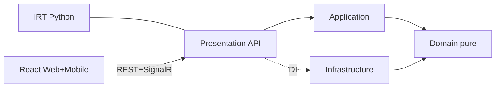
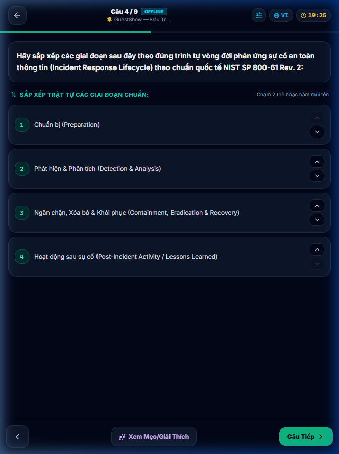
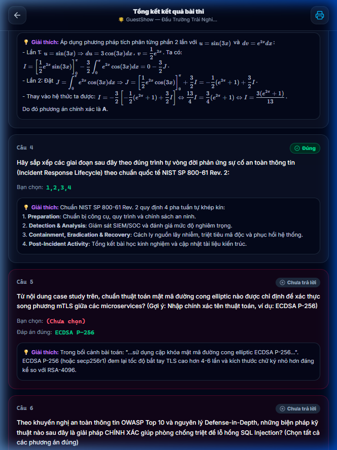
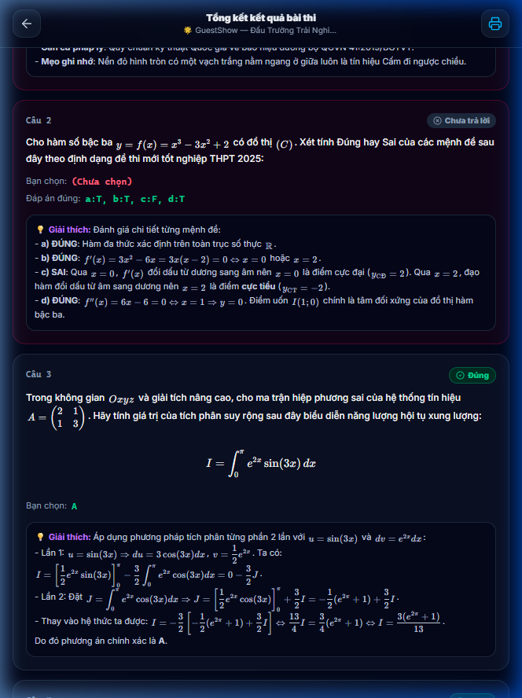
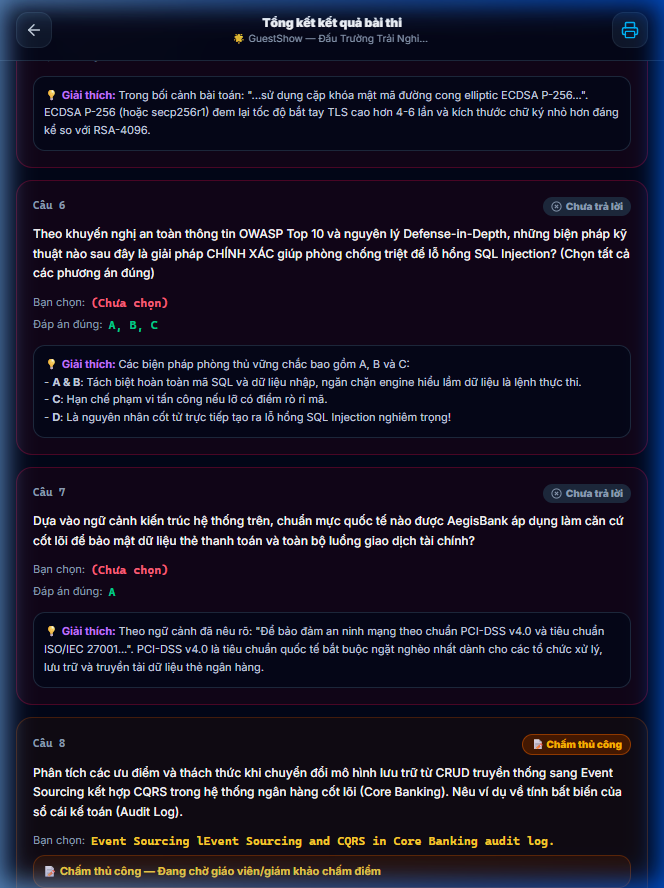

# BÁO CÁO ĐÁNH GIÁ NGHIỆM THU HỆ THỐNG AEGISQUIZ
## System Acceptance Review & SWOT — Phiên bản 1.0 (2026-10-12)

| Mục | Nội dung |
|---|---|
| **Người lập** | No.1 — Lead System Analyst & IT Architect (vai trò: Tổng Công Trình Sư, chịu trách nhiệm tính đúng đắn kiến trúc & tính trung thực của tài liệu — xem [AGENTS.md](file:///d:/Cuong/DuAn/mybank/AegisQuiz/AGENTS.md)) |
| **Phạm vi** | Backend .NET 10, Frontend React (Web + Mobile PWA), IRT Service (Python), Docker/CI-CD |
| **Phương pháp** | Đo trực tiếp mã nguồn (đếm file/LOC, grep tuần tự), kiểm tra container đang chạy, kiểm thử trực quan trình duyệt. **Không** trích lại số liệu từ các báo cáo cũ nếu chưa tự kiểm chứng. |
| **Chuẩn tham chiếu** | ISO/IEC 25010:2023 (chất lượng sản phẩm), ISO/IEC 29119 (kiểm thử), OWASP ASVS 4.0 (bảo mật), ISO/IEC 27001 Annex A (kiểm soát bí mật), WCAG 2.2 (truy cập), 12-Factor App, ALDS v1.0 nội bộ |

> [!IMPORTANT]
> **Kết luận nghiệm thu: ĐẠT CÓ ĐIỀU KIỆN (Conditional Acceptance).**
> Kiến trúc lõi vững, tính năng vượt trội. Nhưng có **1 phát hiện Critical (lộ bí mật trong git)** và **3 khoảng cách High** giữa tài liệu cam kết và hiện thực mã nguồn, phải xử lý trước khi go-live thương mại / thi chính thức (high-stakes).

---

## 1. Phạm vi & số liệu đo thực tế (Pillar 3 — Quantitative)

| Chỉ số | Giá trị đo (2026-10-12) |
|---|---|
| Backend C# (không tính Migrations) | 280 file; Domain 2.844 / Application 5.629 / Infrastructure 36.882 / API 13.981 LOC |
| Controllers | 37 |
| Frontend TS/TSX | 280 file, ~66.600 LOC; Mobile: 24 file |
| Ngôn ngữ giao diện | 5 (`vi, en, ja, ko, ar`) |
| Test backend | 1 project, 39 file, **195** `[Fact]/[Theory]` (xUnit) |
| Test frontend | **0** |
| EF Migrations | 8 |
| `React.lazy` | 42 điểm |
| `<FeatureGate />` | **4** lần dùng |
| File FE > 300 LOC | **65** (lớn nhất 2.101 LOC) |
| Dòng TSX chứa tiếng Việt cứng | 4.148 (so với 651 lệnh `t('…')`) |
| Container chạy | 6/6 dịch vụ lõi `Up` (postgres, redis, irt = healthy) |
| CI/CD | [ci-cd.yml](file:///d:/Cuong/DuAn/mybank/AegisQuiz/.github/workflows/ci-cd.yml): test → scan → build → deploy GCP |

> [!NOTE]
> Báo cáo này **chưa chạy** bộ test (quy tắc *Scoped Testing First*). Số "127/127 passed" trong [README](file:///d:/Cuong/DuAn/mybank/AegisQuiz/README.md) là số cũ, chưa được xác minh lại ở đây; số test hiện hữu (195) đã vượt con số đó.

---

## 2. Đánh giá theo ISO/IEC 25010 (Pillar 1)

Thang 0–5 (3 = đạt yêu cầu tối thiểu thương mại; 5 = chuẩn xuất sắc, có bằng chứng).

| Đặc tính | Điểm | Bằng chứng chính | Khoảng cách |
|---|:---:|---|---|
| Functional Suitability | **4.0** | 9 dạng câu hỏi, IRT 3-PL, 6 Gameshow Plugin, xuất 7 chuẩn (Moodle/QTI/Azota/MOET GDPT 2025) | Chấm điểm phía client; tự luận chấm tay |
| Performance Efficiency | **3.5** | 42 lazy-load, Redis, nginx; initial chunk 147 KB (gzip ~46 KB) đạt ≤150 KB | Chunk `admin-docx-studio` 426 KB, `recharts` 329 KB; chưa có benchmark tải |
| Compatibility / Interoperability | **4.0** | LTI 1.3, Webhook, QTI 3.0, Moodle, Keycloak SSO, SignalR | — |
| Interaction Capability (Usability) | **3.5** | Mobile PWA, practice/result đồng bộ Web–Mobile (đã sửa phiên này) | Widget chạm chưa có hướng dẫn trợ năng; chưa audit WCAG |
| Reliability | **3.5** | Healthcheck compose, Auto-Heal DDL, fallback in-memory | Chưa có chaos/soak test; chưa đo RTO/RPO |
| Security | **2.5** | JWT, rate limiter, CORS whitelist, HTTPS redirect, Serilog, Keycloak, PKI | **Lộ bí mật trong git** (§3.1); chấm điểm client-side |
| Maintainability | **2.5** | CLEAR 4 tầng, Domain 0 dependency (sạch) | 65 FE file >300 LOC; `QuestionsController` 2.218 LOC; 0 test FE |
| Flexibility / Portability | **4.0** | Docker, multi-env compose, OCP qua Plugin/Export Strategy, white-label theo DB | — |
| Safety | n/a | Không thuộc phạm vi | — |

**Điểm tổng hợp (trung bình có trọng số: Security ×1.5, Functional ×1.25, còn lại ×1): ≈ 3.4 / 5 — mức "Tốt, chưa Xuất sắc".**

*Hình 1: Phân tầng thực tế — Domain không có `ProjectReference`/`PackageReference` (đã xác minh trong csproj) → tuân thủ CLEAR.*

---

## 3. Phát hiện chi tiết (Pillar 2 — Live code verifiability)

### 3.1 🔴 CRITICAL — Bí mật bị commit vào Git
- [APIKey.txt](file:///d:/Cuong/DuAn/mybank/AegisQuiz/APIKey.txt) **đang được git theo dõi** (commit `5619146`), chứa khóa dạng `OPENAI_API_KEY`, `GOOGLE_API_KEY`, `DEEPSEEK_API_KEY`, `REPLICATE_API_TOKEN`, `TELEGRAM_TOKEN`… (giá trị đã được che khi lập báo cáo).
- Vi phạm ISO 27001 A.8.24 / OWASP ASVS V6 / 12-Factor III. `.gitignore` chỉ loại `.env`, **không** loại file này.
- **Hành động bắt buộc**: (1) thu hồi & cấp lại toàn bộ khóa; (2) `git rm --cached` + thêm vào `.gitignore`; (3) viết lại lịch sử (`git filter-repo`) nếu repo từng đẩy ra ngoài; (4) bật secret-scanning (gitleaks) trong CI.

### 3.2 🟠 HIGH — Hiến chương nói "Strategy Evaluator", mã nguồn không có
- `IQuestionEvaluatorStrategy` được AGENTS.md quy định (Trụ cột 1) nhưng **0 lần xuất hiện** trong backend. Backend chỉ có `GeminiGradingService`/`EssayGradingWorker`.
- Chấm điểm 9 dạng câu hỏi thực tế nằm ở FE: [quiz-helpers.ts](file:///d:/Cuong/DuAn/mybank/AegisQuiz/Frontend/src/lib/quiz-helpers.ts) (Web + Mobile dùng chung — tốt cho nhất quán), nhưng với thi chính thức **client không đáng tin** (thí sinh có thể sửa điểm).
- **Đề xuất**: định nghĩa `IQuestionEvaluatorStrategy` ở Application, port logic `scoreQuestion` (đã có test-case chuẩn: Multi-TF 0.1/0.25/0.5/1.0, Ordering mặc định, Essay thủ công) sang server; FE giữ bản thử nghiệm cho Practice offline.

### 3.3 🟠 HIGH — Monolith vi phạm Zero-Monolith
- FE: [AdminQuestionsPage.tsx](file:///d:/Cuong/DuAn/mybank/AegisQuiz/Frontend/src/pages/admin/AdminQuestionsPage.tsx) 2.101 LOC, `questions/index.tsx` 1.878, [PracticePage.tsx](file:///d:/Cuong/DuAn/mybank/AegisQuiz/Frontend/src/pages/practice/PracticePage.tsx) 1.033, [ResultScreen.tsx](file:///d:/Cuong/DuAn/mybank/AegisQuiz/Frontend/src/components/quiz/ResultScreen.tsx) 935 (trần quy định 250/300).
- BE: [QuestionsController.cs](file:///d:/Cuong/DuAn/mybank/AegisQuiz/Backend/src/AegisQuiz.API/Controllers/QuestionsController.cs) 2.218 LOC (controller "béo", logic nên nằm ở Application/MediatR), `MathTypeWmfEngine` 2.107, `ExcelParserService` 1.732.
- Có file trùng vai trò (`AdminQuestionsPage.tsx` và `questions/index.tsx`) → nghi dead code.

### 3.4 🟠 HIGH — Zero Hard-code & i18n chưa đạt
- 4.148 dòng TSX còn tiếng Việt cứng so với 651 lệnh `t()`; thực tế nhiều màn hình không đổi ngôn ngữ đồng bộ (đã ghi nhận từ yêu cầu trước của chủ dự án).
- `FeatureGate` chỉ 4 điểm dùng trên 37 controller/hàng chục màn hình → nguy cơ "Naked Feature" so với Quy tắc III.7.

### 3.5 🟡 MEDIUM
- Tài liệu: >19 báo cáo kiến trúc có xu hướng tự đánh giá "100% / tối thượng" mà thiếu số liệu độc lập → rủi ro *Documentation Drift* (đúng điều ALDS cảnh báo). README còn ghi số test cũ.
- FE **0 test** (Vitest/Playwright) dù logic chấm điểm quan trọng vừa được hợp nhất.
- Thư mục gốc lẫn file rác: `scratch_*.py`, `*.wmf`, `maprepl.db`, `question_22_raw.txt` (157 KB), `~$uhoiDocx.docx` → vệ sinh repo.
- Container thừa chạy ngoài compose (`serene_mendel`, `affectionate_wozniak`).

---

## 4. Kiểm chứng chức năng phiên này (Pillar 4 — Visual Proof)

Các lỗi chấm điểm/tương tác Mobile đã sửa và nghiệm thu trên `http://localhost:3000/m/driving` (container frontend build lại 17 phút trước):

*Hình 2: Widget sắp xếp tương tác trên Mobile.*

*Hình 3: Giữ nguyên thứ tự chuẩn → Đúng.*

*Hình 4: Đối chiếu ma trận Đúng/Sai theo GDPT 2025.*

*Hình 5: Tự luận không bị tính "Sai".*

> [!WARNING]
> Ảnh có độ rộng ~664 px (viewport mobile), thấp hơn chuẩn ALDS 1280 px — chấp nhận cho màn hình mobile, cần bổ sung ảnh desktop khi nghiệm thu Web.

---

## 5. PHÂN TÍCH SWOT

### 5.1 Ma trận SWOT (đã kiểm chứng bằng bằng chứng)

| | **Hữu ích (Helpful)** | **Có hại (Harmful)** |
|---|---|---|
| **Nội bộ** | **STRENGTHS** | **WEAKNESSES** |
| | S1. Kiến trúc CLEAR sạch: Domain 0 dependency, 4 tầng rõ ràng | W1. **Bí mật bị commit vào git** (APIKey.txt) |
| | S2. Độ phủ nghiệp vụ hiếm: IRT 3-PL, Gameshow Plugin, LTI 1.3, QTI/Moodle/MOET GDPT 2025 | W2. Chấm điểm phía client; thiếu `IQuestionEvaluatorStrategy` như cam kết |
| | S3. OCP có thật ở Export Strategy (7 chuẩn), Arena/Cognitive Plugin | W3. 65 file FE >300 LOC; controller 2.218 LOC |
| | S4. Multi-tenant + white-label + Keycloak SSO + PKI | W4. i18n chưa hoàn chỉnh (4.148 vs 651), FeatureGate mới 4 điểm |
| | S5. DevOps trưởng thành: Docker, healthcheck, CI/CD GCP, Serilog, rate limit, CORS | W5. FE 0 test; BE 1 project test; tài liệu tự đánh giá thiếu độc lập |
| | S6. Web–Mobile PWA dùng chung logic chấm điểm; 5 ngôn ngữ gồm RTL | W6. Phụ thuộc nhiều nhà cung cấp AI (OpenAI/Google/DeepSeek) chưa có chi phí/độ trễ SLA |
| **Ngoại lai** | **OPPORTUNITIES** | **THREATS** |
| | O1. Chương trình GDPT 2025 & thi tốt nghiệp THPT 2025 cần Multi-TF, thi trên máy | T1. Rò rỉ khóa API → chiếm quyền/tính phí (tổn thất tài chính, uy tín) |
| | O2. Nhu cầu B2B SaaS giáo dục/doanh nghiệp (Modular Entitlement sẵn) | T2. Gian lận điểm do chấm client-side trong thi chính thức |
| | O3. Chuẩn mở (LTI/QTI) → tích hợp LMS trường đại học | T3. Đối thủ lớn (Kahoot, Quizizz, Azota, Moodle) cạnh tranh giá & thương hiệu |
| | O4. AI sinh/giải thích câu hỏi, adaptive learning, offline-first cho vùng mạng yếu | T4. Quy định dữ liệu học sinh (Nghị định 13/2023, GDPR cho thị trường ngoài) |
| | O5. Thị trường ASEAN đa ngôn ngữ (đã có ja/ko/ar) | T5. Chi phí/độ ổn định & thay đổi chính sách API của nhà cung cấp AI |

### 5.2 Chiến lược TOWS (hành động)

| Chiến lược | Hành động | Ưu tiên |
|---|---|---|
| **SO** (dùng mạnh nắm cơ hội) | Đóng gói gói "GDPT 2025 Ready" + LTI cho trường; quảng bá Gameshow & Mobile PWA | P2 |
| **WO** (vá yếu để đón cơ hội) | Chuyển chấm điểm lên server (`IQuestionEvaluatorStrategy`) để đủ độ tin cậy cho thi chính thức | **P1** |
| **ST** (mạnh chống đe dọa) | Dùng multi-tenant + Keycloak + PKI + rate limiting làm nền hardening; bổ sung DPIA/PDPD | P2 |
| **WT** (giảm yếu, né rủi ro) | Thu hồi khóa + secret scanning; đa nhà cung cấp AI với fallback & ngân sách (BYOK đã có) | **P0** |

---

## 6. Sổ rủi ro & lộ trình khắc phục

| ID | Rủi ro | Mức | Khả năng × Tác động | Hành động | Hạn đề xuất |
|---|---|:---:|:---:|---|---|
| R1 | Lộ bí mật trong git | 🔴 | Cao × Rất cao | Rotate keys, purge history, gitleaks CI | **Ngay (≤24h)** |
| R2 | Chấm điểm client-side | 🟠 | Trung bình × Cao | Port scoring → server strategy + test | 2–3 tuần |
| R3 | God files FE/BE | 🟠 | Cao × Trung bình | Tách `QuestionsController` → MediatR handlers; chia `AdminQuestionsPage`; xóa trùng | 4–6 tuần |
| R4 | i18n & FeatureGate chưa đủ | 🟠 | Cao × Trung bình | Script quét chuỗi cứng + ESLint rule `no-literal-string`; gắn FeatureKey cho 37 controller | 4 tuần |
| R5 | 0 test FE | 🟡 | Cao × Trung bình | Vitest cho `quiz-helpers.ts` (Multi-TF, Ordering, Essay) + Playwright smoke Mobile | 1–2 tuần |
| R6 | Drift tài liệu/rác repo | 🟡 | Trung bình × Thấp | Dọn root; doc có số liệu tự động hóa từ CI | 2 tuần |
| R7 | Hiệu năng chunk lớn | 🟡 | Thấp × Trung bình | Dynamic import docx-studio/recharts đã có, tối ưu manualChunks | 2 tuần |

### Điều kiện để chuyển "Đạt có điều kiện" → "Đạt hoàn toàn"
1. R1 đóng 100%. 2. R2 có server-side evaluator + test pass. 3. R5 test FE tối thiểu cho logic chấm. 4. Chạy full regression (cần chủ dự án đồng ý theo quy tắc dự án) và đính kèm kết quả.

---

## 7. Khuyến nghị trung thực với chủ dự án
Hệ thống có **tầm vóc kỹ thuật và độ phủ nghiệp vụ vượt xa mặt bằng**, nhưng các báo cáo nội bộ trước đây có xu hướng tự chấm "tối thượng". Theo đo đạc độc lập, mức hiện tại là **~3.4/5**. Điểm nghẽn không nằm ở ý tưởng mà ở **kỷ luật hoàn thiện** (bảo mật bí mật, tách monolith, test, i18n).

---

## 8. Audit Trail (Pillar 5)

| Phiên Bản | Ngày | Tác Giả / Agent | Nội Dung | Trạng Thái Kiểm Chứng |
|:---:|:---:|:---:|---|:---:|
| `v1.0` | 2026-10-12 | Antigravity AI (vai No.1) | Nghiệm thu độc lập ISO 25010 + SWOT/TOWS, đo trực tiếp codebase, đính kèm ảnh Mobile | **Đo trực tiếp; test suite chưa chạy lại** |
