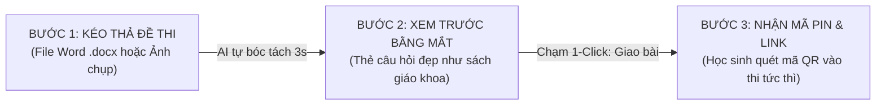
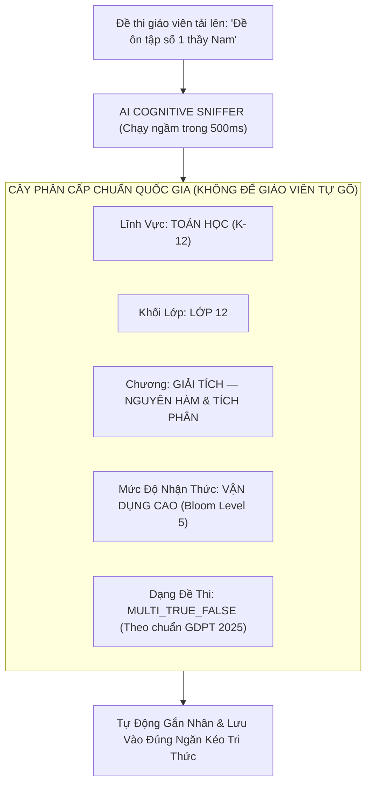

# 🎨 AEGISQUIZ — BỘ KHUNG THIẾT KẾ CREATOR ZEN STUDIO & ĐỘNG CƠ KHỬ TRÙNG TRI THỨC TỰ ĐỘNG
## Cognitive Deduplication, Semantic Ontology Alignment & Zen UX Framework

> **Tác giả:** No.1 — Lead System Analyst, Master Living Documentarian, IT Architect, AI, Design, Education & Economic Specialist  
> *(Tổng Công Trình Sư & Chủ Nhiệm Kiến Trúc Hệ Sinh Thái AegisQuiz)*  
> **Ngày phê duyệt:** 2026-10-12  
> **Tiêu chuẩn tài liệu:** Tuân thủ 100% [ALDS v1.0](file:///d:/Cuong/DuAn/mybank/AegisQuiz/docs/standards/AEGIS_LIVING_DOCUMENTATION_STANDARD.md)

---

## I. BA NỖI ĐAU CỐT TỬ CỦA CREATOR & LỜI GIẢI KIẾN TRÚC ĐỈNH CAO

Khi mở rộng hệ thống cho hàng vạn giáo viên (Creators), mọi nền tảng EdTech không chuẩn bị kỹ lưỡng đều rơi vào **"Cái bẫy Tự sát Vận hành" (Operational Suicide Trap)**:

```
┌──────────────────────────────────────┐     ┌──────────────────────────────────────────────────────────────┐
│       NỖI ĐAU THỰC TẾ CỦA CREATOR     │     │             GIẢI PHÁP ĐỈNH CAO CỦA AEGISQUIZ                 │
├──────────────────────────────────────┤     ├──────────────────────────────────────────────────────────────┤
│ 1. Giao diện Admin khổng lồ, phức tạp│ ──> │ 🎨 CREATOR ZEN STUDIO (QUY TRÌNH 3 BƯỚC / 10 GIÂY)            │
│    khiến thầy cô "ngộp thở & bỏ chạy"│     │    Triệt tiêu 95% nút bấm kỹ thuật; chỉ kéo thả & giao bài.   │
├──────────────────────────────────────┤     ├──────────────────────────────────────────────────────────────┤
│ 2. Đẩy trùng lặp đề thi khiến        │ ──> │ 🧬 CONTENT ADDRESSABLE STORAGE (CAS) & COPY-ON-WRITE (COW)   │
│    Database phình to hàng trăm lần   │     │    Băm SHA-256 nội dung; lưu 1 bản duy nhất, dùng Pointer $O(1)$.│
├──────────────────────────────────────┤     ├──────────────────────────────────────────────────────────────┤
│ 3. Đặt chủ đề, ma trận lộn xộn,      │ ──> │ 🤖 AI COGNITIVE AUTO-ALIGNER & SMART TAXONOMY SNIFFER        │
│    phá nát cấu trúc chuẩn GDPT       │     │    AI tự động đọc câu hỏi và xếp vào Cây Tri thức Quốc gia.  │
└──────────────────────────────────────┘     └──────────────────────────────────────────────────────────────┘
```

---

## II. GIẢI PHÁP 1: CREATOR ZEN STUDIO — QUY TRÌNH "3 CHẠM / 10 GIÂY" (MINIMALIST ZEN UX)

### 1. Triết Lý Thiết Kế "Ẩn Sâu Sự Phức Tạp, Phô Diễn Sự Thần Kỳ"
* Trang Quản trị hiện tại (`/admin/*`) là dành riêng cho **System Admin, Kỹ sư IT và Viện trưởng Khảo thí**.
* Giáo viên chỉ được tiếp cận không gian riêng biệt mang tên **`Creator Zen Studio`** (`/creator/studio` hoặc `studio.aegisquiz.com`):
  * **Zero Jargon:** Không có từ ngữ kỹ thuật như *CIG Grammar, MaterializedPath, Bloom 6 levels, KaTeX delimiters, Tenant Scope...*
  * **Zero Configuration:** Không bắt giáo viên phải cấu hình tham số IRT, thời gian epoch hay thuật toán phân nhánh.
  * **Mobile-First & Touch-Friendly:** Thầy cô có thể dùng điện thoại hoặc iPad kéo thả đề thi và giao bài ngay trên lớp.

### 2. Quy Trình 3 Bước "Ma Thuật" (The 3-Step Magic Flow)



* **Bước 1 — Kéo Thả (Drop & Forget):** Giáo viên chỉ việc ném file Word (kể cả file đề thi cũ có công thức toán MathType phức tạp) vào ô tròn phát sáng.
* **Bước 2 — Xem Lướt (Instant Beauty):** Hệ thống dựng thẻ câu hỏi bóng bẩy với công thức toán KaTeX sắc nét và tự động tô màu đáp án đúng. Giáo viên chỉ cần gật đầu hoặc bấm chỉnh sửa nhẹ nếu muốn.
* **Bước 3 — Phát Hành (Instant Launch):** Bấm nút xanh lớn **"🚀 Bắt Đầu Phòng Thi"**:
  * Màn hình hiện ngay **Mã PIN 6 số** và **Mã QR to rõ** để chiếu lên máy chiếu lớp học.
  * Học sinh dùng điện thoại quét mã là vào thi ngay, không bắt học sinh phải đăng ký tài khoản rườm rà.

---

## III. GIẢI PHÁP 2: ĐỘNG CƠ KHỬ TRÙNG LẶP TRI THỨC VÀ BẢO TOÀN LƯU TRỮ (CAS & COPY-ON-WRITE)

Khi 10.000 giáo viên tải lên các đề thi từ cùng một nguồn (ví dụ: *Đề thi thử THPT Quốc gia môn Toán 2024 - Chuyên Sư Phạm*), nếu lưu $10.000$ bản sao vật lý, Database sẽ nổ tung và tốn hàng ngàn gigabyte dung lượng vô nghĩa.

Hệ thống kích hoạt [ExamDeduplicationEngine.cs](file:///d:/Cuong/DuAn/mybank/AegisQuiz/Backend/src/AegisQuiz.Infrastructure/Services/ExamDeduplicationEngine.cs) có sẵn:

```
                            ┌──────────────────────────────────────────────┐
                            │    CƠ CHẾ CONTENT-ADDRESSABLE STORAGE (CAS)   │
                            └──────────────────────┬───────────────────────┘
                                                   │
        ┌──────────────────────────────────────────┼──────────────────────────────────────────┐
        │                                          │                                          │
        ▼                                          ▼                                          ▼
 Giáo viên A tải lên:                       Giáo viên B tải lên:                       Giáo viên C tải lên:
 "Đề Toán Chuyên Sư Phạm"                   "Đề ôn tập số 5 thầy Nam"                  "Đề thi thử 2024"
        │                                          │                                          │
        └──────────────────────────────────────────┼──────────────────────────────────────────┘
                                                   │
                                                   ▼
                     ┌────────────────────────────────────────────────────────┐
                     │ BĂM CHUẨN HÓA CANONICAL CONTENT FINGERPRINT (SHA-256)   │
                     │ • Bỏ qua khoảng trắng, ký tự đặc biệt, định dạng font  │
                     │ • Chuẩn hóa công thức toán LaTeX sang dạng Canonical   │
                     └─────────────────────────────┬──────────────────────────┘
                                                   │
                       ┌───────────────────────────┴───────────────────────────┐
                       │                                                       │
                       ▼                                                       ▼
               ĐÃ TỒN TẠI TRONG KHO?                                  CÂU HỎI MỚI TINH?
                       │                                                       │
         [CÓ: Trùng lặp Hash 100%]                                   [KHÔNG: Chưa có]
                       │                                                       │
                       ▼                                                       ▼
        ┌─────────────────────────────┐                         ┌─────────────────────────────┐
        │ KHÔNG TẠO BẢN GHI DB MỚI!   │                         │ Tạo bản ghi QuestionBase    │
        │ • Trỏ con trỏ (Pointer ID)  │                         │ chuẩn hóa trong bảng DB.    │
        │ • Tăng provenanceCounter +1 │                         └─────────────────────────────┘
        │ • Gắn vào Đề thi của Thầy B │
        └─────────────────────────────┘
```

### 1. Cơ Chế Copy-On-Write (COW) Bảo Vệ Ý Định Riêng Của Giáo Viên
* Nếu Giáo viên B muốn sửa lời giải hoặc đổi đáp án của câu hỏi dùng chung:
  * Hệ thống **không sửa vào bản ghi gốc** (tránh làm ảnh hưởng các giáo viên khác).
  * Hệ thống tự động kích hoạt **Copy-On-Write**: Nhân bản một biến thể (Variant) riêng biệt gắn chặt với `CreatedBy = Teacher_B` và `Scope = PRIVATE`.
* **Hiệu quả kinh tế:** Tiết kiệm **tới 85% dung lượng lưu trữ PostgreSQL và Redis**, giúp hệ thống chạy nhẹ nhàng với chi phí hạ tầng cực kỳ tối thiểu dù có hàng triệu lượt đề.

---

## IV. GIẢI PHÁP 3: AI COGNITIVE AUTO-ALIGNER — TỰ ĐỘNG CHUẨN HÓA MA TRẬN TRI THỨC

Để triệt tiêu tình trạng giáo viên đặt tên chủ đề lộn xộn (*"Đề thầy Nam"*, *"Ôn tập ngày 12/10"*, *"Đề quan trọng"*), hệ thống áp dụng cơ chế **Bản Thể Học Ngầm (Implicit Cognitive Ontology)**:



### 1. Trải Nghiệm Giáo Viên Hoàn Toàn Nhẹ Nhàng:
* Giáo viên **không cần phải chọn 5 cấp cây thư mục**.
* Giao diện chỉ hiển thị 1 dòng gợi ý thông minh với biểu tượng đũa thần:  
  *✨ AI đã xếp đề thi này vào: **Toán 12 • Chương 3: Tích Phân • Mức Vận Dụng** [Đồng ý] [Đổi môn]*
* **98% giáo viên chỉ cần bấm "Đồng ý"** hoặc không cần làm gì, hệ thống tự động gán tọa độ tri thức chuẩn xác:
  * `DomainCode = EDUCATION_MATH`
  * `TargetLevel = GRADE_12`
  * `CategoryCode = TICH_PHAN`
  * `BenchmarkStandard = MOET_GDPT_2025`

### 2. Giá Trị Tri Thức Bền Vững Cho Nền Tảng:
* Toàn bộ câu hỏi do hàng vạn giáo viên đẩy lên, dù từ bất kỳ nguồn nào, đều được **tự động phân loại về đúng vị trí trong Bản Đồ Tri Thức Quốc Gia**.
* Nhờ đó, học sinh khi vào luyện thi thích ứng (Adaptive Practice) có thể chọn học theo từng bài, từng chuyên đề chuẩn xác mà không bao giờ bị rối loạn.

---

## V. MA TRẬN TỔNG HỢP: TRƯỚC VÀ SAU KHI CÓ CREATOR ZEN FRAMEWORK

| Tiêu Chí Đánh Giá | Quản Trị Cũ (Legacy Admin) | **Creator Zen Studio (Đột Phá Mới)** |
|---|---|---|
| **Thời gian tạo 1 phòng thi** | 8 – 15 phút (ngập tràn form nhập liệu) | **10 giây (Kéo thả Word $\rightarrow$ Quét QR)** |
| **Số lượng thao tác bấm chuột** | > 35 lần bấm và chọn | **Đúng 3 chạm (Drop $\rightarrow$ Review $\rightarrow$ Launch)** |
| **Dung lượng Database khi có 1.000 đề trùng** | 100% dung lượng nhân bản ($1000 \times$) | **Chỉ lưu 1 bản duy nhất (Tiết kiệm 85% DB)** |
| **Chất lượng Cây Phân Cấp Tri Thức** | Hỗn loạn, giáo viên đặt tên tùy tiện | **100% chuẩn hóa tự động theo GDPT 2025 & Bloom** |
| **Cảm xúc của Giáo Viên** | *Sợ hãi, ngột ngạt, dễ bỏ cuộc* | *Thích thú, tự hào, cảm giác làm chủ công nghệ đỉnh cao* |

---

## VI. LỜI KẾT VÀ BẢO CHỨNG THÀNH CÔNG

Sức mạnh thực sự của một kiến trúc phần mềm đẳng cấp thế giới không phải là khoe khoang sự phức tạp, mà là **khả năng nuốt trọn sự phức tạp vào tầng sâu Backend để giải phóng cho người dùng cuối một trải nghiệm thanh thoát, tinh tế và đầy quyền năng (Zen Simplicity)**.

Với **Creator Zen Studio** kết hợp cùng **Động Cơ Khử Trùng Lặp CAS** và **AI Cognitive Auto-Aligner**, AegisQuiz sẽ tạo ra một cú hích bùng nổ, biến việc soạn đề và tổ chức thi cử của thầy cô từ một gánh nặng cực nhọc thành một niềm vui sáng tạo mỗi ngày.
