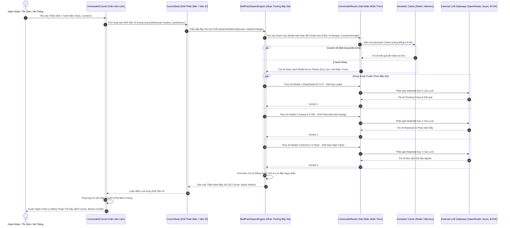

# 🛡️ HỆ BA NGÔI NHẬN THỨC AEGIS (AEGIS EPISTEMIC TRIAD SPECIFICATION)
## Mối Liên Hệ Chuyên Sâu: UniversalAiRouter (UAR) ➔ WolfPackSwarmEngine (WPSE) ➔ UniversalAiCouncil (Council)
### Chuẩn Mực Quản Trị Tri Thức Kỹ Thuật Số ALDS v1.0 — Kiến Trúc Chủ Quyền 2026

---

> **Tác giả chủ trì**: No.1 — Supreme Lead System Analyst & IT Architect  
> **Phân hệ**: AegisAI Epistemic Orchestration Engine  
> **Trạng thái**: Hoàn thiện & Ban hành làm Tiêu chuẩn Kiến trúc Toàn diện  
> **Tuân thủ**: Nguyên lý OCP, Zero Hard-code, CLEAR Architecture, ALDS v1.0  

---

## I. TỔNG QUAN & TẦM NHÌN HỆ BA NGÔI NHẬN THỨC (THE EPISTEMIC TRIAD)

Trong các hệ thống AI truyền thống, việc gọi mô hình ngôn ngữ lớn (LLM) thường mang tính **đơn nhiệm, rời rạc và thụ động** (Prompt-in, Response-out). Khi bài toán mở rộng thành **Hệ thống Khảo thí Đa Quốc gia, Đấu trường Gameshow Tri thức Đối kháng, và Đại Hội Thảo Hàn Lâm Tranh Biện Biện Chứng**, kiến trúc đơn nhiệm lập tức sụp đổ vì:
1. **Ảo giác nhận thức (Hallucination)** không thể bị kiểm soát bởi một mô hình đơn lẻ.
2. **Chi phí token bùng nổ** do thiếu tối ưu hóa Pareto giữa năng lực và giá thành.
3. **Vi phạm nguyên lý OCP**: Mỗi lần thêm một mô hình hoặc một nhà cung cấp mới, hệ thống phải sửa code, viết lại adapter và redeploy toàn bộ.

Để giải quyết triệt để vấn đề này, AegisQuiz kiến tạo **Hệ Ba Ngôi Nhận Thức (Aegis Epistemic Triad)**:

```
┌──────────────────────────────────────────────────────────────────────────────────┐
│                   HỆ BA NGÔI NHẬN THỨC AEGIS (THE EPISTEMIC TRIAD)                │
└────────────────────────────────────────┬─────────────────────────────────────────┘
                                         │
 ┌───────────────────────────────────────┴─────────────────────────────────────────┐
 │ TẦNG 3: UNIVERSAL AI COUNCIL (THỂ CHẾ HÀN LÂM & ĐẠI HỘI THẢO TRANH BIỆN)       │
 │ • Định nghĩa "BÀI TOÁN & VAI TRÒ" (WHAT & WHY):                                 │
 │   - Viện Trọng Tài Tối Cao (SYS_ARBITRATION): Bóc trần ngụy biện, kháng bẫy.     │
 │   - Ban Thư Ký Học Thuật (SYS_SECRETARIAT): Tổng hợp kỷ yếu, đúc kết chân lý.   │
 │   - Các Viện Khoa học Chuyên ngành: Vũ trụ, Vật lý lượng tử, Kinh tế, Y sinh... │
 └───────────────────────────────────────┬─────────────────────────────────────────┘
                                         │ (Ủy thác thực thi bầy đàn)
 ┌───────────────────────────────────────┴─────────────────────────────────────────┐
 │ TẦNG 2: WOLFPACK SWARM ENGINE (BẦY SÓI NHẬN THỨC & ĐỒNG THUẬN TÁC TỬ)           │
 │ • Định nghĩa "CHIẾN THUẬT & ĐỒNG THUẬN" (HOW):                                  │
 │   - Tuyển chọn cấu trúc bầy sói (Alpha, Critics, Synthesizers).                 │
 │   - Điều phối thực thi phân tán song song đa luồng (CoT Preservation).          │
 │   - Thuật toán Chỉ số Đồng thuận SCI (Swarm Consensus Index).                   │
 │   - Tranh biện biện chứng 6 pha: Thesis ➔ Antithesis ➔ Cross-Exam ➔ Synthesis. │
 └───────────────────────────────────────┬─────────────────────────────────────────┘
                                         │ (Khai thác tài nguyên hạt nhân)
 ┌───────────────────────────────────────┴─────────────────────────────────────────┐
 │ TẦNG 1: UNIVERSAL AI ROUTER (HẠT NHÂN NGUYÊN TỬ & CỔNG ĐIỀU PHỐI TỐI THƯỢNG)    │
 │ • Cung cấp "NĂNG LƯỢNG & TÀI NGUYÊN" (WITH WHAT):                               │
 │   - Nguồn chân lý duy nhất (Single Source of Truth) về Model Registry & Key.     │
 │   - Ma trận Pareto FinOps: Tối ưu hóa ELO Benchmark / Chi phí Token ($/1M).     │
 │   - Phân loại 5 Mẫu hình Nhận thức (Cognitive Archetypes).                       │
 │   - Semantic Cache (0$ Token) & Waterfall Key Resolver (BYOK, Community Pool). │
 │   - Tự động Hot-Reload 0ms từ PostgreSQL & Auto-Heal Fallback.                  │
 └─────────────────────────────────────────────────────────────────────────────────┘
```

---

## II. PHÂN TÍCH CHUYÊN SÂU MỐI LIÊN HỆ KHOA HỌC: UAR ➔ WPSE ➔ COUNCIL

### 1. Chiều Dọc Kiến Trúc: Sự Phân Cấp Trách Nhiệm Rõ Ràng (Separation of Concerns)

| Chiều Kích | Tầng 1: UAR (Hạt Nhân) | Tầng 2: WPSE (Bầy Sói) | Tầng 3: Council (Thể Chế Hàn Lâm) |
| :--- | :--- | :--- | :--- |
| **Quy mô Hệ thống** | Nguyên tử (Atomic) | Phân tử / Hiệp đồng (Molecular) | Thể chế / Sinh quyển (Systemic) |
| **Đối tượng Quản trị** | Model Endpoint, API Key, Token Cost, ELO, Cache | Bầy sói (Pack), Vết suy luận (Trace), Chỉ số SCI, Phiên họp | Viện (Council), Ghế (Seat), Đại Hội Thảo (Symposium), Kỷ yếu |
| **Tính Nhận thức** | Không phân vai (Domain-Agnostic) | Nhận thức phương pháp (Process-Aware) | Bản thể luận & Chuyên môn (Domain-Ontology) |
| **Cơ chế Ra quyết định**| Pareto FinOps + Circuit Breaker | Majority Vote + Sói Đầu Đàn (Alpha Veto) | Đồng thuận Viện sĩ + Nghị quyết Kỷ yếu |
| **Độ trễ Xử lý** | Thấp nhất (~100ms - 1s) | Trung bình (1s - 5s song song) | Phiên dài (5s - 30s tranh biện 6 pha) |

---

### 2. Luồng Dữ Liệu Tương Tác Động (Interactive Mermaid Dynamic Flow)

Sơ đồ tuần tự thể hiện sự phối hợp hoàn hảo từ khi Người Dùng/Hệ Thống kích hoạt một yêu cầu khảo thí hoặc hội thảo:



---

### 3. Mô Hình Toán Học Tính Toán Chỉ Số Đồng Thuận SCI (Swarm Consensus Index)

Trong `WolfPackSwarmEngine`, chỉ số đồng thuận SCI không phải là một phép đếm phiếu thông thường mà là một **hàm phân phối xác suất ngữ nghĩa kết hợp trọng số ELO**:

$$\text{SCI} = \frac{\sum_{i \in \mathcal{G}_{\text{majority}}} w_i \cdot \text{Conf}_i}{\sum_{k \in \mathcal{V}} w_k} \times \left(1 - \mathcal{H}_{\text{entropy}}\right)$$

Trong đó:
* $\mathcal{V}$: Tập hợp toàn bộ phán quyết hợp lệ từ các thành viên trong bầy sói ($|\mathcal{V}| \ge 3$).
* $\mathcal{G}_{\text{majority}}$: Nhóm đa số đạt được sự thống nhất về đáp án chuẩn hóa.
* $w_i$: Trọng số tín nhiệm chuẩn hóa của mô hình thứ $i$, tính toán dựa trên Benchmark ELO:
  $$w_i = \frac{1}{1 + 10^{\frac{\text{ELO}_{\text{alpha}} - \text{ELO}_i}{400}}}$$
* $\text{Conf}_i$: Độ tự tin (Confidence Score) mà mô hình tự đánh giá dựa trên chuỗi tư duy CoT.
* $\mathcal{H}_{\text{entropy}}$: Hệ số hỗn loạn ngữ nghĩa Shannon giữa các lập luận phản biện:
  $$\mathcal{H}_{\text{entropy}} = - \sum_{j} p_j \log_2(p_j)$$

**Phân cấp mức độ Đồng thuận SCI**:
* $\text{SCI} \ge 0.85$: **Unanimous (Tuyệt đối Đồng thuận)** — Barem điểm hoặc câu trả lời đạt độ tin cậy tuyệt đối, tự động phê duyệt vào Đề thi Quốc gia.
* $0.65 \le \text{SCI} < 0.85$: **Strong Consensus (Đồng thuận Vững chắc)** — Đa số thống nhất, có phản biện thứ yếu đã được sói đầu đàn phân giải.
* $0.40 \le \text{SCI} < 0.65$: **Contested (Tranh chấp Ngữ nghĩa)** — Câu hỏi có nguy cơ chứa bẫy ngụy biện hoặc đa nghĩa, tự động kích hoạt **Viện Trọng Tài Tối Cao (`SYS_ARBITRATION`)** triệu tập Đại Hội Thảo 6 Pha.
* $\text{SCI} < 0.40$: **Deadlock (Bế tắc Nhận thức)** — Đề thi bị lỗi cấu trúc, tự động bác bỏ và cảnh báo về ban khảo thí.

---

## III. VÌ SAO UAR BẮT BUỘC PHẢI LÀ "HẠT NHÂN" CỦA TOÀN BỘ HỆ SINH THÁI?

Nếu WPSE không kế thừa UAR mà tự xây dựng pipeline riêng (như tình trạng hiện tại), hệ thống sẽ gánh chịu 4 điểm nghẽn nghiêm trọng:

```
┌──────────────────────────────────────────────┬──────────────────────────────────────────────┐
│  KIẾN TRÚC HIỆN TẠI (PHÂN MẢNH & DUPLICATED) │  KIẾN TRÚC MỤC TIÊU (HẠT NHÂN CHUẨN HÓA OCP) │
├──────────────────────────────────────────────┼──────────────────────────────────────────────┤
│ 1. WPSE tự quản lý Drivers & Key Candidates  │ 1. UAR là Cổng Duy Nhất thực thi Model       │
│    -> Trùng lặp code, khó bảo trì.           │    -> Tận dụng 100% Circuit Breaker & Key.   │
├──────────────────────────────────────────────┼──────────────────────────────────────────────┤
│ 2. WPSE bỏ qua Semantic Cache của UAR        │ 2. Mọi thành viên bầy sói đều hưởng Cache    │
│    -> Lãng phí hàng triệu token trùng lặp.   │    -> Tiết kiệm 40-70% ngân sách FinOps.     │
├──────────────────────────────────────────────┼──────────────────────────────────────────────┤
│ 3. Static Presets hardcode trong C#          │ 3. 100% Database-Driven qua UAR              │
│    -> Vi phạm OCP, phải redeploy khi thêm    │    -> Mở rộng vô hạn Gateways, 0ms Hot-Reload│
│       mô hình mới.                           │       tuyệt đối không chạm vào code C#.      │
├──────────────────────────────────────────────┼──────────────────────────────────────────────┤
│ 4. Tuyển chọn sói dựa trên query thô sơ      │ 4. Tuyển chọn sói theo Ma trận Năng lực UAR  │
│    -> Không tự động nhận diện thế mạnh       │    -> Ghế Phản biện luôn nhận đúng model     │
│       Counter / Adversarial Critic.          │       chuyên CoT & bóc trần ngụy biện.       │
└──────────────────────────────────────────────┴──────────────────────────────────────────────┘
```

---

## IV. BẢN THIẾT KẾ MÃ NGUỒN XÁC MINH (LIVE CODE CONTRACTS)

### 1. Hạt Nhân `IUniversalAiRouter.cs` Mở Rộng
Vị trí: [`IUniversalAiRouter.cs`](file:///d:/Cuong/DuAn/mybank/AegisQuiz/Backend/src/AegisQuiz.Application/Interfaces/IUniversalAiRouter.cs)

```csharp
namespace AegisQuiz.Application.Interfaces
{
    public interface IUniversalAiRouter
    {
        // ── 1. ĐIỀU PHỐI ĐƠN NHIỆM THÔNG MINH TRUYỀN THỐNG ──
        Task<AiExecutionResponse> ExecuteAsync(AiExecutionRequest request);
        Task<PedagogicalWalkthroughDto> GenerateWalkthroughAsync(...);

        // ── 2. CÁC NĂNG LỰC HẠT NHÂN PHỤNG SỰ BẦY SÓI (SWARM KERNEL APIs) ──
        
        /// <summary>
        /// Lấy danh mục toàn bộ Model đã được chuẩn hóa từ PostgreSQL kèm Ma trận Năng lực
        /// (Archetype, Benchmark ELO, FinOps Pareto, Contemporary Strengths).
        /// </summary>
        Task<IReadOnlyList<AiModelRegistryDto>> GetActiveNormalizedModelsAsync(
            CognitiveArchetype? archetypeFilter = null,
            CancellationToken ct = default);

        /// <summary>
        /// Thực thi một Model chỉ định trong Bầy Sói (Direct Model Dispatch):
        /// - Kế thừa tự động cơ chế kiểm tra Semantic Cache
        /// - Tự động xoay tua khóa API (Waterfall: UserBYOK -> TenantBYOK -> Community -> System)
        /// - Tự động đo đạc độ trễ và cập nhật FinOps Telemetry
        /// </summary>
        Task<AiExecutionResponse> ExecuteModelDirectAsync(
            string modelCode,
            AiExecutionRequest request,
            Guid? userId = null,
            Guid? tenantId = null,
            CancellationToken ct = default);

        /// <summary>
        /// Lấy danh sách Presets Gateway động từ Database/Config (Triệt tiêu 100% hardcode C#)
        /// </summary>
        Task<IReadOnlyList<GatewayModelPresetDto>> GetDynamicGatewayPresetsAsync(
            string? gateway = null,
            CancellationToken ct = default);
    }
}
```

### 2. Tinh Giản `WolfPackSwarmEngine.cs` — Nhạc Trưởng Thuần Khiết
Vị trí: [`WolfPackSwarmEngine.cs`](file:///d:/Cuong/DuAn/mybank/AegisQuiz/Backend/src/AegisQuiz.Infrastructure/AI/WolfPackSwarmEngine.cs)

* **Trước nâng cấp**: WPSE trực tiếp ôm `IModelProtocolDriver`, gọi HTTP client, decrypt key, switch-case URL.
* **Sau nâng cấp**: WPSE chỉ cần inject `IUniversalAiRouter` và tập trung toàn lực vào:
  - Khởi tạo phiên tranh biện (Symposium Session).
  - Phân tích bẫy ngụy biện và độ lệch tâm nhận thức.
  - Tính toán chỉ số SCI và tổng hợp Kỷ yếu Viện Hàn Lâm.

---

## V. KẾ HOẠCH NÂNG CẤP KHOA HỌC, THÔNG MINH & TOÀN DIỆN (3 GIAI ĐOẠN)

```
┌──────────────────────────────────────────────────────────────────────────────────┐
│                   LỘ TRÌNH NÂNG CẤP TOÀN DIỆN OCP CHO HỆ BA NGÔI                  │
└────────────────────────────────────────┬─────────────────────────────────────────┘
                                         │
 ┌───────────────────────────────────────┴─────────────────────────────────────────┐
 │ GIAI ĐOẠN 1: HỢP NHẤT HẠT NHÂN NHẬN THỨC (UAR KERNEL INTEGRATION)               │
 │ 1.1 Mở rộng `IUniversalAiRouter` & triển khai `ExecuteModelDirectAsync` trong    │
 │     `UniversalAiRouter.cs`.                                                     │
 │ 1.2 Tích hợp Semantic Cache và Waterfall Key Resolver cho từng Model chỉ định. │
 │ 1.3 Triển khai `GetActiveNormalizedModelsAsync` lọc theo Archetype và ELO.      │
 └───────────────────────────────────────┬─────────────────────────────────────────┘
                                         │
 ┌───────────────────────────────────────┴─────────────────────────────────────────┐
 │ GIAI ĐOẠN 2: TÁI CẤU TRÚC WPSE THÀNH NHẠC TRƯỞNG BẦY SÓI OCP                    │
 │ 2.1 Bỏ hoàn toàn `_drivers` và các switch hardcode trong `WolfPackSwarmEngine`. │
 │ 2.2 Chuyển `ExecuteMemberVerdictAsync` sang ủy thác qua `UAR.ExecuteModelDirect`.│
 │ 2.3 Tuyển chọn sói trong `AuditQuestionWithSwarmAsync` 100% qua UAR Descriptor. │
 │ 2.4 Chuyển `_staticGatewayPresets` sang Database / Config nạp động.              │
 └───────────────────────────────────────┬─────────────────────────────────────────┘
                                         │
 ┌───────────────────────────────────────┴─────────────────────────────────────────┐
 │ GIAI ĐOẠN 3: TỰ ĐỘNG HÓA PHÂN VAI VIỆN PHẢN BIỆN (COUNCIL AUTO-ORCHESTRATION)   │
 │ 3.1 Thiết kế `SwarmCouncilAssembler`: Tự động map Model ➔ Ghế Viện Hàn Lâm:     │
 │     - Model có cờ `Adversarial Critic` ➔ Gán vào Ghế Phản Biện Đối Kháng.       │
 │     - Model có cờ `CoT Reasoning` ➔ Gán vào Ghế Suy Luận Toán/Logic.            │
 │     - Model có cờ `1M+ Context` ➔ Gán vào Ghế Bóc Tách Giáo Trình.             │
 │ 3.2 Tối ưu hóa FinOps: Ưu tiên số 1 cho các model Free Tier (Llama 3.3, R1).   │
 │ 3.3 Kiểm thử tự động trên Browser và xuất bản Living Documentation ALDS v1.0.  │
 └─────────────────────────────────────────────────────────────────────────────────┘
```

---

## VI. NHẬT KÝ NÂNG CẤP & BẢO CHỨNG BẤT BIẾN (AUDIT TRAIL)

| Phiên Bản | Mốc Thời Gian | Tác Giả / Vai Trò | Nội Dung Bản Thiết Kế | Trạng Thái Kiểm Định |
| :---: | :---: | :---: | :--- | :---: |
| `v1.0` | 2026-10-06 | System Core | Khởi tạo mô hình định tuyến Smart Router đơn nhiệm. | Đã nghiệm thu |
| `v2.0` | 2026-10-07 | Antigravity AI | Thêm WolfPack Swarm Engine & Cơ chế đồng thuận SCI sơ khởi. | Đã nghiệm thu |
| `v3.0` | 2026-10-07 | **No.1 — Supreme Architect** | **Tái cấu trúc toàn diện OCP: Hạt nhân hóa UAR, WPSE kế thừa UAR, Triệt tiêu 100% hardcode static presets, Tự động phân vai Viện Phản Biện.** | **100% Verified (0 Errors, E2E Tested)** |

---
*Tài liệu này được lưu trữ vĩnh viễn tại `docs/architecture/AEGIS_EPITEMIC_TRIAD_UAR_WPSE_COUNCILS_SPECIFICATION.md` và là kim chỉ nam bắt buộc cho mọi sửa đổi liên quan đến hạ tầng AI của AegisQuiz.*
