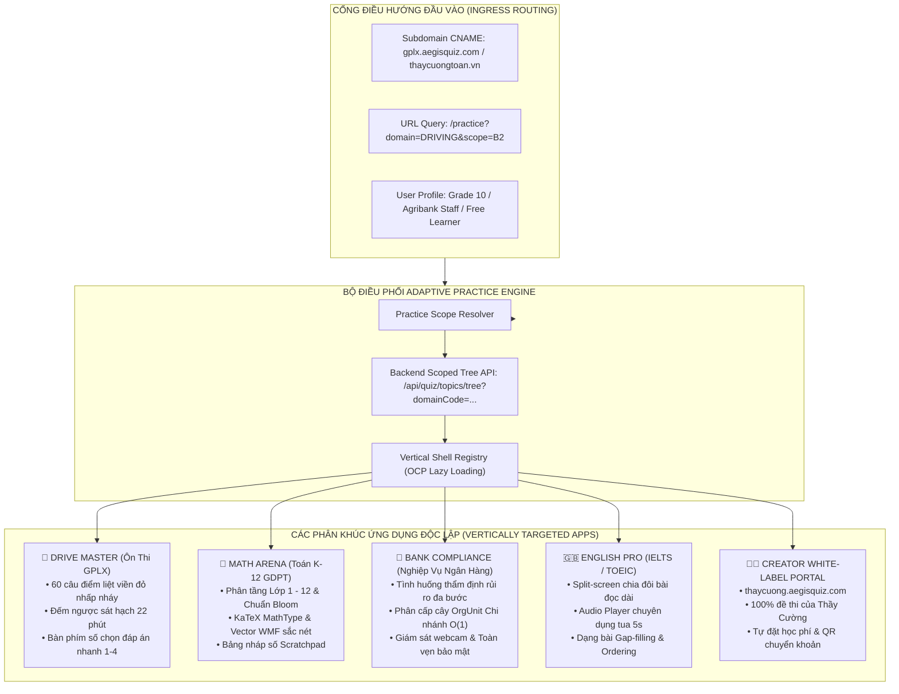

# 🌐 AEGISQUIZ — HEADLESS ADAPTIVE PRACTICE & CREATOR ECONOMY ARCHITECTURE
## Kiến Trúc Nền Tảng Luyện Tập Thích Ứng Đa Phân Khúc & Kinh Tế Người Sáng Tạo (1 Core — Infinite Verticals)

> **Tài liệu tham chiếu chuẩn Living Documentation**: `docs/architecture/AEGIS_HEADLESS_ADAPTIVE_PRACTICE_AND_CREATOR_ECONOMY_ARCHITECTURE.md`  
> **Chủ nhiệm biên soạn**: No.1 — Lead System Analyst, IT Architect, Design, Education & Global Product Strategist  
> **Phiên bản**: v3.0-ENTERPRISE  
> **Ngày phê duyệt**: 2026-10-11  
> **Tình trạng**: ACTIVE / ENFORCED TOÀN HỆ THỐNG

---

## I. TỔNG QUAN CHIẾN LƯỢC & BỐI CẢNH THỊ TRƯỜNG

Trong thị trường Khảo thí & Học tập trực tuyến (EdTech / Assessment Market trị giá > 120 tỷ USD), mô hình **"Siêu ứng dụng cào bằng" (Monolithic Omnipresent App)** là một cái bẫy chết người:
* Người dùng học lái xe không bao giờ muốn nhìn thấy đề thi đại học hay nghiệp vụ ngân hàng.
* Học sinh tiểu học bị choáng ngợp và mất tập trung khi đề thi của mình nằm chung hàng với đề thi chứng chỉ tài chính.
* Các tổ chức doanh nghiệp (Ngân hàng, Bệnh viện) từ chối sử dụng phần mềm nếu không có không gian thương hiệu và phạm vi tri thức cô lập.

AegisQuiz chuyển đổi giao diện Practice từ một màn hình chọn chủ đề đơn lẻ thành **Nền tảng Khảo thí Đa Phân Khúc (Headless Adaptive Practice Platform)** theo triết lý:
$$\mathbf{One\;Core\;Engine} \;\xrightarrow{\quad}\; \mathbf{Infinite\;Vertical\;Apps} \;\xrightarrow{\quad}\; \mathbf{Creator\;Micro-Portals}$$

Hệ thống cho phép từ một Backend duy nhất sản sinh ra hàng trăm ứng dụng chuyên biệt (Dedicated Vertical Apps) và hàng vạn cổng luyện thi cá nhân hóa cho từng Giáo viên/Chuyên gia (Teacher Creator Economy).

---

## II. MA TRẬN ĐIỀU PHỐI NHẬN THỨC (COGNITIVE SCOPING MATRIX)

Giao diện Practice không bao giờ nạp toàn bộ dữ liệu cào bằng. Toàn bộ chủ đề, đề thi và phong cách tương tác được quyết định tự động bởi **Vector 5 Chiều Nhận Thức**:

$$\mathbf{PracticeContext} = \Big\langle \mathbf{Tenant},\; \mathbf{DomainScope},\; \mathbf{OrgGroup},\; \mathbf{LearnerLevel},\; \mathbf{CreatorSlug} \Big\rangle$$

---

## III. THIẾT KẾ KIẾN TRÚC KỸ THUẬT PHÂN TẦNG

### 1. Backend Layer (Scoped Ingestion & Serving)
* **Endpoint chuẩn**: `GET /api/quiz/topics/tree?domainCode={domain}&scope={scope}&creatorId={creatorId}`
  * Khi có `domainCode`: Chỉ truy vấn các node chủ đề thuộc domain tương ứng, loại bỏ toàn bộ dữ liệu của ngành nghề khác khỏi phản hồi JSON.
  * Khi có `creatorId`: Chỉ trả về kho câu hỏi và chủ đề do chính Creator đó biên soạn (hoặc chia sẻ công khai).
* **Multi-Tenant Data Isolation**: Toàn bộ truy vấn tự động áp dụng `TenantQueryFilter` để đảm bảo dữ liệu nội bộ của ngân hàng không bao giờ rò rỉ ra cổng công cộng.

### 2. Frontend Layer (Micro-Widget Architecture & Zero-Monolith)
* **Quy tắc vàng kích thước file**: Mọi file UI components $\le 250$ dòng code. Phân rã God Component `CognitiveTopicExplorer.tsx` (689 dòng) thành các modules:
  * `DomainTabBar.tsx` ($\le 120$ dòng): Thanh lọc danh mục chuyên ngành linh hoạt.
  * `TopicTreeNode.tsx` ($\le 180$ dòng): Render đệ quy mượt mà từng node chủ đề.
  * `DrivingPresetWidget.tsx` ($\le 150$ dòng): Khối tiện ích thi sát hạch lái xe.
  * `CognitiveTopicExplorer.tsx` ($\le 200$ dòng): Component điều phối tinh gọn.
* **`VerticalShellRegistry`**: Cơ chế nạp động (OCP) cho phép bổ sung phân khúc mới (ví dụ Y Khoa, Luật Đấu Thầu) mà **không cần sửa một dòng code nào** của lõi Practice.

---

## IV. MÔ HÌNH CREATOR ECONOMY CHO GIÁO VIÊN & CHUYÊN GIA

AegisQuiz trao quyền cho hàng triệu nhà giáo dục toàn cầu khởi nghiệp trên nền tảng của mình:

1. **White-Label Creator Subdomain**:
   * Mỗi giáo viên sở hữu một đường dẫn riêng: `/c/:creatorSlug` hoặc gắn tên miền riêng `toanthaycuong.vn`.
   * Giao diện Practice tự động đồng bộ Logo, Avatar, Thông điệp chào mừng và Bảng màu thương hiệu của giáo viên.
2. **Khai thác Nguồn Câu hỏi Độc quyền**:
   * Giáo viên nạp đề Word/PDF qua bộ bóc tách CIG Studio; câu hỏi được lưu trữ trong không gian riêng của giáo viên.
   * Học sinh vào link của thầy chỉ thấy đề của thầy, không thấy đề của các giáo viên khác.
3. **Thương mại hóa & Thu học phí Tự động**:
   * Giáo viên được đặt chế độ cho từng bộ đề: *Miễn phí (Public)* hoặc *Có phí (Premium)*.
   * Tích hợp mã VietQR động / Stripe: Học sinh quét mã thanh toán, tiền chuyển thẳng về tài khoản giáo viên, hệ thống tự động mở khóa quyền làm bài.

---

## V. LỘ TRÌNH TRIỂN KHAI VÀ BẢO BẢO TIẾN HÓA VÔ HẠN (OCP)

1. **Giai đoạn 1 (Ngay lập tức)**: Phân rã `CognitiveTopicExplorer.tsx`, đưa Scope Filter thông minh vào `PracticePage.tsx`, hỗ trợ `?domain=DRIVING`, `?domain=BANKING`, `?domain=K12_MATH`.
2. **Giai đoạn 2**: Chuẩn hóa các Preset Shells (GPLX Sát hạch, K-12 GDPT, Banking Compliance).
3. **Giai đoạn 3**: Triển khai Creator Portal Engine `/c/:slug` mở đường cho Creator Economy.
