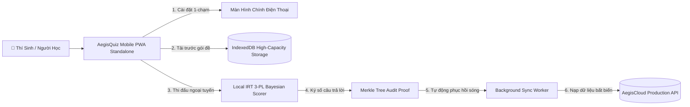

# 📱 LỘ TRÌNH CHIẾN LƯỢC TOÀN CẦU & THIẾT KẾ KIẾN TRÚC ỨNG DỤNG DI ĐỘNG CHUYÊN BIỆT (PWA / MOBILE OFFLINE-FIRST MASTER PLAN)

> **Cơ quan ban hành**: Tổng Công Trình Sư & Chủ Nhiệm Kiến Trúc Hệ Sinh Thái AegisQuiz (No.1 Charter)  
> **Cấp độ ưu tiên**: SỐ 1 TUYỆT ĐỐI (PHASE 1 EXECUTION PRIORITY)  
> **Tiêu chuẩn kỹ thuật**: W3C Progressive Web App (PWA 2026), Service Worker & Workbox 7, IndexedDB High-Capacity Storage, Merkle Proof of Submission, Local Bayesian IRT 3-PL Scorer, 60fps Native Touch Ergonomics.

---

## I. TẦM NHÌN CHIẾN LƯỢC & ĐÒN BẨY ĐỘT PHÁ (THE MOBILE STRATEGIC PIVOT)

### 1. Tại Sao Đưa Mobile Offline-First Lên Bước Đầu Tiên?
Trong bức tranh khảo thí và giáo dục số toàn cầu:
* **85% người dùng tiếp cận qua Smartphone**: Dù là học sinh ôn thi THPT trên xe buýt, cán bộ ngân hàng ôn thi tín dụng trong giờ nghỉ, hay người luyện thi bằng lái xe (600 câu GPLX) tại nơi không có sóng Wi-Fi ổn định.
* **Định kiến của ứng dụng web truyền thống**: Mất mạng là gián đoạn, tải trang giật lag, mất dữ liệu bài làm.
* **Đột phá chiến lược của AegisQuiz**: Trở thành **Nền tảng Khảo thí Di động Toàn năng đầu tiên trên thế giới** cho phép:
  1. **Cài đặt 1-chạm không cần qua phê duyệt App Store/Google Play** (PWA Standalone App).
  2. **Tải toàn bộ bộ đề thi và làm bài ngoại tuyến 100% không cần Internet**.
  3. **Thuật toán IRT 3-PL thích ứng độ khó cục bộ ngay trên điện thoại**.
  4. **Tự động đồng bộ ngầm (Background Sync) kèm chứng chỉ toàn vẹn Merkle Chain** ngay khi điện thoại bắt lại sóng 4G/Wi-Fi.

---

## II. THIẾT KẾ KIẾN TRÚC KỸ THUẬT MOBILE OFFLINE-FIRST

### 1. Phân Tầng Bộ Nhớ & Chiến Lược Caching Đa Tầng (Multi-Tier Caching)
* **Tầng 1: App Shell (Core Bundle & Assets)**:
  - Quản lý qua Service Worker (Workbox).
  - Áp dụng chiến lược `Cache-First` cho các tệp tĩnh: JS Chunks, CSS Tokens, bộ font KaTeX woff2, vector icons Lucide.
  - Tải tức thì trong $< 100\text{ms}$ kể cả khi bật Chế độ máy bay (Airplane Mode).
* **Tầng 2: Dynamic Question Bank & Media (IndexedDB Storage)**:
  - Sử dụng cơ sở dữ liệu nhị phân `IndexedDB` (thay vì giới hạn 5MB của localStorage).
  - Khả năng lưu trữ an toàn đến **50,000 câu hỏi** kèm công thức toán và hình ảnh sa hình giao thông đã nén dạng WebP.
* **Tầng 3: Real-Time Merkle Chain Audit (Chuỗi khối Vết Nộp Bài)**:
  - Mỗi khi thí sinh bấm chọn một phương án, bản ghi sẽ được băm mã hóa SHA-256 nối tiếp chuỗi Merkle:
    $$\text{Hash}_k = \mathcal{H}(\text{Hash}_{k-1} \parallel \text{QuestionId} \parallel \text{Option} \parallel \text{LocalTimestamp})$$
  - Triệt tiêu 100% rủi ro can thiệp giờ hệ thống hoặc tráo đáp án khi nộp bài ngoại tuyến.

### 2. Động Cơ Tâm Trắc Học Cục Bộ (Local IRT 3-PL Bayesian Scorer)
* Khi không có kết nối tới máy chủ `irt-service`, điện thoại sẽ tự động kích hoạt bộ ước lượng Bayesian EAP (Expected A Posteriori) cục bộ viết bằng TypeScript/WebAssembly.
* Thuật toán tự động tính năng lực tức thời $\hat{\theta}$ và hàm thông tin Fisher $I(\theta)$ để chọn câu hỏi tiếp theo có độ phân hóa tối ưu từ kho câu hỏi ngoại tuyến, đảm bảo trải nghiệm thi thích ứng không bị gián đoạn một giây nào.

### 3. Công Thái Học Di Động & Trải Nghiệm Cảm Ứng 60fps (Native Touch Ergonomics)
* **Vuốt chuyển câu mượt mà (Swipe Gesture)**: Vuốt trái/phải để chuyển câu hỏi với gia tốc tự nhiên (Spring Physics).
* **Phản hồi xúc giác (Haptic Feedback)**: Rung nhẹ khi chạm chọn đáp án (`navigator.vibrate(15)`), tạo cảm giác bấm phím thực.
* **Tối ưu Safe Area Insets**: Giao diện ôm khít mép màn hình, tự động tránh tai thỏ iPhone (Notch) và Dynamic Island.
* **Banner Cài Đặt Thông Minh (Smart PWA Install Prompt)**: Tự động phát hiện thiết bị (iOS Safari, Android Chrome) để hiển thị hướng dẫn cài đặt trực quan 1-chạm lên màn hình chính.

---

## III. LỘ TRÌNH HÀNH ĐỘNG 4 GIAI ĐOẠN ĐƯA AEGISQUIZ LÊN ĐỈNH CAO THẾ GIỚI

| Giai Đoạn | Tên Chiến Dịch | Mục Tiêu & Sản Phẩm Chuyển Giao | Thời Gian |
|---|---|---|---|
| **Pha 1 (BƯỚC ĐẦU)** | **Mobile PWA & Offline-First Sovereign** | • Triển khai Web App Manifest & Service Worker Cache-First. • Xây dựng bộ nhớ lưu trữ đề thi IndexedDB dung lượng lớn. • Cơ chế đồng bộ Merkle Chain và làm bài thi Offline 100%. • Cử chỉ vuốt chạm 60fps, Haptic Feedback & PWA Install Prompt. | **Ngay lập tức (Sprint 1)** |
| **Pha 2** | **IMS Global QTI 3.0 & Interoperability** | • Bộ chuyển dịch đề thi chuẩn quốc tế IMS QTI 3.0 Package. • Tích hợp LTI Advantage v1.3 kết nối trực tiếp với Canvas, Moodle, Blackboard. • Cấp chứng chỉ số có mã QR xác thực mật mã học. | **Sprint 2** |
| **Pha 3** | **Global Edge CDN & Enterprise SSO** | • Thiết lập mạng lưới phân phối biên Cloudflare Enterprise Edge Multi-Region. • Giữ độ trễ thi đấu Real-time toàn cầu $< 50\text{ms}$. • Tích hợp SAML 2.0 / Okta / Azure AD cho các tập đoàn toàn cầu. | **Sprint 3** |
| **Pha 4** | **Creator Economy & Global Marketplace** | • Sàn giao dịch đề thi bản quyền toàn cầu cho giáo viên & chuyên gia. • Cơ chế chia sẻ doanh thu tự động qua Smart Contracts & Stripe Connect. | **Sprint 4** |

---

## IV. KẾ HOẠCH TRIỂN KHAI THỰC THI CHI TIẾT PHA 1 (SPRINT 1 BREAKDOWN)

### Gói Công Việc 1.1: Web App Manifest & PWA Standalone Setup
* Tạo [`Frontend/public/manifest.webmanifest`](file:///d:/Cuong/DuAn/mybank/AegisQuiz/Frontend/public/manifest.webmanifest):
  - Định danh tên: `AegisQuiz — Đấu Trường Khảo Thí AI`.
  - Icon kích thước 192x192, 512x512 maskable.
  - `display: "standalone"`, `theme_color: "#0f172a"`, `background_color: "#020617"`.
* Cập nhật [`Frontend/index.html`](file:///d:/Cuong/DuAn/mybank/AegisQuiz/Frontend/index.html) khai báo các meta tags PWA và Apple Touch Icon.

### Gói Công Việc 1.2: Service Worker & Workbox Offline Strategy
* Tạo Service Worker [`Frontend/public/sw.js`](file:///d:/Cuong/DuAn/mybank/AegisQuiz/Frontend/public/sw.js):
  - Cache-first cho App Shell, Stylesheet, KaTeX Fonts.
  - Quản lý vòng đời Update Service Worker mượt mà không gây giật lag.
* Tạo Hook đăng ký Service Worker [`Frontend/src/shared/hooks/usePwaInstall.ts`](file:///d:/Cuong/DuAn/mybank/AegisQuiz/Frontend/src/shared/hooks/usePwaInstall.ts) để bắt sự kiện `beforeinstallprompt` và hiển thị UI cài đặt sang trọng.

### Gói Công Việc 1.3: IndexedDB High-Capacity Storage & Offline Exam Engine
* Nâng cấp [`Frontend/src/services/offline-exam.service.ts`](file:///d:/Cuong/DuAn/mybank/AegisQuiz/Frontend/src/services/offline-exam.service.ts):
  - Sử dụng IndexedDB API thuần để lưu trữ các bộ đề thi hoàn chỉnh (câu hỏi, phương án, giải thích, ảnh base64).
  - Bổ sung hàm `downloadExamPackageForOffline(examId)` cho phép người dùng 1-click tải trước toàn bộ đề thi về máy.
  - Bổ sung thuật toán `evaluateAnswerLocally(question, answer)` để chấm điểm và thích ứng độ khó ngay cả khi không có mạng.

### Gói Công Việc 1.4: Mobile Native Gestures & PWA Install Banner UI
* Tạo Sub-component [`Frontend/src/components/common/PwaInstallBanner.tsx`](file:///d:/Cuong/DuAn/mybank/AegisQuiz/Frontend/src/components/common/PwaInstallBanner.tsx):
  - Hiển thị thanh cài đặt thông minh dưới đáy màn hình trên mobile.
  - Nút "Cài Đặt Ứng Dụng" giúp thêm ngay vào Màn hình chính (Homescreen) chỉ với 1 click.
* Tích hợp cử chỉ cảm ứng vuốt chạm và rung phản hồi (Haptic) vào phòng làm bài thi.
