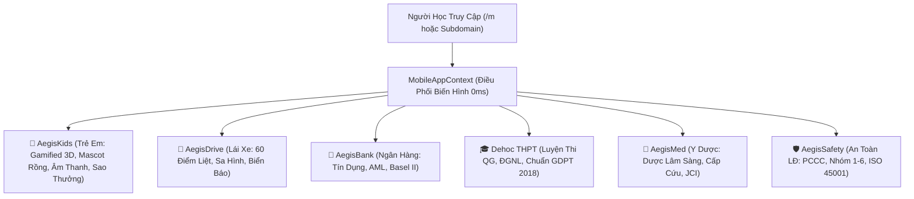

# 📱 LỘ TRÌNH CHIẾN LƯỢC TOÀN CẦU & KIẾN TRÚC ỨNG DỤNG DI ĐỘNG CHUYÊN BIỆT (PWA / MOBILE METAMORPHIC OFFLINE-FIRST MASTER PLAN)

> **Cơ quan ban hành**: Tổng Công Trình Sư & Chủ Nhiệm Kiến Trúc Hệ Sinh Thái AegisQuiz (No.1 Charter)  
> **Phiên bản**: v2.0.0 (Living Architecture Dossier — Pha 1 Hoàn Thành & Tích Hợp ACSE)  
> **Trạng thái**: Hoạt động thực tế trên Docker Desktop (Port 3000, Chunk Mobile 9.24 KB gzip)  
> **Tiêu chuẩn kỹ thuật**: W3C PWA 2026, Service Worker Cache-First, IndexedDB Merkle Chain, Cognitive Micro-Course Transpiler, 60fps Native Touch Ergonomics.

---

## I. TỔNG QUAN CHIẾN LƯỢC: PHÂN TÁCH PHÂN HỆ DI ĐỘNG ĐỘC LẬP (METAMORPHIC ENGINE)

Thay vì dùng chung một giao diện Web Desktop cồng kềnh với nhiều công cụ nặng (MathType, CIG Editor, FinOps AI), hệ thống đã chính thức **tách phân hệ Di động thành một Engine riêng biệt siêu nhẹ (Chunk chỉ 9.24 KB gzip)**:
- **Đường dẫn độc lập**: `/m` và `/m/:appVariant` (hoặc qua tham số `?app=...` và Subdomain).
- **Cơ chế Biến hình 0ms (Metamorphic Metamorphosis)**: Tự động thay đổi màu sắc CSS Tokens, biểu tượng, danh mục chuyên đề và phong cách giao diện theo từng ngành học mà **không cần sửa đổi mã nguồn (OCP)**.

---

## II. DANH MỤC THÀNH PHẦN ĐÃ HOÀN THÀNH & TÍCH HỢP (COMPLETED MATRIX)

### 1. Phân Hệ Mobile Metamorphic Core
* [`Frontend/src/mobile/config/mobile-app-variants.ts`](file:///Frontend/src/mobile/config/mobile-app-variants.ts):  
  Định nghĩa 6 biến thể chuẩn hóa (`kids`, `driving`, `banking`, `thpt`, `med`, `hse`) kèm màu sắc HSL, tagline, chuyên đề mẫu và cờ `uiMode: 'standard' | 'gamified_kids'`.
* [`Frontend/src/mobile/context/MobileAppContext.tsx`](file:///Frontend/src/mobile/context/MobileAppContext.tsx):  
  Nhận diện biến thể qua URL, Subdomain (`laixe.dehoc.vn`, `kids.dehoc.vn`), Query param, hoặc LocalStorage; hỗ trợ Haptic Feedback API.
* [`Frontend/src/mobile/components/MobileShell.tsx`](file:///Frontend/src/mobile/components/MobileShell.tsx):  
  Khung Native Shell chuẩn Safe Area Insets (tai thỏ iPhone/Dynamic Island), Header có nút đổi ngành nhanh, Bottom Navigation Bar 4 nút (Luyện thi, Thi thử, Ngoại tuyến, Cá nhân).
* [`Frontend/src/mobile/components/MobileAppSwitcherModal.tsx`](file:///Frontend/src/mobile/components/MobileAppSwitcherModal.tsx):  
  Modal đổi ngành thi 1-chạm cực kỳ mượt mà.
* [`Frontend/src/mobile/pages/MobileHomePage.tsx`](file:///Frontend/src/mobile/pages/MobileHomePage.tsx):  
  Trang chủ biến hình hiển thị Năng lực IRT $\theta$, câu đã luyện, độ chính xác %, và các chuyên đề nóng của từng ngành.

### 2. Phân Hệ Trẻ Em Gamified & Thất Bại An Toàn (AegisKids)
* [`Frontend/src/mobile/components/KidsMascot.tsx`](file:///Frontend/src/mobile/components/KidsMascot.tsx) (75 dòng):  
  Linh vật tương tác "Bé Rồng Aegis 🐲" với các biểu cảm (`happy`, `thinking`, `cheering`), có nút phát âm tiếng Anh qua Web Speech API.
* [`Frontend/src/mobile/components/KidsPracticeView.tsx`](file:///Frontend/src/mobile/components/KidsPracticeView.tsx) (245 dòng):  
  Phòng học 3D Chunky Cards, nút bấm khối nổi, thanh kẹo tiến trình, âm thanh reo vui Fanfare, chuỗi Streak 🔥, Sao thưởng ⭐ và pháo hoa Confetti.
* [`Frontend/src/mobile/utils/kids-sound.ts`](file:///Frontend/src/mobile/utils/kids-sound.ts) (55 dòng):  
  Bộ tổng hợp âm thanh Web Audio API thuần (không cần file mp3 ngoài) và TTS phát âm tiếng Anh chuẩn Mỹ.

### 3. Cỗ Máy Chuyển Hóa Lời Giải Thành Bài Giảng Vi Mô (ACSE Engine v1.0)
* [`Frontend/src/mobile/types/slice-lesson.ts`](file:///Frontend/src/mobile/types/slice-lesson.ts):  
  Khung dữ liệu chuẩn hóa 4 chặng nhận thức: Manh mối (`clue`) $\rightarrow$ Quy luật (`concept`) $\rightarrow$ Giải phẫu từng bước (`step`) $\rightarrow$ Mẹo nhớ sâu (`memory_hook`).
* [`Frontend/src/mobile/utils/explanation-slice-transpiler.ts`](file:///Frontend/src/mobile/utils/explanation-slice-transpiler.ts):  
  Bộ Transpiler tự động giải phẫu trường `Explanation` (Word/Excel/LaTeX) thành mảng `LessonSlice[]`.
* [`Frontend/src/mobile/components/InteractiveSliceViewer.tsx`](file:///Frontend/src/mobile/components/InteractiveSliceViewer.tsx) (178 dòng):  
  Trình chiếu Storyboard dạng Story (Instagram/TikTok style) 60fps, có thanh đếm giờ phân đoạn, giọng đọc thuyết minh của Bé Rồng Mascot và nút nhận thưởng Sao vàng.
* Tích hợp đồng thời vào [`KidsPracticeView.tsx`](file:///Frontend/src/mobile/components/KidsPracticeView.tsx) và [`MobilePracticeRoom.tsx`](file:///Frontend/src/mobile/components/MobilePracticeRoom.tsx) cho **tất cả mọi ngành**.

### 4. Quản Trị Cấu Hình Động từ Giao Diện Admin
* [`Frontend/src/pages/admin/tenants/TenantsPage.tsx`](file:///Frontend/src/pages/admin/tenants/TenantsPage.tsx):  
  Bổ sung mục lựa chọn **Định Dạng Trải Nghiệm Mobile (Metamorphic Engine)** trong Modal Tạo và Cập nhật Khách thuê; bổ sung nút icon **Điện Thoại (`Smartphone`)** trong bảng quản trị để mở bản di động kiểm chứng ngay lập tức.
* [`Frontend/src/pages/admin/AdminLayout.tsx`](file:///Frontend/src/pages/admin/AdminLayout.tsx) & [`Frontend/src/App.tsx`](file:///Frontend/src/App.tsx):  
  Liên kết hoàn chỉnh các tuyến đường quản trị:
  - `/admin/tenants`: Quản trị Khách thuê & Nhãn trắng.
  - `/admin/org-units`: Quản trị Cây tổ chức 5 cấp $O(1)$ (`MaterializedPath`).

---

## III. HƯỚNG DẪN TIẾP TỤC PHÁT TRIỂN TRONG PHIÊN TIẾP THEO (RESUME GUIDE)

Khi mở phiên làm việc mới, Kỹ sư / AI Agent chỉ cần thực hiện theo các chỉ dẫn sau:

### 1. Trạng Thái Hiện Tại & Cổng Chạy
- **Mã nguồn đã commit**: Commit `eaaf1b8` (Kids Gamification) và `9f8ffaf` (ACSE Engine).
- **Môi trường Docker Desktop**: Các container đang chạy:
  - Frontend: `http://localhost:3000` (Nginx SPA, chunk mobile 9.24 KB).
  - Backend: `http://localhost:8080` (.NET 9 Web API).
  - Postgres: `localhost:5432` (`aegisquiz` DB).
- **Các URL kiểm chứng**:
  - Giao diện Admin: `http://localhost:3000/admin/tenants`
  - Giao diện Trẻ Em: `http://localhost:3000/m?app=kids`
  - Giao diện Sát Hạch Lái Xe: `http://localhost:3000/m/driving`
  - Giao diện Ngân Hàng: `http://localhost:3000/m/banking`

### 2. Các Hạng Mục Tiếp Theo Cần Triển Khai (Sprint 2 Backlog)
1. **Kết nối API Realtime cho Mobile Practice**:
   - Thay thế dữ liệu mẫu trong `MobilePracticeRoom.tsx` và `KidsPracticeView.tsx` bằng API nạp câu hỏi thật: `GET /api/quiz/exams/{id}/questions` hoặc nạp từ `offlineExamService.getOfflineExam(examId)` trong IndexedDB.
2. **Kéo-Thả Ghép Chữ Cho Bé (Letter Scramble Widget)**:
   - Viết micro-widget kéo thả chữ cái vào ô trống cho phân hệ trẻ em (ví dụ ghép chữ `C - A - T`).
3. **Quét Mã QR Đề Thi Trên Mobile (QR Scanner)**:
   - Tích hợp thư viện quét mã camera nhẹ (`html5-qrcode`) vào `MobileHomePage.tsx` để học sinh quét mã đề thi của Giáo viên vào thẳng phòng thi.
4. **Pha 2 Chuẩn Quốc Tế IMS Global QTI 3.0**:
   - Triển khai xuất/nhập gói chuẩn QTI 3.0 để tích hợp LMS quốc tế (Canvas, Moodle, Blackboard).

---
*Tài liệu được bảo chứng bởi Kiến Trúc Sư Trưởng Hệ Sinh Thái AegisQuiz (No.1 Charter).*
