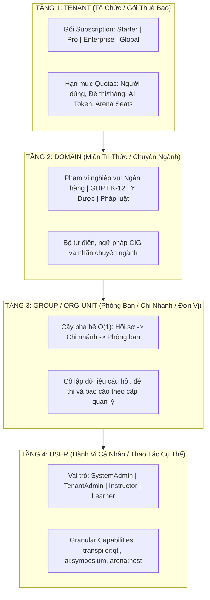
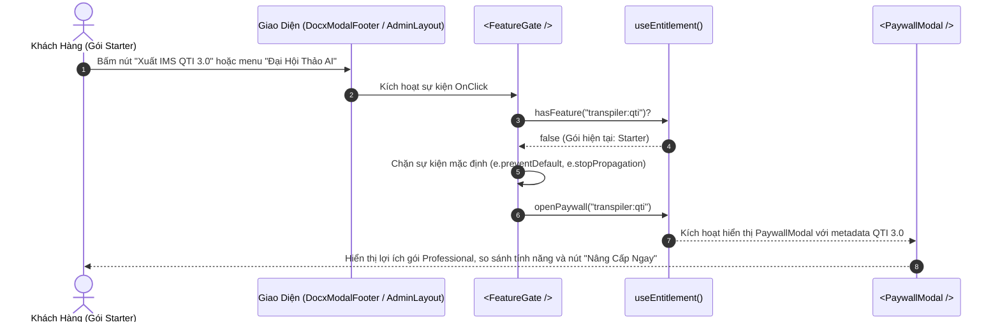

# 💎 AEGISQUIZ — MODULAR B2B SAAS ENTITLEMENT & 4-TIER GOVERNANCE ARCHITECTURE
## Kiến Trúc Nền Tảng Phân Quyền & Đóng Gói Sản Phẩm B2B Thương Mại Hóa Chuẩn Toàn Cầu

> **Tài liệu tham chiếu chuẩn Living Documentation**: `docs/architecture/AEGIS_MODULAR_B2B_SAAS_ENTITLEMENT_ARCHITECTURE.md`  
> **Chủ nhiệm biên soạn**: No.1 — Lead System Analyst, IT Architect, Product Strategist & Global Monetization Specialist  
> **Phiên bản**: v3.0-ENTERPRISE  
> **Ngày phê duyệt**: 2026-10-11  
> **Tình trạng**: ACTIVE / ENFORCED BẮT BUỘC

---

## I. TỔNG QUAN CHIẾN LƯỢC KINH DOANH & BỐI CẢNH KIẾN TRÚC

Trong quá trình tiến hóa từ một nền tảng thi trắc nghiệm thuần túy sang **Hệ sinh thái Khảo thí & Tri thức Toàn cầu**, AegisQuiz đã tích lũy hàng loạt "vũ khí công nghệ tối tân": *Universal Exam Transpiler, Hội đồng AI Symposium 3 đại diện, Đấu trường trực tiếp 6 gameshows, Động cơ bóc tách MathType vector WMF, và Mô hình đo lường thích ứng IRT 3-PL CAT*.

Tuy nhiên, việc để toàn bộ các tính năng này hiển thị cào bằng trên giao diện (Monolithic Super-App Syndrome) gây ra 3 hệ lụy nghiêm trọng:
1. **Khủng hoảng nhận thức người dùng (Cognitive Overload)**: Giáo viên và gia sư phổ thông bị choáng ngợp bởi hàng loạt tính năng công nghiệp phức tạp.
2. **Bế tắc thương mại hóa SaaS (Zero Packaging & Monetization)**: Khách hàng không có ranh giới gói cước; doanh thu B2B không thể tối ưu hóa khi không có cơ chế **Feature Gates (Cổng kiểm soát tính năng)** và **Upgrade Triggers (Kích hoạt mua thêm)**.
3. **Thủng lưới quản trị phân cấp doanh nghiệp (Enterprise Governance Void)**: Ngân hàng và tập đoàn đa chi nhánh đòi hỏi sự cô lập quyền lực tuyệt đối giữa các đơn vị thành viên.

Kiến trúc **Modular B2B SaaS Entitlement Engine** ra đời nhằm giải quyết triệt để bài toán trên, biến AegisQuiz thành cỗ máy kinh doanh B2B tự động (*Product-Led Growth - PLG*) vận hành trên ma trận phân quyền 4 tầng.

---

## II. MA TRẬN PHÂN QUYỀN & THỤ HƯỞNG 4 TẦNG (4-TIER ENTITLEMENT MATRIX)

Công thức xác định quyền truy cập một hành vi hoặc chức năng được định nghĩa bất biến:

$$\mathbf{Access(User, Feature)} = \mathbf{TenantTier} \;\cap\; \mathbf{DomainScope} \;\cap\; \mathbf{GroupPolicy} \;\cap\; \mathbf{UserCapability}$$



### 1. Tầng 1 — Tenant (Tổ Chức & Gói Thuê Bao)
* **Thực thể dữ liệu**: `Tenant.cs` (`TenantPlan`, `ScaleType`, `FeatureFlagsJson`, `TenantQuotaLimits`).
* **Nhiệm vụ**: Xác định gói bản quyền của khách hàng doanh nghiệp (`Starter`, `Professional`, `Enterprise`, `Global`). Kiểm soát hạn mức cứng (Hard Quotas): số lượng câu hỏi/tháng, số thí sinh đồng thời, dung lượng lưu trữ cloud.

### 2. Tầng 2 — Domain (Miền Tri Thức & Nghiệp Vụ)
* **Thực thể dữ liệu**: `TenantDomainConfig.cs`, `DynamicDomain.cs`.
* **Nhiệm vụ**: Kích hoạt bộ từ điển, luật ngữ pháp bóc tách đề thi (CIG Specs) và thuật ngữ chuyên ngành phù hợp cho từng Tenant (Ví dụ: Ngân hàng kích hoạt Domain *Tín dụng & Thẩm định rủi ro*; Trường học kích hoạt Domain *Toán Lý Hóa K-12*).

### 3. Tầng 3 — Group / OrgUnit (Phân Cấp Đơn Vị Đa Tầng $O(1)$)
* **Thực thể dữ liệu**: `OrganizationUnit.cs` (`HierarchyPath`, `DepthLevel`, `OrgUnitType`).
* **Nhiệm vụ**: Quản lý phân cấp không giới hạn độ sâu (Hội sở $\to$ Khối $\to$ Chi nhánh $\to$ Phòng ban $\to$ Tổ/Lớp). Áp dụng thuật toán `MaterializedPath` truy vấn $O(1)$ để cô lập dữ liệu đề thi, không cho phép phòng ban này xem kho đề thi mật của phòng ban khác.

### 4. Tầng 4 — User (Năng Lực Hành Động Vi Mô - Granular Capabilities)
* **Thực thể dữ liệu**: `UserRole.cs`, `AppRolePermissions.cs`.
* **Nhiệm vụ**: Xác định hành vi cụ thể mà người dùng được phép thực thi trong phạm vi OrgUnit của mình (`transpiler:moodle`, `questions:write`, `exams:assign`, `reports:team`).

---

## III. MA TRẬN ĐÓNG GÓI THƯƠNG MẠI (COMMERCIAL PACKAGING SPECIFICATION)

| Nhóm Tính Năng | Feature Key | STARTER (Cá Nhân) | PROFESSIONAL (Trường Học/SME) | ENTERPRISE (Tập Đoàn/Bank) | GLOBAL SOVEREIGN (Bộ GD/Chính Phủ) |
| :--- | :--- | :---: | :---: | :---: | :---: |
| **Bản Quyền Đề Thi** | `transpiler:moodle` | ✅ Moodle XML | ✅ Moodle XML | ✅ Moodle XML | ✅ Moodle XML |
| | `transpiler:gift` | ❌ Khóa (Teaser) | ✅ Moodle GIFT | ✅ Moodle GIFT | ✅ Moodle GIFT |
| | `transpiler:qti` | ❌ Khóa (Teaser) | ✅ IMS QTI 3.0 | ✅ IMS QTI 3.0 | ✅ IMS QTI 3.0 |
| | `transpiler:canvas` | ❌ Khóa | ❌ Khóa | ✅ Direct API | ✅ Custom LMS Engine |
| **Đồ Họa & Toán Học** | `math:vector_wmf` | ✅ Chuẩn | ✅ Cao cấp | ✅ Không giới hạn | ✅ Không giới hạn |
| **Tương Tác Trực Tiếp** | `arena:gameshow` | ❌ Khóa | ✅ Max 50 seats | ✅ Max 1.000 seats | ✅ Max 10.000+ seats |
| **Phân Cấp Tổ Chức** | `org:hierarchy_tree` | ❌ Phẳng | ✅ 2 Cấp (Bộ môn) | ✅ 5 Cấp vô hạn $O(1)$ | ✅ Toàn cầu Multi-tenant |
| **Khảo Thí & Đo Lường** | `irt:cat3pl` | ❌ CTT Cổ điển | ❌ 1-PL Rasch | ✅ IRT 3-PL CAT ($a,b,c$) | ✅ Multidimensional IRT |
| **Trí Tuệ Nhân Tạo** | `ai:symposium` | ❌ Khóa | ❌ 1 Bot hỗ trợ | ✅ 3 AI Đa đại diện | ✅ Private Model On-prem |
| **Thương Hiệu & Bảo Mật** | `branding:white_label`| ❌ Domain chung | ❌ Logo cơ bản | ✅ White-label + SSO | ✅ ISO 27001 / Air-gapped |
| | `security:audit_log` | ❌ Không | ❌ Cơ bản | ✅ Audit Trail bất biến | ✅ Blockchain / WORM log |

---

## IV. KIẾN TRÚC KỸ THUẬT PHÂN TẦNG (TECHNICAL ARCHITECTURE)

### 1. Backend Layer (CLEAR Architecture)
```
[Domain]        FeatureEntitlement.cs (FeatureKeys, PlanFeatureCatalog, QuotaLimits)
                   ▲
[Application]   Interfaces, DTOs (TenantEntitlementsDto)
                   ▲
[Infrastructure]AegisQuizDbContext, MultiTenantQueryFilter
                   ▲
[API Gateway]   EntitlementsController.cs (GET /api/entitlements/current)
```

* **`PlanFeatureCatalog`**: Cung cấp hàm thuần khiết giải mã gói thuê bao thành tập hợp `HashSet<string>` các tính năng hợp lệ. Hỗ trợ ghi đè linh hoạt qua `Tenant.FeatureFlagsJson` để bán các gói Add-on tùy biến.
* **`EntitlementsController`**: Tổng hợp dữ liệu từ 4 tầng và xuất bản một payload phản hồi nhẹ $\approx 1.2\text{ KB}$, cache thân thiện.

### 2. Frontend Layer (FSD Modular Architecture)
```
[shared/types]       entitlement.ts (FeatureKey, TenantPlan, QuotaLimits, Catalog)
                        ▲
[services]           entitlementService.ts (API client call /api/entitlements/current)
                        ▲
[shared/context]     EntitlementContext.tsx (Quản lý state, fallback Community)
                        ▲
[shared/hooks]       useEntitlement.ts (hasFeature, isFeatureLocked, plan, quotas)
                        ▲
[shared/components]  FeatureGate.tsx | FeatureBadge.tsx | PaywallModal.tsx
                        ▲
[Presentation Pages] DocxModalFooter.tsx, AdminLayout.tsx, QuestionStudio...
```

* **`<FeatureGate />`**: Wrapper bảo vệ tính năng. Hỗ trợ 3 chế độ:
  1. `lock`: Giữ nguyên vị trí UI, hiển thị huy hiệu `PRO`/`ENTERPRISE`, chặn click và mở `PaywallModal` (Áp dụng chiến lược PLG Teaser).
  2. `hidden`: Ẩn hoàn toàn tính năng khỏi DOM nếu người dùng chưa nâng cấp gói.
  3. `custom`: Hiển thị component thay thế (Fallback banner).
* **`<FeatureBadge />`**: Huy hiệu sang trọng với animation nhịp thở (`animate-pulse`) và màu gradient độc quyền theo cấp độ (`PRO`: Vàng hổ phách; `ENTERPRISE`: Tím hoàng gia; `GLOBAL`: Xanh ngọc lam).
* **`<PaywallModal />`**: Modal chuyển đổi bán hàng B2B, hiển thị giá trị vượt trội của tính năng, thông tin gói cước hiện tại và Call-to-Action trực tiếp.

---

## V. LUỒNG TƯƠNG TÁC THƯƠNG MẠI HÓA (PRODUCT-LED GROWTH WORKFLOW)



---

## VI. QUY TRÌNH PHÁT TRIỂN TÍNH NĂNG MỚI (DEVELOPER GOLDEN WORKFLOW)

Mọi kỹ sư hoặc AI Agent khi bổ sung tính năng mới vào hệ thống AegisQuiz bắt buộc phải tuân thủ quy trình 5 bước:

1. **Bước 1 — Khai báo FeatureKey tại Domain Backend**:
   Thêm hằng số vào `AegisQuiz.Domain.Entities.FeatureKeys`.
2. **Bước 2 — Định cấu hình gói tại PlanFeatureCatalog**:
   Quy định tính năng này thuộc gói nào (`Starter`, `Professional`, `Enterprise`, `Global`).
3. **Bước 3 — Đồng bộ hóa TypeScript Types**:
   Cập nhật `Frontend/src/types/entitlement.ts` và bổ sung bản ghi vào `FEATURE_METADATA_CATALOG`.
4. **Bước 4 — Bọc UI bằng `<FeatureGate />`**:
   Mọi nút bấm, tab hoặc trang mới phải được kiểm soát bằng `<FeatureGate feature={...}>`.
5. **Bước 5 — Viết Scoped Unit Test**:
   Bổ sung test case kiểm tra quyền trong `EnterpriseEntitlementMatrixTests.cs`.
