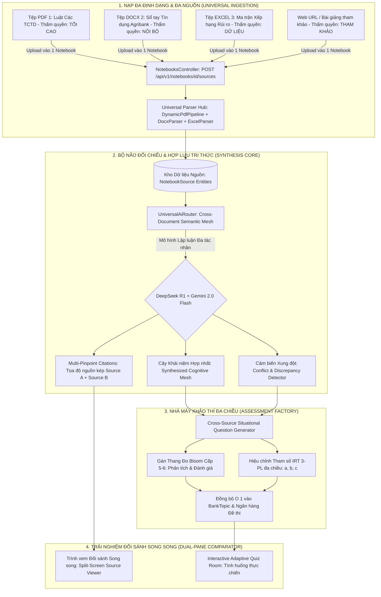
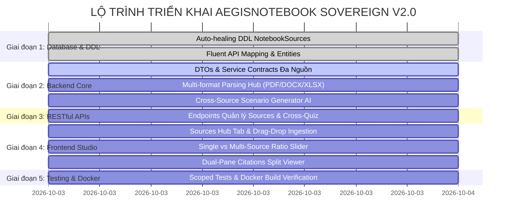

# 🛡️ AEGISNOTEBOOK SOVEREIGN — KẾ HOẠCH TRIỂN KHAI TOÀN DIỆN VÀ TỐI THƯỢNG (V2.0)
## Kiến Tạo Hệ Thống Nhận Thức Sống Đa Nguồn & Nhà Máy Khảo Thí Tự Động Đỉnh Cao Thế Giới
> **Mã định danh**: `AEGIS-PLAN-NOTEBOOK-2026-V2`  
> **Tổng Công Trình Sư**: No.1 — Lead System Analyst, Master Living Documentarian, IT Architect, AI, Design, Education & Economic Specialist  
> **Tiêu chuẩn áp dụng**: [AEGIS LIVING VISUAL DOCUMENTATION STANDARD (ALDS v1.0)](file:///docs/standards/AEGIS_LIVING_DOCUMENTATION_STANDARD.md)

---

## I. TẦM NHÌN CHIẾN LƯỢC: CHUYỂN DỊCH TỪ ĐƠN TÀI LIỆU SANG HỒ SƠ ĐA NGUỒN (PILLAR 1)

### 1.1. Sứ mệnh Đột phá V2.0
Phân hệ **AegisNotebook Sovereign V2.0** giải quyết triệt để "tử huyệt" của các công cụ AI đọc tài liệu thế hệ thứ nhất (như NotebookLM, Knowt, Quizlet) — vốn chỉ giới hạn việc đọc hiểu trong các tệp tin đơn lẻ, cô lập.

Tri thức thực tế trong đào tạo chuyên gia, y tế, ngân hàng, pháp luật và giáo dục chất lượng cao luôn luôn là **Mạng lưới Tri thức Đa nguồn (Multi-Source Knowledge Mesh)**:
1. **Một chủ đề học thuật hoặc một vị trí công tác đòi hỏi nhiều nguồn tài liệu bổ trợ lẫn nhau**:
   - Nguồn 1: Căn cứ pháp lý cao nhất (Luật / Nghị định / Tiêu chuẩn ISO).
   - Nguồn 2: Văn bản hướng dẫn điều hành (Thông tư / Phác đồ / Chỉ thị).
   - Nguồn 3: Sổ tay tác nghiệp thực tế (Quy trình nội bộ SOP / Sách hướng dẫn).
   - Nguồn 4: Dữ liệu thực chứng (Báo cáo tài chính / Hồ sơ mẫu / Đề thi các năm).
2. **Khảo thí học Đỉnh cao (Bloom Cấp 5 & 6)**:
   - Thay vì chỉ hỏi ghi nhớ một câu chữ trong một trang sách (Bloom 1), hệ thống tự động sinh ra **Câu hỏi tình huống phức hợp đa nguồn (Cross-Source Situational Exam)**: Yêu cầu người học đối chiếu giữa quy chuẩn pháp lý và quy trình nội bộ để ra quyết định tối ưu.
3. **Cảm biến Xung đột Tri thức (Conflict Resolution Engine)**:
   - Tự động phát hiện khi quy trình nội bộ bị lỗi thời hoặc mâu thuẫn với thông tư/luật mới ban hành, gán nhãn cảnh báo rủi ro tuân thủ cho tổ chức.

---

### 1.2. Sơ đồ Luồng Nhận Thức Hợp Nhất Đa Nguồn (Cross-Source Topology)



---

## II. ĐẶC TẢ HỢP ĐỒNG MÃ NGUỒN & ENTITIES V2.0 (PILLAR 2)

### 2.1. Cấu trúc Thực thể Domain Đa Nguồn ([Notebook.cs](file:///Backend/src/AegisQuiz.Domain/Entities/Notebook.cs))

```csharp
namespace AegisQuiz.Domain.Entities
{
    // [AegisNotebook Sovereign V2.0] Hồ sơ Nhận thức Sống Đa Nguồn
    public class Notebook : ITenantEntity
    {
        public Guid Id { get; set; } = Guid.NewGuid();
        public Guid TenantId { get; set; } = Guid.Empty;
        public Guid? OrgUnitId { get; set; }
        public string Title { get; set; } = string.Empty;
        public string Description { get; set; } = string.Empty;
        public string DomainCode { get; set; } = "GENERAL";
        public Guid? BankTopicId { get; set; }
        
        public NotebookStatus Status { get; set; } = NotebookStatus.Ready;
        public string? ErrorMessage { get; set; }

        // Thống kê phân tích tổng hợp (Bloom, IRT range, Báo cáo xung đột)
        public string CognitiveStatsJson { get; set; } = "{}";
        public string ConflictReportJson { get; set; } = "[]"; // Danh sách mâu thuẫn giữa các tài liệu

        // [MỚI] NẠP VAI TRÒ ĐỐI THOẠI (PERSONA ROLE INJECTION)
        public string PersonaName { get; set; } = "Cố Vấn Tri Thức Trưởng";
        public PersonaRoleType PersonaRole { get; set; } = PersonaRoleType.SocraticMentor;
        public string CustomPersonaPrompt { get; set; } = string.Empty;

        public Guid CreatedByAdminId { get; set; }
        public DateTime CreatedAt { get; set; } = DateTime.UtcNow;
        public DateTime? UpdatedAt { get; set; }

        // QUAN HỆ 1-N: 1 Notebook quản lý nhiều Nguồn tài liệu
        public List<NotebookSource> Sources { get; set; } = new();

        // Cây kiến thức nhận thức hợp nhất (Cross-Source Chapters)
        public List<NotebookChapter> Chapters { get; set; } = new();

        // Lịch sử Đối thoại Nhận thức Nhập vai (Socratic Chat History)
        public List<NotebookChatMessage> ChatMessages { get; set; } = new();
    }

    public enum PersonaRoleType
    {
        SocraticMentor = 1,       // Gia sư Socratic: Luôn hỏi vặn gợi mở, rèn luyện tư duy phản biện
        StrictAuditor = 2,        // Thanh tra Pháp chế / Kiểm toán Trưởng: Soi xét rủi ro, bắt bẻ kẽ hở
        ExecutiveConsultant = 3,  // Cố vấn Điều hành: Tóm tắt chiến lược vĩ mô, khuyến nghị ra quyết định
        ChiefExaminer = 4,        // Trưởng Ban Giám Khảo: Đóng vai phỏng vấn vấn đáp, chấm điểm trực tiếp
        DomainExpert = 5,         // Chuyên gia Kỹ thuật Đầu ngành: Giải thích sâu chi tiết công thức, kỹ thuật
        Custom = 99               // Tùy biến tự do theo System Prompt người dùng nạp vào
    }

    // Thực thể Tin nhắn Đối thoại Nhận thức
    public class NotebookChatMessage
    {
        public Guid Id { get; set; } = Guid.NewGuid();
        public Guid NotebookId { get; set; }
        public string Sender { get; set; } = "User"; // "User" | "Assistant"
        public string RoleName { get; set; } = string.Empty;
        public string Message { get; set; } = string.Empty;
        public string CitationsJson { get; set; } = "[]"; // [{ sourceId, sourceName, page, textSnippet }]
        public DateTime CreatedAt { get; set; } = DateTime.UtcNow;
        public Notebook Notebook { get; set; } = null!;
    }

    // Thực thể Nguồn Tài Liệu trong Hồ Sơ
    public class NotebookSource
    {
        public Guid Id { get; set; } = Guid.NewGuid();
        public Guid NotebookId { get; set; }
        public string Title { get; set; } = string.Empty;
        public string OriginalFileName { get; set; } = string.Empty;
        public string StoragePath { get; set; } = string.Empty;
        public string SourceUrl { get; set; } = string.Empty;
        public long FileSizeBytes { get; set; }
        public int TotalPages { get; set; }

        public SourceType Type { get; set; } = SourceType.Pdf;
        public AuthorityLevel Authority { get; set; } = AuthorityLevel.InternalSop; // Cấp thẩm quyền

        public SourceStatus Status { get; set; } = SourceStatus.Ready;
        public string ExtractedTextSummary { get; set; } = string.Empty;
        public DateTime UploadedAt { get; set; } = DateTime.UtcNow;

        public Notebook Notebook { get; set; } = null!;
    }

    public enum AuthorityLevel
    {
        SupremeLegal = 4,   // Luật, Hiến pháp, Nghị định, Chuẩn ISO quốc tế
        Regulatory = 3,     // Thông tư NHNN, Bộ Y Tế, Quy chuẩn Bộ GTVT
        InternalSop = 2,    // Sổ tay quy trình nội bộ, Quy định công ty
        ReferenceCase = 1   // Báo cáo mẫu, Tài liệu tham khảo, Đề luyện thi
    }

    public enum SourceType
    {
        Pdf,
        Docx,
        Excel,
        WebUrl,
        PlainText
    }

    public enum SourceStatus
    {
        Uploaded,
        Processing,
        Ready,
        Failed
    }
}
```

### 2.2. Tiến hóa Thực thể Chương Mục Nhận Thức ([NotebookChapter](file:///Backend/src/AegisQuiz.Domain/Entities/Notebook.cs))
Một Chương không còn bị trói buộc vào 1 file PDF đơn lẻ. Một Chương là một **Chủ đề Hợp nhất (Cognitive Topic)** liên kết trích dẫn chéo tới nhiều tài liệu nguồn:

```csharp
    public class NotebookChapter
    {
        public Guid Id { get; set; } = Guid.NewGuid();
        public Guid NotebookId { get; set; }
        public int OrderIndex { get; set; }
        public string Title { get; set; } = string.Empty;

        // Tóm tắt hợp nhất đa tài liệu
        public string Summary { get; set; } = string.Empty;
        public string RawContent { get; set; } = string.Empty;

        // Danh sách các ID nguồn tài liệu đóng góp vào chương này
        public List<Guid> SourceIds { get; set; } = new();

        // Ý chính tổng hợp đa nguồn
        public string KeyPointsJson { get; set; } = "[]";

        // Tọa độ trích dẫn đa nguồn: [{ "sourceId": "...", "sourceName": "Luật Đất Đai", "page": 42, "box": [...] }]
        public string PinpointCoordinatesJson { get; set; } = "[]";

        public int QuestionCount { get; set; }
        public List<Guid> GeneratedQuestionIds { get; set; } = new();

        public Notebook Notebook { get; set; } = null!;
    }
```

---

### 2.3. Hợp đồng RESTful API V2.0 ([NotebooksController.cs](file:///Backend/src/AegisQuiz.API/Controllers/NotebooksController.cs))

| Phương thức | Endpoint | Chức năng Đa Nguồn & Nhập Vai |
| :--- | :--- | :--- |
| `POST` | `/api/v1/notebooks` | Khởi tạo Hồ sơ Nhận thức mới (chưa cần tệp hoặc kèm tệp đầu tiên) |
| `POST` | `/api/v1/notebooks/{id}/sources` | Tải thêm tài liệu mới (PDF / Word / Excel / URL) vào Hồ sơ đang có |
| `GET` | `/api/v1/notebooks/{id}/sources` | Lấy danh sách toàn bộ tài liệu nguồn kèm thẩm quyền và trạng thái |
| `DELETE` | `/api/v1/notebooks/{id}/sources/{sourceId}` | Gỡ bỏ một tài liệu nguồn và cập nhật lại mạng lưới tri thức |
| `PUT` | `/api/v1/notebooks/{id}/persona` | Cấu hình nạp vai trò đối thoại (Persona Role, Custom Prompt, Tone) |
| `POST` | `/api/v1/notebooks/{id}/chat` | Gửi câu hỏi / tình huống để Notebook đóng vai phản hồi kèm trích dẫn kép |
| `GET` | `/api/v1/notebooks/{id}/chat` | Lấy lịch sử hội thoại đối đáp nhận thức giữa người dùng và vai trò Notebook |
| `DELETE` | `/api/v1/notebooks/{id}/chat` | Đặt lại phiên đối thoại nhập vai |
| `POST` | `/api/v1/notebooks/{id}/synthesize` | Kích hoạt AI đối chiếu toàn bộ nguồn, tìm xung đột và hợp nhất cây chương mục |
| `POST` | `/api/v1/notebooks/{id}/generate-cross-quiz` | Sinh câu hỏi tình huống phức hợp đa nguồn (Bloom 5-6) |
| `POST` | `/api/v1/notebooks/{id}/publish-to-bank` | Đồng bộ toàn bộ câu hỏi vào Ngân hàng chính thức $O(1)$ |

---

## III. ĐẶC TẢ CHI TIẾT TRẢI NGHIỆM NGƯỜI DÙNG & TÍNH NĂNG ĐỘT PHÁ (PILLAR 3)

### 3.1. Mô hình "Không Gian Tri Thức Hub" (Knowledge Workspace Hub)
1. **Khởi tạo Độc lập & Tiến hóa Linh hoạt**:
   - Giáo viên/Chuyên gia có thể bấm **"Tạo Không Gian Tri Thức Mới"** với Tiêu đề, Mô tả và Lĩnh vực trước khi nạp tài liệu.
   - Bất kỳ lúc nào, người dùng có thể kéo thả bổ sung thêm tài liệu (PDF, Word DOCX, Bảng tính Excel XLSX) hoặc dán link Web bài viết / văn bản số hóa.
2. **Quản lý Thẩm quyền Nguồn (Authority Matrix)**:
   - Mỗi tài liệu nạp vào được gán 1 trong 4 cấp bậc thẩm quyền:
     - 🔴 **Cấp 4: Tối cao (Supreme Legal)**: Hiến pháp, Luật, Nghị định, Tiêu chuẩn Quốc tế (ISO/IEC).
     - 🟠 **Cấp 3: Quy chuẩn (Regulatory)**: Thông tư bộ ngành, Quyết định Thống đốc NHNN, Quy chế ngành.
     - 🟡 **Cấp 2: Nội bộ (Internal SOP)**: Quy trình tác nghiệp, Sổ tay tín dụng, Chính sách nội bộ.
     - 🟢 **Cấp 1: Tham khảo (Reference/Case)**: Hồ sơ doanh nghiệp, Tình huống điển hình, Báo cáo tài chính.
   - Khi có sự khác biệt dữ liệu giữa các nguồn, hệ thống tự động viện dẫn theo cấp thẩm quyền cao hơn.

---

### 3.2. Nạp Vai Trò Đối Thoại Nhận Thức (Cognitive Persona Role Injection)
Người dùng có thể chỉ định vai trò để Notebook "nhập vai" khi đàm thoại và phân tích:
1. **Thư viện Vai trò Chuẩn mực (Curated Persona Profiles)**:
   - 🎓 **Gia sư Socratic (Socratic Mentor)**: Không bao giờ trả lời cụt lủn, luôn đặt các câu hỏi gợi mở, bẫy tư duy để kích thích phản biện sâu sắc của người học.
   - ⚖️ **Thanh tra Pháp chế & Kiểm toán Trưởng (Strict Auditor)**: Soi xét mọi sơ hở, đối chiếu gắt gao giữa quy trình nội bộ với Luật và Thông tư NHNN; đóng vai thanh tra chất vấn nhân sự.
   - 🏛️ **Cố vấn Chiến lược Điều hành (Executive Consultant)**: Tóm tắt vĩ mô, phân tích SWOT và đưa ra các khuyến nghị hành động thực chiến cấp Ban Giám Đốc.
   - 🏆 **Trưởng Ban Giám Khảo (Chief Examiner)**: Tổ chức phỏng vấn thi vấn đáp trực tiếp, đưa ra các tình huống hóc búa và chấm điểm lời giải của người dùng tại chỗ.
   - 🛠️ **Tùy biến Tự do (Custom System Prompt)**: Cho phép chuyên gia tự mô tả bất kỳ vai trò chuyên biệt nào (ví dụ: *"Bác sĩ Cố vấn Dược lâm sàng"*, *"Kỹ sư Trưởng An toàn Đập thủy điện"*).
2. **Trải nghiệm Đối thoại Đa nguồn Căn cứ (Grounding-Backed Dialogue)**:
   - Mọi câu trả lời của Persona đều kèm **Hộp Trích dẫn Nguồn Sống (Live Grounding Chips)**: Bấm vào chip trích dẫn sẽ lập tức mở đúng trang/đoạn trong tài liệu tương ứng ở nửa màn hình bên trái.

---

### 3.3. Thanh Trượt Cân Bằng Khảo Thí: Đơn Nguồn vs Đa Nguồn (Ratio Slider)
Trong Tab **"Đề Thi Tự Động"**, người dùng được toàn quyền điều chỉnh tỷ lệ khảo thí thông minh:
* **Thanh trượt Tỷ lệ % (Ratio Slider)**:
  * Ví dụ: **40% Câu hỏi Trọng tâm Từng Nguồn** (Bloom 1-3: Nhận biết, Hiểu, Vận dụng công thức từng tài liệu).
  * và **60% Câu hỏi Tình huống Phức hợp Đa Nguồn** (Bloom 4-6: Phân tích so sánh, Đánh giá mâu thuẫn, Sáng tạo giải pháp dung hòa).
* **AI Scenario Orchestrator**:
  * Đọc song song từ 2 hoặc nhiều nguồn tài liệu để xây dựng các *Tình huống Đời thực (Real-life Vignettes)*.
  * Mỗi câu hỏi đa nguồn đều cung cấp **Trích dẫn Kép (Dual Citations)**: Người học bấm vào biểu tượng trích dẫn sẽ mở ngay lập tức cả 2 văn bản nguồn tại vị trí xung đột/đối chiếu.

---

### 3.4. 5 Tab Nhận Thức Trong Dual-Pane Cognitive Studio
Giao diện Studio được tổ chức thành 5 phân hệ nhận thức tối ưu:
1. 📂 **Tab 1: Cây Chủ Đề Nhận Thức (Cognitive Topics)**:
   - Hiển thị các chuyên đề tổng hợp đã được AI hợp lưu từ các tài liệu nguồn, các điểm mấu chốt và công thức toán học LaTeX.
2. 📚 **Tab 2: Trạm Nguồn Tài Liệu (Sources Hub)**:
   - Quản lý danh sách toàn bộ tài liệu trong không gian (PDF, Word, Excel, Web URL).
   - Tải thêm tệp mới, xóa nguồn cũ, hiển thị dung lượng, số trang, thẩm quyền và trạng thái xử lý thời gian thực.
3. ⚖️ **Tab 3: Ma Trận Xung Đột & Đối Chiếu (Conflict Matrix)**:
   - Bảng đối soát các điểm mâu thuẫn hoặc thay đổi quy định giữa các nguồn tài liệu kèm giải pháp khuyến nghị tự động.
4. 🎭 **Tab 4: Hội Thoại Nhập Vai & Vấn Đáp Socratic (Socratic Dialogue Studio)**:
   - Giao diện chat trực tiếp với Persona đã nạp.
   - Thao tác nhanh: Chọn vai trò từ menu thả xuống, chất vấn văn bản, yêu cầu AI thi vấn đáp phản biện, xem trích dẫn nguồn trực tiếp.
5. 📝 **Tab 5: Nhà Máy Đề Thi Tình Huống (Cross-Source Exam Studio)**:
   - Tùy chỉnh thanh trượt tỷ lệ Đơn nguồn / Đa nguồn.
   - Bấm sinh đề thi tự động với thang đo Bloom và tham số IRT 3-PL ($a, b, c$).
   - Đồng bộ 1 chạm vào Ngân hàng Câu hỏi và Đấu trường Gameshow.

---

## IV. LỘ TRÌNH TRIỂN KHAI KỸ THUẬT (PILLAR 4)



---

## V. CÁC NỘI DUNG THẢO LUẬN THỐNG NHẤT (PILLAR 5)

Để bảo đảm tính hoàn mỹ cao nhất cho hệ thống, Tổng Công Trình Sư đề xuất thống nhất các điểm trọng yếu sau với Trưởng Dự án:

1. **Phương thức Lưu trữ Tệp Nguồn**:
   - Hiện tại: Lưu trữ local file storage trong thư mục upload chuyên dụng của Docker volume (`/app/uploads/notebooks/{tenantId}/{notebookId}`).
   - Khi mở rộng: Chuẩn bị sẵn adapter MinIO / S3 Object Storage với Zero Code Change qua Interface `IStorageService`.
2. **Quy tắc Xử lý Xung đột khi Xóa Nguồn (Source Deletion Policy)**:
   - Khi một nguồn tài liệu bị xóa khỏi Notebook: Các câu hỏi *chỉ phụ thuộc vào nguồn đó* sẽ bị đánh dấu lưu trữ (Archived); các câu hỏi *liên nguồn* có thể được cảnh báo để AI tái thẩm định.
3. **Mô hình AI Lập Luận Đa Nguồn**:
   - Sử dụng kết hợp **Gemini 2.0 Flash / Pro** (Context Window 1M-2M tokens) để nạp đồng thời toàn văn 4-5 tài liệu nguồn lớn mà không bị thất thoát ngữ cảnh (Lost in the Middle), kết hợp **DeepSeek R1** để suy luận logic các câu hỏi tình huống toán học / pháp lý hóc búa.

---
*Tài liệu Kế hoạch Triển khai V2.0 được cập nhật theo chuẩn ALDS v1.0 — Sẵn sàng cho thảo luận và mã hóa.*
