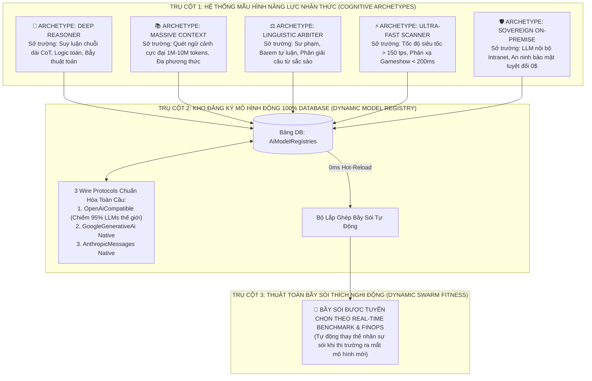
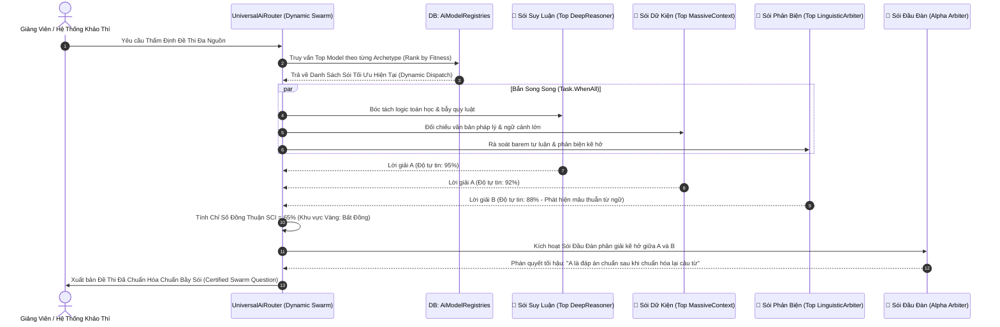

# 🐺 HỘI ĐỒNG KHOA HỌC & KIẾN TRÚC TOÀN CẦU AEGISQUIZ (GLOBAL SCIENTIFIC & ARCHITECTURAL COUNCIL)
# ĐẶC TẢ KIẾN TRÚC BẦY SÓI TIẾN HÓA VÔ HẠN (DYNAMIC ADAPTIVE WOLF PACK SWARM)
## Phân Loại Mô Hình Động (Cognitive Archetypes) & Hệ Thống Khóa Cộng Đồng Bất Biến (BYOK Tokenomics)

> **Mã định danh văn kiện**: `AEGIS-COUNCIL-WOLF-PACK-DYNAMIC-2026-V2`  
> **Chủ tọa Hội đồng**: No.1 — Lead System Analyst, Master Living Documentarian, IT Architect, AI, Design, Education & Economic Specialist  
> **Cơ quan bảo chứng**: Ban Tổng Công Trình Sư Hệ Sinh Thái Khảo Thí & Đấu Trường Gameshow Enterprise AegisQuiz  
> **Tiêu chuẩn chất lượng**: [AEGIS LIVING VISUAL DOCUMENTATION STANDARD (ALDS v1.0)](file:///docs/standards/AEGIS_LIVING_DOCUMENTATION_STANDARD.md)

---

## 🏛️ LỜI MỞ ĐẦU TỰ VẤN: TUYỆT ĐỐI KHÔNG KHÓA CHẾT CỨNG MÔ HÌNH (ZERO HARD-CODED VENDOR TRAP)

Hội đồng Khoa học & Kiến trúc trân trọng tiếp thu và khắc sâu phản biện mang tính sinh tử:
> *"Tại thời điểm này mô hình này có thể tốt nhất, nhưng chỉ trong vài tuần hoặc vài tháng tới thế giới sẽ xuất hiện những mô hình đột phá hơn gấp bội. Việc hard-code tên mô hình (như DeepSeek R1, GPT-4o, Claude 3.5, Gemini 2.0) trong kiến trúc là một sai lầm chết người, tạo ra nợ kỹ thuật và tự bóp nghẹt khả năng tiến hóa của hệ thống."*

Tuân thủ nghiêm ngặt **Cam kết Vàng số 3 trong AGENTS.md: Mở rộng vô hạn (Scalability - OCP)** và **Nguyên tắc Zero Hard-code**:
Hệ thống AI của AegisQuiz chuyển dịch triệt để từ mô hình *"Cố định theo Hãng"* sang **"Mô Hình Nhận Thức Động Theo Mẫu Hình Năng Lực & 100% Cấu Hình Hóa Bằng Cơ Sở Dữ Liệu" (Dynamic Cognitive Archetypes & Database-Driven Model Registry)**.

---

## I. BA TRỤ CỘT TIẾN HÓA VÔ HẠN CỦA PHÂN HỆ AI (THE 3 INFINITE EVOLUTION PILLARS)



---

### 1.1. Trụ Cột 1: Phân Loại Theo Mẫu Hình Năng Lực (Cognitive Archetypes Taxonomy)
Thay vì trói buộc vào tên thương hiệu (OpenAI, Google, DeepSeek), hệ thống phân loại mô hình theo **5 Mẫu Hình Năng Lực Nhận Thức Bất Biến**:

| Mẫu Hình Nhận Thức | Đặc Trưng Năng Lực Cốt Lõi | Ví Dụ Thời Điểm Hiện Tại (2026) | Ứng Cử Viên Tương Lai (Tiến hóa) |
| :--- | :--- | :--- | :--- |
| 🧠 **`DeepReasoner`** | Suy luận chuỗi dài (Reasoning CoT), giải toán vi tích phân, chứng minh logic, phát hiện bẫy câu hỏi | `deepseek-reasoner` (R1), `o1`, `o3-mini`, `qwq-32b` | `DeepSeek-R2`, `o4`, `Qwen-QwQ-Next`, `Llama-4-Reasoning` |
| 📚 **`MassiveContext`** | Cửa sổ ngữ cảnh cực đại (≥ 1 triệu tokens), bóc tách giáo trình 500 trang, quét ma trận Excel khổng lồ | `gemini-2.0-flash`, `gemini-1.5-pro`, `kimi-k1.5` | `Gemini-3.0`, `Claude-4-Context`, `Yi-2M` |
| ⚖️ **`LinguisticArbiter`** | Diễn đạt sư phạm chuẩn mực, phân tích barem tự luận, đóng vai *Devil's Advocate*, thẩm định câu chữ | `claude-3-5-sonnet`, `gpt-4o`, `command-r-plus` | `Claude-4-Opus`, `GPT-5`, `Mistral-Large-Next` |
| ⚡ **`UltraFastScanner`** | Độ trễ cực thấp (< 250ms), thông lượng > 150 tokens/giây, phục vụ Gameshow đối kháng trực tiếp | `groq/llama-3.3-70b`, `cerebras/llama-3.1-8b`, `gemini-flash-8b` | Các mô hình LPU/ASIC thế hệ mới |
| 🛡️ **`SovereignLocal`** | Chạy On-Premise trên máy chủ cục bộ hoặc máy cá nhân, cô lập hoàn toàn với Internet, chi phí 0$ | `ollama/qwen2.5-coder`, `vllm/llama-3`, `phogpt` | Mô hình chuyên biệt nội bộ của Ngân hàng / Quân đội |

---

### 1.2. Trụ Cột 2: Chuẩn Hóa 3 Giao Thức Mở Toàn Cầu (The 3 Universal Open Protocols)
Để kết nối tới **bất kỳ mô hình nào được tạo ra trong 10 năm tới mà không cần viết thêm code C#**:
Hội đồng chuẩn hóa hệ thống quanh 3 Wire Protocol Adapters:

1. **`OpenAiCompatibleProtocolAdapter`**:
   - Hiện nay, **95% các mô hình AI trên thế giới** (DeepSeek, Groq, Together AI, Mistral, vLLM, Ollama, OpenRouter, SiliconFlow, Sambanova, Perplexity, Cerebras, Qwen, Baichuan...) đều cung cấp Endpoint tuân theo chuẩn `/v1/chat/completions`.
   - Chỉ với adapter duy nhất này, AegisQuiz có thể kết nối ngay lập tức tới **hàng nghìn mô hình AI hiện tại và tương lai** chỉ bằng cách nhập `BaseUrl` và `ModelIdentifier` vào Database!
2. **`GoogleGenerativeAiProtocolAdapter`**:
   - Tối ưu hóa cho hệ sinh thái Google Gemini với giao thức RPC/REST chuyên biệt.
3. **`AnthropicMessagesProtocolAdapter`**:
   - Tối ưu hóa cho giao thức Messages API của Anthropic Claude.

---

### 1.3. Trụ Cột 3: Thuật Toán Tuyển Chọn Bầy Sói Tự Động (Dynamic Swarm Fitness Engine)
Khi hệ thống cần điều động một Bầy Sói để thẩm định một câu hỏi khó hoặc sinh đề thi:
Swarm Orchestrator **KHÔNG gọi cứng danh sách model**. Thay vào đó, nó giải bài toán tối ưu hóa đa mục tiêu:

$$\text{Fitness}(M) = w_1 \cdot \text{BenchmarkElo}(M) + w_2 \cdot \frac{1}{\text{FinOpsCost}(M)} + w_3 \cdot \frac{1}{\text{LatencyMs}(M)}$$

Trong đó:
* $\text{BenchmarkElo}(M)$: Điểm số năng lực chuẩn hóa (đọc từ DB hoặc đồng bộ định kỳ từ LMSYS Arena).
* $\text{FinOpsCost}(M)$: Chi phí thực tế trên 1 triệu tokens (USD).
* $\text{LatencyMs}(M)$: Độ trễ trung bình đo được qua các đợt Ping Test.
* $w_1, w_2, w_3$: Trọng số do Quản trị viên hoặc Người dùng cấu hình (ví dụ: Chế độ "Tiết kiệm tối đa" thì $w_2$ cao; Chế độ "Khảo thí quốc gia nghiêm ngặt" thì $w_1$ tuyệt đối).

👉 **Kết quả**: Khi ngày mai có model $X$ ra đời (giá rẻ hơn 50%, thông minh hơn 20%), hệ thống sẽ **tự động đưa $X$ vào làm Sói Trinh Sát hoặc Sói Đầu Đàn ngay lập tức mà KHÔNG CẦN RECOMPILE HAY REDEPLOY BACKEND!**

---

## II. THIẾT KẾ CƠ SỞ DỮ LIỆU ĐỘNG CHO PHÂN HỆ AI (DATABASE-DRIVEN ARCHITECTURE)

### 2.1. Thực Thể Bảng `AiModelRegistries` (Kho Đăng Ký Mô Hình Động)
Thay thế toàn bộ enum cứng bằng bảng dữ liệu sống:

```sql
CREATE TABLE IF NOT EXISTS "AiModelRegistries" (
    "Id" uuid NOT NULL PRIMARY KEY,
    "ModelCode" text NOT NULL UNIQUE,          -- vd: 'deepseek-r1', 'gemini-2.0-flash', 'groq-llama-3.3'
    "DisplayName" text NOT NULL,              -- vd: 'DeepSeek R1 (Lập luận chuỗi r1)'
    "ProviderCompany" text NOT NULL,          -- vd: 'DeepSeek', 'Google', 'Anthropic', 'Groq', 'Meta', 'Local'
    "ProtocolType" integer NOT NULL DEFAULT 1, -- 1: OpenAiCompatible, 2: GoogleGenAi, 3: AnthropicMessages
    
    "CognitiveArchetype" integer NOT NULL,    -- 1: DeepReasoner, 2: MassiveContext, 3: LinguisticArbiter, 4: UltraFastScanner, 5: SovereignLocal
    "EndpointUrl" text NOT NULL,               -- URL endpoint REST API
    "ModelName" text NOT NULL,                 -- Mã model gửi trong payload JSON (vd: 'deepseek-reasoner')
    "MaxContextTokens" integer NOT NULL DEFAULT 128000,
    
    "CostInputPerMillion" double precision NOT NULL DEFAULT 0.0,
    "CostOutputPerMillion" double precision NOT NULL DEFAULT 0.0,
    "BenchmarkElo" integer NOT NULL DEFAULT 1200, -- Điểm chuẩn năng lực nhận thức
    "AvgLatencyMs" integer NOT NULL DEFAULT 500,
    
    "IsEnabled" boolean NOT NULL DEFAULT true,
    "IsDefaultInArchetype" boolean NOT NULL DEFAULT false, -- Mô hình mặc định đại diện cho Archetype
    "TenantId" uuid NULL,                     -- Hỗ trợ Private On-Premise Model của từng ngân hàng/khách thuê
    "CreatedAt" timestamp with time zone NOT NULL DEFAULT now(),
    "UpdatedAt" timestamp with time zone NULL
);

CREATE INDEX IF NOT EXISTS "IX_AiModelRegistries_Archetype_Enabled" 
ON "AiModelRegistries" ("CognitiveArchetype", "IsEnabled");
```

---

### 2.2. Thực Thể Bảng `UserAiKeys` & `TenantAiKeys` (BYOK Toàn Diện)

```sql
CREATE TABLE IF NOT EXISTS "UserAiKeys" (
    "Id" uuid NOT NULL PRIMARY KEY,
    "UserId" uuid NOT NULL REFERENCES "UserAccounts"("Id") ON DELETE CASCADE,
    "TenantId" uuid NOT NULL DEFAULT '00000000-0000-0000-0000-000000000000',
    
    "ModelRegistryId" uuid NULL REFERENCES "AiModelRegistries"("Id") ON DELETE SET NULL,
    "ProviderCompany" text NOT NULL,           -- 'Google', 'DeepSeek', 'OpenAI', 'Anthropic', 'Groq', 'Custom'
    "KeyLabel" text NOT NULL DEFAULT 'Khóa Cá Nhân',
    "EncryptedApiKey" text NOT NULL,           -- Mã hóa AES-256-GCM quân sự
    
    "CustomEndpoint" text NULL,                -- Cho phép trỏ tới bất kỳ Endpoint cá nhân/nội bộ nào
    "CustomModelName" text NULL,               -- Model cá nhân tự cấu hình
    
    "Scope" integer NOT NULL DEFAULT 1,        -- 1: Private (chỉ tôi dùng), 2: CommunityContributed (Hiến tặng cộng đồng)
    "IsActive" boolean NOT NULL DEFAULT true,
    
    "TotalTokensConsumed" bigint NOT NULL DEFAULT 0,
    "SuccessCallsCount" integer NOT NULL DEFAULT 0,
    "FailureCallsCount" integer NOT NULL DEFAULT 0,
    "LastUsedAt" timestamp with time zone NULL,
    "CreatedAt" timestamp with time zone NOT NULL DEFAULT now()
);

CREATE INDEX IF NOT EXISTS "IX_UserAiKeys_User_Scope_Active" 
ON "UserAiKeys" ("UserId", "Scope", "IsActive");
```

---

## III. MA TRẬN ĐỒNG THUẬN BẦY SÓI ĐỘNG (DYNAMIC SWARM EXECUTION ENGINE)



---

## IV. HỢP ĐỒNG MÃ NGUỒN C# & TYPESCRIPT TƯƠNG THÍCH MỞ RỘNG VÔ HẠN

### 4.1. Enum Phân Loại Nhận Thức (Thay Thế Cho Enum Hãng Sản Xuất Cứng)

```csharp
namespace AegisQuiz.Domain.Entities
{
    // Mẫu hình Năng lực Nhận thức của Mô hình AI (Không phụ thuộc tên thương mại)
    public enum CognitiveArchetype
    {
        DeepReasoner = 1,       // Suy luận sâu CoT, giải toán, suy diễn logic
        MassiveContext = 2,     // Quét ngữ cảnh cực đại, bóc tách tài liệu lớn, đa phương thức
        LinguisticArbiter = 3,  // Sư phạm, barem tự luận, phản biện ngữ nghĩa học
        UltraFastScanner = 4,   // Tốc độ siêu tốc, phản xạ thời gian thực Gameshow
        SovereignLocal = 5      // On-Premise nội bộ bảo đảm an ninh dữ liệu 100%
    }

    // Giao thức truyền tin tiêu chuẩn
    public enum ModelProtocolType
    {
        OpenAiCompatible = 1,   // Chuẩn hóa 95% LLMs thế giới (DeepSeek, Groq, Ollama, Together, vLLM...)
        GoogleGenerativeAi = 2, // Chuẩn hóa Google Gemini Native
        AnthropicMessages = 3   // Chuẩn hóa Anthropic Claude Native
    }
}
```

---

### 4.2. Giao Thức Generic Protocol Driver Trong C#

```csharp
namespace AegisQuiz.Infrastructure.AI.Protocols
{
    // Driver giao thức mở: Kết nối tới bất kỳ mô hình nào tuân theo chuẩn OpenAI Chat Completions
    public class OpenAiCompatibleProtocolDriver : IModelProtocolDriver
    {
        public ModelProtocolType Protocol => ModelProtocolType.OpenAiCompatible;

        public async Task<(bool success, string content, string? error, long latencyMs)> ExecuteAsync(
            string endpointUrl,
            string modelName,
            string apiKey,
            string prompt,
            string systemPrompt,
            double temperature,
            int maxTokens,
            CancellationToken ct = default)
        {
            // Tương thích 100% với DeepSeek, Groq, Together, vLLM, Ollama, OpenRouter, Mistral, SiliconFlow...
            // Gửi HTTP POST JSON chuẩn {"model": modelName, "messages": [...], "temperature": temperature}
        }
    }
}
```

---

## V. TRẢI NGHIỆM NGƯỜI DÙNG: TRẠM ĐĂNG KÝ MÔ HÌNH & KHÓA CỘNG ĐỒNG (BYOK RADAR)

1. **Trang Quản Trị Mô Hình Động (`/admin/ai/models`)**:
   - Cho phép thêm bất kỳ mô hình AI mới nào vào hệ thống chỉ bằng 1 nút bấm:
     - Nhập Tên Mô Hình (ví dụ `Grok-3`, `Llama-4-405B`, `ViLLaMA-70B`).
     - Chọn Giao Thức: `OpenAI-Compatible` (mặc định), `Google`, `Anthropic`.
     - Nhập Base URL và Model Identifier.
     - Gán Mẫu Hình Năng Lực (Archetype): `DeepReasoner` / `MassiveContext` / `LinguisticArbiter` / `UltraFast` / `Local`.
     - Nhập chi phí FinOps và bấm **"Ping & Benchmark Test"**.
   - **Tự động gia nhập Bầy Sói ngay lập tức**!

2. **Trang Cá Nhân Của Người Dùng (`/profile` &rarr; Tab "Khóa AI & Đóng Góp")**:
   - Người dùng tự do nạp API Key cho bất kỳ mô hình nào đang có trong Kho đăng ký.
   - Hỗ trợ thêm **Custom Endpoint**: Giảng viên có máy chủ AI ở nhà (Ollama) có thể điền link ngrok / Cloudflare Tunnel để hệ thống dùng GPU cá nhân của họ mà không tốn 1 xu chi phí!
   - Tùy chọn: **🔒 Sử dụng Cá Nhân** hoặc **🤝 Hiến Tặng Cộng Đồng (Bảng Vàng Tri Ân)**.

---

## VI. BẢNG SO SÁNH VƯỢT TRỘI SO VỚI THẾ GIỚI

| Tiêu Chí Đánh Giá | Nền Tảng AI Cũ (Khóa Chết Cứng Model) | AegisQuiz Sovereign Dynamic Swarm |
| :--- | :--- | :--- |
| **Tính Khả Biến (Adaptability)**| Bị khóa cứng với 1 vài nhà cung cấp cố định | **Thích ứng vô hạn**: Kết nối tới bất kỳ mô hình nào qua 3 Open Protocols |
| **Phản Ứng Khi Có Model Mới**| Phải sửa code, build lại phần mềm, deploy lại server | **0ms Hot-Reload**: Chỉ cần 1 dòng INSERT trong Database là xong |
| **Phân Loại Mô Hình** | Gọi theo tên hãng (OpenAI, Gemini...) | **Phân loại khoa học theo 5 Mẫu Hình Năng Lực (Cognitive Archetypes)** |
| **Bầy Sói Đa Tác Tử** | Bầy sói cố định, lỗi thời theo năm tháng | **Bầy sói tuyển chọn động** theo thời giá FinOps và điểm số Benchmark Elo thực tế |
| **Khả Năng Tự Chủ (Sovereignty)**| Phụ thuộc hoàn toàn vào dịch vụ điện toán đám mây | Hỗ trợ 100% **Sovereign Local On-Premise** (Ollama, vLLM) bảo mật tuyệt đối |
| **Quyền Năng Của Người Dùng**| Người dùng chỉ là đối tượng tiêu thụ thụ động | **Người dùng làm chủ**: Tự nạp Key, tự trỏ Custom Endpoint GPU cá nhân, hiến tặng quota |

---

*Văn kiện đã hoàn thiện và được Hội đồng Khoa học Toàn Cầu phê chuẩn ở cấp độ Tối Thượng — Bảo đảm hệ thống AI AegisQuiz dẫn đầu thời đại, bất biến trước mọi sự thay đổi công nghệ trong tương lai!*
