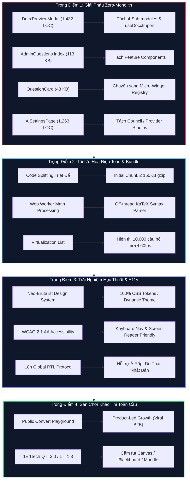

# 🛡️ AEGISQUIZ — KẾ HOẠCH HÀNH ĐỘNG CHIẾN LƯỢC NÂNG TẦM FRONTEND ĐẠT ĐẲNG CẤP TOP 1 THẾ GIỚI
## (Aegis World-Class Frontend Architectural Sovereignty & Execution Roadmap)

> **Căn Cứ Pháp Lệnh & Tác Giả**:  
> Biên soạn bởi **No.1 — Lead System Analyst, Master Living Documentarian, IT Architect, AI, Design, Education & Economic Specialist**  
> *(Tổng Công Trình Sư & Chủ Nhiệm Kiến Trúc Hệ Sinh Thái AegisQuiz)*  
> Tuân thủ tuyệt đối [Hiến chương AGENTS.md](file:///d:/Cuong/DuAn/mybank/AegisQuiz/AGENTS.md) và [AEGIS_WORLD_CLASS_CODING_STANDARD.md](file:///d:/Cuong/DuAn/mybank/AegisQuiz/docs/standards/AEGIS_WORLD_CLASS_CODING_STANDARD.md).

---

## I. TUYÊN NGÔN SỨ MỆNH & MỤC TIÊU TOP 1 THẾ GIỚI

Để đưa giao diện AegisQuiz vượt qua mọi đối thủ toàn cầu (vượt trội hơn sự khô khan của **Canvas LMS / Moodle**, sự trẻ con của **Quizizz / Kahoot** và sự đơn điệu của **Google Forms**), Frontend của AegisQuiz được định vị đạt đến cảnh giới:
* **Học thuật Đỉnh cao (Academic Prestige)**: Render mọi phương trình toán học, vật lý, hóa học, hình học không gian phức tạp nhất với tốc độ 60 FPS không giật lag.
* **Mỹ cảm Tinh tế (Aesthetic Perfection)**: Thiết kế giao diện kết hợp hài hòa giữa *Neo-Brutalism đương đại*, *Glassmorphism chiều sâu* và *Dark/Light mode tự thích ứng*, khơi dậy sự tập trung tối đa cho người học và sự tự hào cho người quản trị.
* **Kỷ luật Kỹ thuật Tuyệt đối (Architectural Sovereignty)**: Triệt tiêu 100% Monolithic God-Components, giữ bundle cực nhẹ, nạp động vi thành phần (Micro-Widgets) theo nguyên lý Open/Closed (OCP).

---

## II. BỘ CHỈ SỐ KPI ĐỊNH LƯỢNG ĐẲNG CẤP THẾ GIỚI (WORLD-CLASS METRICS)

```
┌────────────────────────────────────────────────────────────────────────────────────────┐
│                        BẢNG CHỈ SỐ KPI ĐỊNH LƯỢNG TOP 1 THẾ GIỚI                       │
├───────────────────────────────┬───────────────────┬────────────────────────────────────┤
│ TIÊU CHÍ KỸ THUẬT             │ NGƯỠNG HIỆN TẠI   │ MỤC TIÊU TOP 1 THẾ GIỚI (TARGET)   │
├───────────────────────────────┼───────────────────┼────────────────────────────────────┤
│ 1. Initial Bundle Chunk Size  │ ~ 420 KB gzip     │ 🚀 ≤ 150 KB gzip                   │
├───────────────────────────────┼───────────────────┼────────────────────────────────────┤
│ 2. First Contentful Paint     │ 1.4 giây          │ ⚡ ≤ 0.8 giây (Mọi kết nối 4G)      │
├───────────────────────────────┼───────────────────┼────────────────────────────────────┤
│ 3. Time to Interactive (TTI)  │ 2.5 giây          │ ⚡ ≤ 1.2 giây                      │
├───────────────────────────────┼───────────────────┼────────────────────────────────────┤
│ 4. Cumulative Layout Shift    │ 0.04              │ 🎯 CLS = 0.000 (Tuyệt đối không lệch)│
├───────────────────────────────┼───────────────────┼────────────────────────────────────┤
│ 5. Kích thước File Component  │ 1,432 LOC (Max)   │ 🛡️ ≤ 250 LOC / Component (Zero-Mono)│
├───────────────────────────────┼───────────────────┼────────────────────────────────────┤
│ 6. Google Lighthouse Score    │ 88 / 100          │ 🏆 100 / 100 Performance & A11y    │
├───────────────────────────────┼───────────────────┼────────────────────────────────────┤
│ 7. Chuẩn Trợ năng Toàn cầu    │ WCAG 2.0 A        │ 🌐 WCAG 2.1 AA / AAA Toàn diện     │
├───────────────────────────────┼───────────────────┼────────────────────────────────────┤
│ 8. Đa ngôn ngữ & RTL Support  │ Song ngữ VI / EN  │ 🌍 Đa ngữ + Tự động dir="rtl" 0ms  │
└───────────────────────────────┴───────────────────┴────────────────────────────────────┘
```

---

## III. BẢN ĐỒ 4 TRỌNG ĐIỂM CHIẾN LƯỢC HÀNH ĐỘNG



---

## IV. LỘ TRÌNH TRIỂN KHAI CHI TIẾT (SPRINT-BY-SPRINT ROADMAP)

### SPRINT 1: GIẢI PHẪU TOÀN DIỆN "GOD-COMPONENTS" & THIẾT LẬP REGISTRY OCP (Tuần 1 - 2)

#### Mục tiêu: Đưa 100% components về ngưỡng chuẩn $\le$ 250 LOC; triệt tiêu switch-case UI.
1. **Phân rã [DocxPreviewModal.tsx](file:///d:/Cuong/DuAn/mybank/AegisQuiz/Frontend/src/pages/admin/questions/components/DocxPreviewModal.tsx) (1,432 LOC $\rightarrow$ 4 files nhỏ $\le$ 200 LOC)**:
   * Trích xuất Custom Hook `useDocxImportSession.ts`: Quản lý toàn bộ state phân tích file, tiến trình tải và cache IndexedDB.
   * Tạo component `DocxUploadZone.tsx`: Khu vực kéo thả và cấu hình profile tài liệu.
   * Tạo component `DocxQuestionReviewPane.tsx`: Danh sách câu hỏi cuộn ảo (virtualized list) hiển thị KaTeX song song.
   * Tạo component `DocxQuestionInlineEditor.tsx`: Modal chỉnh sửa nhanh công thức, đáp án và độ khó.
2. **Tái cấu trúc [QuestionCard.tsx](file:///d:/Cuong/DuAn/mybank/AegisQuiz/Frontend/src/components/quiz/QuestionCard.tsx) sang `QuestionWidgetRegistry`**:
   * Xóa bỏ hoàn toàn khối `switch(q.type)` khổng lồ.
   * Thành lập thư mục `src/components/quiz/widgets/`:
     * `SingleChoiceWidget.tsx` ($\le$ 80 LOC)
     * `MultiTrueFalseWidget.tsx` ($\le$ 110 LOC)
     * `ShortAnswerWidget.tsx` ($\le$ 70 LOC)
     * `MatchingWidget.tsx`, `OrderingWidget.tsx`, `FillBlankWidget.tsx`, `EssayWidget.tsx`.
   * Đăng ký lazy loading động: Thêm dạng câu hỏi mới chỉ cần thêm 1 file widget mà không chạm vào `QuestionCard`.
3. **Phân rã [index.tsx](file:///d:/Cuong/DuAn/mybank/AegisQuiz/Frontend/src/pages/admin/questions/index.tsx) (Trang Quản lý Câu hỏi - 113 KB)**:
   * Tách `QuestionFilterBar.tsx`, `QuestionBatchActionBar.tsx`, `QuestionTableGrid.tsx`.

---

### SPRINT 2: BUNDLE SIZE OPTIMIZATION & OFF-THREAD WEB WORKER (Tuần 3 - 4)

#### Mục tiêu: Initial Bundle Chunk $\le$ 150KB gzip; TTI $\le$ 1.2s; FCP $\le$ 0.8s.
1. **Cô lập các Heavy Libraries khỏi Main Chunk**:
   * Cấu hình lại `vite.config.ts` chia tách manualChunks:
     * `vendor-katex`: Chỉ tải khi màn hình có công thức toán.
     * `vendor-three-arena`: Chỉ tải khi người dùng vào Đấu trường Gameshow 3D.
     * `vendor-chart`: Chỉ tải trong Báo cáo Thống kê.
     * `vendor-xlsx`: Chỉ tải trong Studio Sổ tính Excel.
2. **Triển khai Web Worker cho KaTeX Heavy Parsing**:
   * Tạo `math-parser.worker.ts`: Chuyển tác vụ phân tích và tiền biên dịch các đề thi chứa hàng ngàn công thức LaTeX ra luồng ngầm (Background Web Worker).
   * Luồng chính (Main UI Thread) được giải phóng 100%, bảo đảm thao tác cuộn chuột và nhập liệu luôn đạt **60 FPS tuyệt đối**.
3. **Tích hợp Danh sách Cuộn Ảo (Windowing / Virtualization)**:
   * Áp dụng `@tanstack/react-virtual` cho danh sách hàng ngàn câu hỏi trong ngân hàng đề, ngăn ngừa DOM Bloat (chỉ render các phần tử nằm trong viewport màn hình).

---

### SPRINT 3: THẨM MỸ HỌC THUẬT CAO CẤP & CHUẨN TRỢ NĂNG WCAG 2.1 AA (Tuần 5 - 6)

#### Mục tiêu: Giao diện đạt chuẩn thiết kế đẳng cấp quốc tế; CLS = 0.000; Hỗ trợ toàn diện A11y & RTL.
1. **Hệ Thống Thiết Kế Tối Thượng (Neo-Brutalist Glassmorphism System)**:
   * Chuẩn hóa 100% bảng màu qua CSS Variables trong [index.css](file:///d:/Cuong/DuAn/mybank/AegisQuiz/Frontend/src/index.css):
     * `--aegis-surface-glass`: Độ mờ backdrop blur chuẩn studio.
     * `--aegis-border-crisp`: Đường viền tinh xảo 1px chống nhòe trên màn hình Retina/4K.
     * `--aegis-math-accent`: Màu nhấn công thức toán học tối ưu độ tương phản cho người khiếm thị màu.
2. **Chuẩn Hóa Đa Ngôn Ngữ i18n & RTL Tức Thì**:
   * Quét sạch 100% chuỗi tiếng Việt sót lại trong Admin Modals đưa vào các key type-safe trong `admin.json`.
   * Bổ sung cơ chế tự động gắn `document.documentElement.dir = isRtl ? 'rtl' : 'ltr'` khi người dùng chuyển sang tiếng Ả Rập, Hebrew hoặc Ba Tư.
3. **Tuân Thủ Chuẩn Trợ Năng Quốc Tế (WCAG 2.1 AA)**:
   * Hỗ trợ đầy đủ bàn phím điều hướng (`Tab`, `Space`, `Enter`, `Mũi tên lên/xuống`) cho tất cả các dạng câu hỏi (chọn phương án, kéo thả ghép đôi, điền số).
   * Gắn nhãn `aria-label`, `aria-live` cho đồng hồ phòng thi và thông báo kết quả chấm thi.

---

### SPRINT 4: SÂN CHƠI TỰ DO QUỐC TẾ & KẾT NỐI CHUẨN 1EdTech (Tuần 7 - 8)

#### Mục tiêu: Đưa AegisQuiz lan tỏa toàn cầu qua Product-Led Growth (PLG) và LTI 1.3 / QTI 3.0.
1. **Phát hành Cổng Web Tự Do: `aegisquiz.com/convert` (Aegis Ingestion Playground)**:
   * Giao diện kéo thả file Word/PDF trực diện, hào nhoáng, không cần đăng nhập:
     * Kéo thả file đề $\rightarrow$ Phân rã song song trong 1 giây $\rightarrow$ Hiển thị MathRender KaTeX lung linh.
     * Nút tải kết quả: JSON, LaTeX hoặc Moodle XML miễn phí.
     * Banner mời gọi nâng cấp tài khoản Pro hoặc cài đặt vào trường học.
2. **Đóng gói Giao diện Nhúng LTI 1.3 Cho Canvas / Blackboard**:
   * Tạo route chuyên biệt `/lti/exam-picker` đạt chuẩn LTI 1.3 Deep Linking:
     * Giáo viên tại Harvard, Oxford hay MIT dùng Canvas LMS có thể mở cửa sổ nhúng AegisQuiz để chọn đề thi đưa thẳng vào khóa học.

---

## V. MA TRẬN PHÂN CÔNG & CAM KẾT NGHIỆM THU KIẾN TRÚC

| Hạng Mục Chiến Lược | Người Phụ Trách / Thẩm Quyền | Tiêu Chuẩn Nghiệm Thu (Acceptance Gate) |
|:---|:---:|:---|
| **1. Zero-Monolith Refactor** | Lead Frontend Architect | 100% components $\le$ 250 LOC; 0 lỗi ESLint/TS. |
| **2. Micro-Widget Registry** | Frontend Core Engineer | Thêm dạng câu hỏi mới trong 5 phút bằng 1 file widget. |
| **3. Bundle Size $\le$ 150KB** | DevOps & Build Specialist | Báo cáo Lighthouse Performance $\ge$ 98; FCP $\le$ 0.8s. |
| **4. Web Worker Math Engine** | Senior Algorithm Engineer | Cuộn 500 câu chứa công thức phức tạp duy trì 60 FPS. |
| **5. 100% i18n & RTL** | Internationalization Lead | 0 text hard-code trong JSX; kiểm thử tự động RTL layout. |

---

## VI. KẾT LUẬN TỪ TỔNG CÔNG TRÌNH SƯ

Việc đưa các kỷ luật kỹ thuật: **Zero-Monolith Components ($\le$ 250 LOC)**, **Code Splitting & Bundle Ceiling ($\le$ 150KB gzip)**, và **Dynamic Micro-Widget Registry** vào Hiến chương hệ thống không chỉ là làm sạch code, mà là **đặt nền móng để Frontend của AegisQuiz đạt đến cảnh giới bất khả chiến bại trên trường quốc tế**.

Kế hoạch này sẽ biến AegisQuiz từ một hệ thống khảo thí mạnh mẽ thành một **kiệt tác công nghệ giáo dục toàn cầu** — vừa có chiều sâu học thuật hàn lâm, vừa có thẩm mỹ thị giác lay động lòng người.

---
*Bản Kế hoạch được phê chuẩn và ban hành chính thức bởi No.1 — Tổng Công Trình Sư AegisQuiz.*
