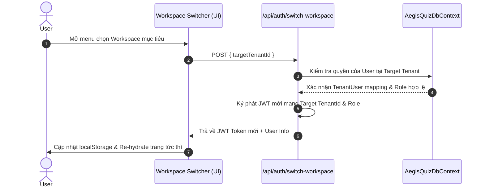

# KIẾN TRÚC KHÔNG GIAN KÉP NHẬN THỨC & CHỦ QUYỀN TÀI NGUYÊN
## COGNITIVE DUAL-SPACE ARCHITECTURE (CDSA) & RESOURCE SOVEREIGNTY SPECIFICATION

> **Tài liệu đặc tả kiến trúc cấp Doanh nghiệp (Enterprise Architectural Specification)**  
> **Hệ thống:** AegisQuiz Enterprise AI Quiz & Proctoring Platform  
> **Phiên bản:** 2.5.0-Enterprise  
> **Trạng thái:** Đã ban hành & Triển khai chính thức (Production Ready)  

---

### 1. TỔNG QUAN VÀ TƯ TƯỞNG THIẾT KẾ (DESIGN PHILOSOPHY)

Nền tảng AegisQuiz được định vị phục vụ hai phân khúc mục tiêu song hành nhưng có tính chất trái ngược:
1. **Tính Lan Tỏa Bùng Nổ (Viral Product-Led Growth - PLG):** Tiếp cận hàng triệu học viên, giảng viên tự do, chuyên gia giáo dục đăng nhập bằng Gmail/Google chỉ trong 1 chạm, không yêu cầu thiết lập rườm rà.
2. **Pháo Đài An Ninh Doanh Nghiệp (Enterprise Sovereign Fortress):** Phục vụ các tập đoàn, ngân hàng, trường đại học toàn cầu với yêu cầu cô lập dữ liệu 100%, tuân thủ GDPR/SOC2, bảo mật đa khách thuê (Multi-Tenancy) và phân quyền theo phạm vi cây tổ chức (Scoped RBAC).

**Kiến trúc Không Gian Kép Nhận Thức (Cognitive Dual-Space Architecture - CDSA)** là giải pháp giải quyết triệt để sự đánh đổi này mà không tạo lỗ hổng rò rỉ dữ liệu chéo tổ chức.

---

### 2. PHÂN GIẢI DANH TÍNH GOOGLE 4 TẦNG (4-TIER GOOGLE IDENTITY RESOLUTION)

Khi người dùng thực hiện **Đăng nhập bằng Google (Google OAuth2)**, hệ thống không bao giờ gán ép tài khoản vào một "Default Tenant" chung (tránh rủi ro rò rỉ ngân hàng đề thi nội bộ). Thay vào đó, bộ phân giải danh tính (Identity Resolver) thực thi tuần tự theo 4 tầng:

```mermaid
flowchart TD
    A[Google OAuth2 Callback / Token] --> B{Tầng 1: Đã được Pre-provisioned bởi Doanh nghiệp?}
    B -- Có --> B1[Gán vào Tenant Doanh nghiệp & Kích hoạt Role]
    B -- Không --> C{Tầng 2: Khớp Corporate Domain của Khách thuê?}
    C -- Có --> C1[Tự động tham gia Tenant Doanh nghiệp với Role Learner]
    C -- Không --> D{Tầng 3: Có Invitation Token hợp lệ?}
    D -- Có --> D1[Gia nhập Tenant mục tiêu theo Token ủy quyền]
    D -- Không --> E[Tầng 4: Tự sinh Personal Workspace độc lập]
    E --> E1[Khởi tạo Tenant cá nhân p_{slug}_{guid}, Plan Starter, ScaleType Individual]
```

#### Chi tiết 4 Tầng:
- **Tầng 1 - Pre-provisioned Identity:** Tài khoản đã được phòng nhân sự/quản trị viên doanh nghiệp lập danh sách trước (Pre-provisioned) trong Tenant. Hệ thống lập tức liên kết và trao quyền tương ứng.
- **Tầng 2 - Verified Corporate Domain:** Nếu email có đuôi domain doanh nghiệp đã được xác minh (ví dụ `@vietcombank.com.vn`, `@fpt.edu.vn`), hệ thống tự động đưa user vào Tenant của tổ chức đó với vai trò `Learner`.
- **Tầng 3 - Explicit Invitation Token:** Nếu user đăng nhập từ link mời khảo thí / tham gia khoá học có kèm mã lời mời cryptographically signed, hệ thống gắn kết user vào đúng Tenant bảo trợ.
- **Tầng 4 - Sovereign Personal Workspace:** Với mọi tài khoản Gmail cá nhân vãng lai (`@gmail.com`, `@outlook.com`...), hệ thống khởi tạo tức thì một Không gian Cá nhân độc lập (`ScaleType = Individual`, `Code = p_{email_name}_{short_guid}`). User trở thành Quản trị viên trong không gian của chính mình, tự do tạo câu hỏi, giáo trình AI mà tuyệt đối không thấy dữ liệu của các tổ chức khác.

---

### 3. CƠ CHẾ SYSADMIN CROSS-TENANT SUPPORT HUB

#### Vấn đề giải quyết:
`SystemAdmin` (Quản trị viên Hệ thống toàn cục) không thể hỗ trợ cấu hình cơ cấu tổ chức (Org Units), nhập ngân hàng câu hỏi hay gỡ lỗi cho một khách thuê nếu hệ thống ép lọc `TenantId` cứng nhắc hoặc giao diện không cung cấp bộ chuyển đổi ngữ cảnh.

#### Giải pháp Kiến trúc:
1. **Backend Privilege Boundary Guard:**
   - Tại `OrganizationUnitsController.cs`:
     ```csharp
     protected async Task<Guid> GetTenantIdAsync(Guid? requestedTenantId = null)
     {
         var role = User.FindFirst(ClaimTypes.Role)?.Value;
         if (role == AppRoles.SystemAdmin && requestedTenantId.HasValue && requestedTenantId.Value != Guid.Empty)
         {
             return requestedTenantId.Value; // SystemAdmin có quyền hỗ trợ bất kỳ Tenant nào
         }
         return await _tenantContext.GetCurrentTenantIdAsync(); // TenantAdmin bị khóa chặt trong Tenant của mình
     }
     ```
   - Chống tấn công IDOR: Nếu một `TenantAdmin` cố tình gửi `requestedTenantId` của tổ chức khác, hàm sẽ bỏ qua và chỉ trả về `TenantId` trong JWT của chính họ.
2. **Frontend Multi-Tenant Context Bar:**
   - Đối với `SystemAdmin`: Hiển thị thanh chọn Tenant (`<select>`) với danh sách tổ chức toàn hệ thống. Khi đổi tenant, toàn bộ cây OUs tự động tải theo tổ chức được chọn.
   - Đối với `TenantAdmin`: Hiển thị thanh định danh tổ chức kèm biểu tượng khóa (`Lock`), xác nhận phạm vi cô lập doanh nghiệp.
   - Khi mở modal tạo đơn vị mới, hệ thống hiển thị rõ tổ chức đích được hưởng thụ.

---

### 4. UNIVERSAL WORKSPACE SWITCHER PROTOCOL

Hệ thống cho phép một người dùng (ví dụ: giảng viên vừa dạy tại Đại học FPT, vừa cố vấn tại Viettel, vừa có không gian cá nhân) chuyển đổi qua lại giữa các không gian làm việc mà không cần đăng xuất:



---

### 5. MA TRẬN CHỦ QUYỀN TÀI NGUYÊN (RESOURCE SOVEREIGNTY MATRIX - RSM)

Mọi tài nguyên trong hệ thống (Câu hỏi, Bộ đề thi, Giáo trình AI Notebook, Thống kê IRT) được phân cấp chủ quyền theo 3 cấp độ:

| Cấp độ Tài nguyên | Phạm vi (Scope) | Thuộc tính sở hữu | Mô hình phân quyền & Bảo mật |
| :--- | :--- | :--- | :--- |
| **PERSONAL** | Cá nhân | `IsPersonal = true`, `TenantId = p_...`, `UserId = OwnerId` | Chỉ tác giả nhìn thấy và chỉnh sửa. Sử dụng hạn ngạch AI cá nhân. |
| **TENANT (Doanh nghiệp)** | Nội bộ Khách thuê | `IsPersonal = false`, `TenantId = org_guid`, `OrgUnitId = ou_guid` | Cô lập 100%. Quản lý qua Scoped RBAC (TenantAdmin, OrgUnitManager, TeamLeader). |
| **PUBLIC (Toàn cầu)** | Nền tảng mở | `IsPublic = true`, `TenantId = Guid.Empty` | Read-only cho cộng đồng, qua kiểm duyệt nội dung của SystemAdmin. |

#### Quy trình Thăng cấp Tài nguyên (Resource Promotion):
Người dùng từ không gian cá nhân có thể nộp đề xuất (Publishing Request) chuyển giao bộ câu hỏi hoặc giáo trình vào kho tri thức chung của Doanh nghiệp. Quản trị viên đơn vị (OrgUnitManager) phê duyệt trước khi tài sản được đưa vào ngân hàng nội bộ.

---

### 6. TÍNH NHẤT QUÁN & BẢO ĐẢM TRUY VẤN (QUERY INTEGRITY)

Tại tầng ORM (Entity Framework Core):
- Triển khai Bộ lọc truy vấn đa khách thuê toàn cục (`Global Query Filter`):
  ```csharp
  modelBuilder.Entity<OrganizationUnit>()
      .HasQueryFilter(x => IsTenantFilterBypassed || x.TenantId == CurrentTenantId);
  ```
- Cho phép `IsTenantFilterBypassed = true` độc quyền đối với các luồng vận hành nền tảng của `SystemAdmin` hoặc Worker nội bộ, đảm bảo không có rủi ro SQL Injection hay rò rỉ dữ liệu trong mọi trường hợp.
- Bộ kiểm thử tự động 187/187 test cases bảo đảm tính toàn vẹn 100% của kiến trúc.

---

### 7. ĐỒNG BỘ TOÀN DIỆN CHỦ ĐỀ & CÂU HỎI VỚI KIẾN TRÚC MỚI (TOPICS & QUESTIONS SYNCHRONIZATION)

#### 7.1. Lỗ hổng tiềm ẩn đã được khắc phục (Audit Findings & Remediation):
- **Hiện trạng trước đây:** `BankTopic` và `QuestionBase` đã có trường `TenantId` và Global Query Filter trong `AegisQuizDbContext`, **tuy nhiên** cả `TopicsController` và `QuestionsController` đều chưa được tiêm `ITenantContext`.
- **Hậu quả nghiêm trọng:** Khi người dùng tạo hoặc import câu hỏi/chủ đề từ file (Excel, Word DOCX, PDF, Smart URI), dữ liệu mặc định bị gán `TenantId = Guid.Empty` (`Scope = COMMUNITY`). Điều này gây ra **nguy cơ rò rỉ đề thi mật của doanh nghiệp thành câu hỏi công khai dùng chung toàn hệ thống**. Đồng thời, `SystemAdmin` không có cơ chế lọc câu hỏi theo từng khách thuê cụ thể.

#### 7.2. Giải pháp Đồng Bộ Hóa Đạt Chuẩn CDSA & RSM:
1. **Backend - Dependency Injection & Dynamic Privilege Resolution:**
   - Tiêm `ITenantContext? tenantContext = null` vào `TopicsController` và `QuestionsController` (tham số tùy chọn, bảo tồn 100% khả năng tương thích ngược cho unit tests).
   - Bổ sung helper `GetEffectiveTenantId(Guid? requestedTenantId = null)`:
     - Nếu user là `SystemAdmin` và gửi `requestedTenantId`: Áp dụng Tenant đích được chỉ định.
     - Nếu user là `TenantAdmin` hoặc `Learner`: Khóa cứng vào `CurrentTenantId` của phiên đăng nhập (bảo vệ chống IDOR).
     - Nếu không có Tenant hợp lệ: Gán `Guid.Empty` (`COMMUNITY`).
2. **Backend - Đồng bộ CRUD & Quy tắc Bản quyền:**
   - `GetTopics` & `GetQuestions`: Hỗ trợ lọc theo `tenantId` (dành cho SystemAdmin) và `scope` (`COMMUNITY`, `TENANT`, `PERSONAL`, `ALL`).
   - `CreateTopic` & `CreateQuestion`: Tự động đóng dấu `TenantId = effectiveTenantId` và `Scope = effectiveScope`. Chỉ `SystemAdmin` mới có quyền xuất bản với phạm vi `COMMUNITY`.
   - `UpdateTopic`, `DeleteTopic`, `UpdateQuestion`, `DeleteQuestion`: Kiểm tra quyền sở hữu Tenant trước khi cho phép sửa/xóa. Trả về `Forbid()` (403 Forbidden) nếu user cố tình thao tác lên tài nguyên ngoài Tenant của mình.
   - `ConfirmImportQuestionsDocx` & `ConfirmImportQuestionsExcel`:
     - Tự động gán `TenantId = effectiveTenantId` và `Scope = effectiveScope` cho toàn bộ câu hỏi được import, cho `QuestionContext` dùng chung, và cho các `BankTopic` được tự động sinh trên luồng import.
3. **Frontend - Multi-Tenant & Resource Sovereignty Context Bar:**
   - Tích hợp thanh điều hướng ngữ cảnh đa khách thuê trên giao diện Quản trị Ngân hàng câu hỏi (`AdminQuestionsPage`):
     - Đối với `SystemAdmin`: Hiển thị Dropdown chọn Khách thuê (`Toàn hệ thống` hoặc chọn đích danh Doanh nghiệp).
     - Đối với `TenantAdmin/User`: Hiển thị Thẻ định danh Tổ chức và Gói tài khoản bản quyền.
     - Bộ lọc Chủ quyền tài nguyên 4 nấc (`Tất cả`, `Cộng đồng / Mẫu`, `Doanh nghiệp`, `Cá nhân`).
   - Tự động truyền `tenantId` và `scope` vào `getQuestions` và `getTopics`.
   - Gắn `tenantId` vào payload lưu câu hỏi thủ công, lưu chủ đề và các tác vụ import batch từ Excel/Word.
4. **Kiểm thử & Xác minh Toàn diện:**
   - 100% Test Suite Backend: **187 / 187 passed (0 failures)**.
   - Frontend Build: `tsc -b && vite build` hoàn tất 0 lỗi.
   - Browser Subagent: Xác minh thực tế tại `http://localhost:3000/admin/questions`, các modal tạo chủ đề và tạo câu hỏi phản ánh chính xác ranh giới bản quyền của không gian làm việc hiện hành.

---

### 8. COMMUNITY-FIRST TENANCY & 4-TIER PROGRESSIVE IDENTITY RESOLUTION (v2.6+)

> 🚨 **Lỗ hổng kiến trúc đã khắc phục:** Mô hình cũ sinh `p_{slug}_{guid}` tenant riêng cho mỗi tài khoản cá nhân → Phân mảnh dữ liệu (Data Silos), SysAdmin mất khả năng quản trị tập trung, triệt tiêu Network Effects.

#### 8.1. Nguyên tắc Thiết kế

- **Một Định danh Toàn Cầu (Global Identity)**: `UserAccount.Id` là duy nhất, bất biến và toàn cục.
- **Nhiều Ngữ cảnh Làm Việc (Poly-Tenant Membership)**: Cùng 1 người có thể là `Learner` ở Community, `Instructor` ở NEU, `Auditor` ở Vietcombank.
- **Workspace Chủ quyền là Ngữ cảnh (Contextual Scope)**: `ActiveTenantId` trong JWT xác định Tenant đang làm việc; người dùng chuyển đổi 1-click qua `POST /api/auth/switch-workspace`.
- **Community Commons là Hub mặc định**: Mọi user cá nhân (@gmail.com, @yahoo.com...) đều hội tụ vào COMMUNITY TENANT `00000000-0000-0000-0000-000000000001`.

#### 8.2. Luồng 4-Tier Identity Resolution (Register & Google OAuth)

```
[Đăng ký / Đăng nhập]
         │
         ▼
Tier 1: Có Invite Token?  ─── YES ──► Tham gia Tenant được mời + Community
         │ NO
         ▼
Tier 2: Domain Email khớp Enterprise Whitelist?  ─── YES ──► Auto-join Enterprise Tenant + Community
         │ NO
         ▼
Tier 3: User chủ động tạo Workspace (POST /api/tenants/create)?  ─── YES ──► Tạo Dedicated Tenant
         │ NO
         ▼
Tier 4: Community Fallback ──► TenantId = 00000000-0000-0000-0000-000000000001 (Learner)
```

#### 8.3. Lợi ích Kiến trúc

| Tiêu chí | Mô hình cũ (`p_{slug}_{guid}`) | Mô hình mới (Community-First) |
|---|---|---|
| Network Effects | ❌ Data Silo – Bằng 0 | ✅ Kho tri thức chung hàng triệu câu hỏi |
| Quản trị SysAdmin | ❌ Phân mảnh, mù thông tin | ✅ Tập trung 100%, toàn cục |
| Hiệu năng Database | ❌ Hàng trăm ngàn Tenant rác | ✅ Tối ưu – chỉ sinh Tenant khi cần |
| UX người dùng cá nhân | ❌ Bị ép làm TenantAdmin | ✅ Vai trò đúng nghĩa: Learner/Educator |
| Bảo mật Enterprise | ⚠️ Nhập nhằng | ✅ Ranh giới tuyệt đối qua Tenant Isolation |
| Khả năng PLG / Viral | ❌ Không thể chia sẻ đề thi | ✅ Fork/Share/Rate giữa triệu người dùng |

#### 8.4. Các Thực Thể & Files Đã Triển Khai

| File | Thay đổi |
|---|---|
| `Domain/Entities/Tenant.cs` | Thêm `CommunityTenantId`, `CommunityTenantCode`, `IsCommunityHub` |
| `Domain/Entities/UserAccount.cs` | Thêm `ActiveTenantId`, nav `Memberships` |
| `Domain/Entities/QuestionBase.cs` | Thêm `IsPublic`, `CreatedBy` |
| `Domain/Entities/TenantMembership.cs` | **[NEW]** Bảng liên kết Người dùng – Tenant |
| `Infrastructure/Data/AegisQuizDbContext.cs` | DbSet `TenantMemberships`, Fluent API, QueryFilter Community |
| `Infrastructure/Services/TenantMiddleware.cs` | Đọc `active_tenant_id`, fallback về CommunityTenantId |
| `API/Controllers/AuthController.cs` | Register: 4-Tier Resolution; JWT: claim `active_tenant_id`, `is_community` |

#### 8.5. JWT Claims Schema (v2.6+)

```json
{
  "sub": "<UserId>",
  "email": "user@example.com",
  "role": "Learner",
  "tenant_id": "00000000-0000-0000-0000-000000000001",
  "active_tenant_id": "00000000-0000-0000-0000-000000000001",
  "is_community": "true",
  "isPremium": "false",
  "subscriptionTier": "FREE"
}
```

> **Workspace Switcher**: Khi user chuyển sang Enterprise Tenant, gọi `POST /api/auth/switch-workspace` → Hệ thống cấp JWT mới với `active_tenant_id = <Enterprise Tenant Id>`, `is_community = false`.

