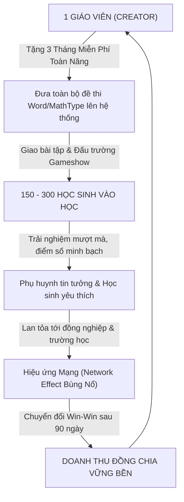
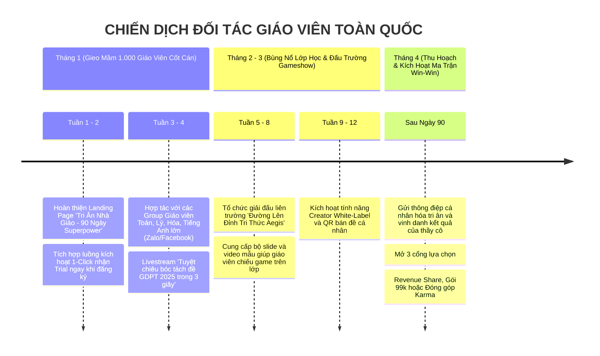

# 👨‍🏫 CHIẾN LƯỢC ĐỐI TÁC GIÁO VIÊN (CREATOR FLYWHEEL) & MÔ HÌNH HỢP TÁC KINH TẾ WIN-WIN
## The Educator-Led Growth (ELG) & Creator Economy Strategy for AegisQuiz

> **Chủ nhiệm Chiến lược:** No.1 — Lead System Analyst, Master Living Documentarian, IT Architect, AI, Design, Education & Economic Specialist  
> *(Tổng Công Trình Sư & Chủ Nhiệm Kiến Trúc Hệ Sinh Thái AegisQuiz)*  
> **Phiên bản:** v1.0 — Global Enterprise Standard  
> **Ngày phê duyệt:** 2026-10-12  
> **Tiêu chuẩn tài liệu:** Tuân thủ 100% [ALDS v1.0](file:///d:/Cuong/DuAn/mybank/AegisQuiz/docs/standards/AEGIS_LIVING_DOCUMENTATION_STANDARD.md)

---

## I. TỔNG QUAN CHIẾN LƯỢC: GIÁO VIÊN — TRỌNG TÂM CỦA BÁNH ĐÀ TĂNG TRƯỞNG (THE CREATOR FLYWHEEL)

Trong thị trường EdTech toàn cầu, việc chi tiền quảng cáo Facebook/Google (Paid Ads) để tiếp cận từng học sinh hay phụ huynh là chiến lược **đốt tiền kém hiệu quả và chi phí thu hút khách hàng (CAC) cực kỳ đắt đỏ**.

Ngược lại, **Giáo viên chính là Nút Mạng Quyền Lực Nhất (The Ultimate Super-Node)**:
* Một người thầy/cô giáo dạy trung bình **3 đến 5 lớp** $\rightarrow$ Quản lý trực tiếp **150 đến 300 học sinh**.
* Lời khuyên của giáo viên có **trọng lượng tuyệt đối** với học sinh và phụ huynh. Khi giáo viên yêu cầu *"Cả lớp vào link này làm đề kiểm tra cuối tuần"*, **100% học sinh sẽ cài đặt ứng dụng và tham gia làm bài**.



---

## II. GIAI ĐOẠN 1: CHIẾN DỊCH "90 NGÀY SIÊU QUYỀN NĂNG GIÁO VIÊN" (90-DAY ALL-ACCESS PASS)

### 1. Chính Sách Dùng Thử 3 Tháng Miễn Phí (Zero-Barrier Onboarding)
* **Đối tượng áp dụng:** Toàn bộ giáo viên K-12 (Tiểu học, THCS, THPT), giảng viên đại học, gia sư tự do và chuyên gia đào tạo doanh nghiệp.
* **Quyền lợi mở khóa 100% (Full Superpowers Unlocked):**
  1. ⚡ **Bóc tách đề thi Word/MathType không giới hạn**: Tự động chuyển đổi file .docx chứa công thức toán LaTeX, hình vector WMF, câu hỏi Đúng/Sai GDPT 2025 thành ngân hàng đề thi trong 3 giây.
  2. 🎮 **Đấu trường Gameshow Lớp học Realtime**: Tổ chức giải đấu Olympia, Rung Chuông Vàng, Chiếc Nón Kỳ Diệu trực tiếp trên máy chiếu lớp học với tốc độ chuông bấm sub-2ms.
  3. 🧠 **Trợ lý AI Soạn Đề & Sinh Lời Giải Chi Tiết**: AI tự động giải thích từng phương án đúng/sai chuẩn cấu trúc sư phạm.
  4. 📊 **Báo cáo Phân tích Năng lực Lớp học (Learning Analytics)**: Thống kê tức thì học sinh nào yếu phần kiến thức nào theo từng dạng câu hỏi.
  5. 🌐 **Trang Cổng Luyện Thi Riêng Biệt (Creator Micro-Portal)**: Giáo viên sở hữu đường dẫn định danh cá nhân (ví dụ: `thaycuongtoan.aegisquiz.com` hoặc `aegisquiz.com/c/thaycuong`).

### 2. Chiến Lược "Cắm Rễ Tri Thức & Khóa Chặt Chi Phí Chuyển Đổi" (Switching Cost Moat)
* Sau 3 tháng (90 ngày) sử dụng liên tục:
  * Giáo viên đã tích lũy **hàng ngàn câu hỏi quý báu** được cấu trúc hóa trên hệ thống.
  * Hàng trăm học sinh đã có **lịch sử điểm số, bảng xếp hạng và chuỗi ngày học tập (Streaks)**.
  * Thói quen giao bài và chấm thi đã ăn sâu vào quy trình làm việc hàng ngày của thầy cô.
  * **Chi phí chuyển đổi sang nền tảng khác trở nên vô cùng đắt đỏ và phi thực tế**.

---

## III. GIAI ĐOẠN 2: CHÍNH SÁCH HỢP TÁC KINH TẾ ĐỒNG LỢI NHUẬN (WIN-WIN ECONOMIC MATRIX)

Sau 90 ngày dùng thử, AegisQuiz tuyệt đối không dùng biện pháp "khóa sổ đòi tiền cưỡng bức" (Coercive Paywall), mà áp dụng **Ma Trận 3 Tùy Chọn Win-Win** linh hoạt:

```
                            ┌──────────────────────────────────────────────┐
                            │      MA TRẬN HỢP TÁC KINH TẾ WIN - WIN       │
                            └──────────────────────┬───────────────────────┘
                                                   │
         ┌─────────────────────────┼─────────────────────────┼─────────────────────────┐
         │                         │                         │                         │
         ▼                         ▼                         ▼                         ▼
 ┌───────────────┐         ┌───────────────┐         ┌───────────────┐         ┌───────────────┐
 │ CƠ CHẾ 1      │         │ CƠ CHẾ 2      │         │ CƠ CHẾ 3      │         │ CƠ CHẾ 4      │
 │ REVENUE SHARE │         │ ĐÓNG PHÍ      │         │ KARMA OFFSET  │         │ ĐẠI SỨ LAN TỎA│
 │ 80% GIÁO VIÊN │         │ HẠT DẺ (SAAS) │         │ MIỄN PHÍ TRỌN │         │ HOA HỒNG TRỌN │
 │ 20% NỀN TẢNG  │         │ 99.000đ/tháng │         │ ĐỜI CỘNG ĐỒNG │         │ ĐỜI 25%       │
 └───────────────┘         └───────────────┘         └───────────────┘         └───────────────┘
```

---

### Cơ Chế 1: Đồng Chia Doanh Thu Bán Đề & Khóa Học (Creator Revenue-Share: 80 / 20)
* **Ý tưởng cốt lõi**: Biến AegisQuiz thành cỗ máy kiếm tiền thụ động cho giáo viên giỏi.
* **Cách vận hành**:
  * Giáo viên đóng gói bộ đề luyện thi chất lượng cao (ví dụ: *"Bộ 30 Đề Thực Chiến THPT 2025 Môn Toán - Thầy Cường"*).
  * Giáo viên tự định giá (ví dụ: 199.000 VNĐ / gói bản quyền 1 năm).
  * Học sinh / Phụ huynh quét mã VietQR / Thẻ thanh toán trực tiếp trên trang cá nhân của thầy cô.
  * **Tỉ lệ phân chia Win-Win**:
    * **80% (159.200 VNĐ)** chuyển thẳng về tài khoản ngân hàng của Giáo viên.
    * **20% (39.800 VNĐ)** thuộc về AegisQuiz (chi trả hạ tầng máy chủ, AI GPU, lưu trữ và bảo trì).
* **Giá trị tạo ra**: Nếu một giáo viên có 300 học sinh mua gói $\rightarrow$ Giáo viên thu về **gần 48 triệu VNĐ/năm**, AegisQuiz thu về **12 triệu VNĐ/năm**. Cả hai bên đều chiến thắng (Win-Win).

---

### Cơ Chế 2: Thu Phí Phần Mềm Dịch Vụ Dành Cho Giáo Viên (Educator Pro SaaS)
* Dành cho giáo viên không muốn bán đề kinh doanh mà chỉ dùng AegisQuiz làm công cụ giảng dạy, chấm thi và quản lý lớp học.
* **Chính sách mức phí "Hạt dẻ" thân thiện với ngành giáo dục**:

| Gói Dịch Vụ | Mức Phí Dự Kiến | Tính Năng & Quyền Hạn |
|---|---|---|
| **Educator Free (Miễn Phí Cơ Bản)** | **0 VNĐ / Trọn đời** | • Giữ nguyên 100% dữ liệu đã tạo sau 3 tháng trial<br/>• Quản lý tối đa 2 lớp học (dưới 80 học sinh)<br/>• Bóc tách tối đa 3 đề thi Word/tháng |
| **Educator Pro (Giáo Viên Chuyên Nghiệp)** | **99.000 VNĐ / tháng**<br/>*(hoặc 890.000 VNĐ / năm)* | • Không giới hạn số lớp và số học sinh<br/>• Bóc tách Word/MathType & AI không giới hạn<br/>• Full 6 Gameshow Đấu trường Realtime<br/>• Không quảng cáo, báo cáo chuyên sâu |
| **School / Department License (Tổ Chuyên Môn / Trường)** | **4.900.000 VNĐ / năm / trường** | • Bản quyền cho toàn bộ giáo viên trong tổ bộ môn/nhà trường<br/>• Ngân hàng đề thi dùng chung phân quyền bảo mật<br/>• Hỗ trợ kỹ thuật 1-1 chuyên trách |

---

### Cơ Chế 3: Cơ Chế "Karma Contribution" — Đóng Góp Tri Thức = Dùng Miễn Phí Trọn Đời
* **Thấu hiểu tâm lý giáo viên Việt Nam & thế giới**: Nhiều thầy cô tâm huyết ở vùng sâu vùng xa hoặc giáo viên trường công không có ngân sách đóng phí hàng tháng.
* **Quy tắc Karma Offset**:
  * Mỗi khi giáo viên xuất bản **1 đề thi chuẩn hóa có lời giải chi tiết** vào kho tài nguyên chung (Community Commons) và đề thi đó nhận được từ 20 lượt học sinh làm bài đánh giá 5 sao:
  * Giáo viên được **tặng ngay 1 tháng sử dụng Educator Pro hoàn toàn miễn phí**!
* **Lợi ích kép (Dual Moat)**:
  * Giáo viên được dùng công cụ đỉnh cao mà không tốn một đồng.
  * AegisQuiz thu về **hàng triệu câu hỏi bản quyền chất lượng cao được kiểm chứng bởi giáo viên thật**, làm giàu ngân hàng tri thức toàn cầu.

---

### Cơ Chế 4: Chương Trình "Đại Sứ Giáo Dục" (Educator Affiliate Flywheel)
* Mỗi giáo viên tham gia hệ thống được cấp một **Mã Giới Thiệu (Referral Code / Link)** riêng biệt.
* Khi giáo viên giới thiệu đồng nghiệp khác trong trường hoặc trường bạn tham gia:
  * Đồng nghiệp được **tặng thêm 1 tháng dùng thử miễn phí** (thành 4 tháng).
  * Giáo viên giới thiệu được hưởng **hoa hồng định kỳ trọn đời 25%** trên mỗi khoản phí mà đồng nghiệp hoặc trường học đó chi trả cho AegisQuiz.
* Tạo động lực mạnh mẽ để các tổ trưởng chuyên môn, giáo viên cốt cán chủ động lan tỏa hệ thống trong toàn bộ hội đồng sư phạm nhà trường.

---

## IV. LỘ TRÌNH TRIỂN KHAI THỰC CHIẾN 3 BƯỚC (ACTIONABLE EXECUTION ROADMAP)



---

## V. CÁC ĐIỀU CHỈNH KỸ THUẬT CẦN THIẾT TRÊN HỆ THỐNG ĐỂ HỖ TRỢ CHIẾN LƯỢC

Để hỗ trợ hoàn hảo chiến lược trên, hệ thống cần bổ sung các mô đun kỹ thuật tương ứng:

1. **Backend Database Entity (`EducatorPartnership`)**:
   * Bổ sung trường `TrialExpiresAt` (mặc định = `CreatedAt + 90 days`).
   * Bổ sung `ReferralCode`, `ReferredByUserId`, `RevenueShareRate` (mặc định 0.8).
   * Bổ sung `KarmaPoints` để tự động gia hạn khi có đóng góp cộng đồng.
2. **Cổng Rút Tiền Tự Động (Creator Payout Gateway)**:
   * Tích hợp cấu hình tài khoản ngân hàng / VietQR để giáo viên nhận tiền tự động định kỳ vào ngày 05 và 20 hàng tháng.
3. **Frontend Dashboard Riêng Cho Giáo Viên (`/creator/dashboard`)**:
   * Thống kê trực quan: Số học sinh đang quản lý, số lượt làm bài, số tiền hoa hồng đã kiếm được, số ngày trial còn lại kèm nút *"Chia sẻ nhận thêm tháng miễn phí"*.

---

## VI. KẾT LUẬN & CAM KẾT SỨ MỆNH

Chiến lược tập trung vào Giáo viên như một **Đối Tác Chiến Lược Đồng Lợi Nhuận (Strategic Creator Partner)** chính là **"chìa khóa vạn năng"** giải quyết cùng lúc 3 bài toán khó nhất của một startup EdTech:
1. **Triệt tiêu chi phí quảng cáo (Zero CAC)** nhờ hiệu ứng mạng lưới từ lớp học.
2. **Khóa chặt tỷ lệ gắn kết (Obsessive Retention)** vì giáo viên không thể bỏ rơi ngân hàng đề thi đã dày công gây dựng.
3. **Tạo ra dòng tiền định kỳ bền vững (Sustainable Recurring Cashflow)** dựa trên tinh thần phụng sự và chia sẻ lợi ích công bằng (Win-Win).
