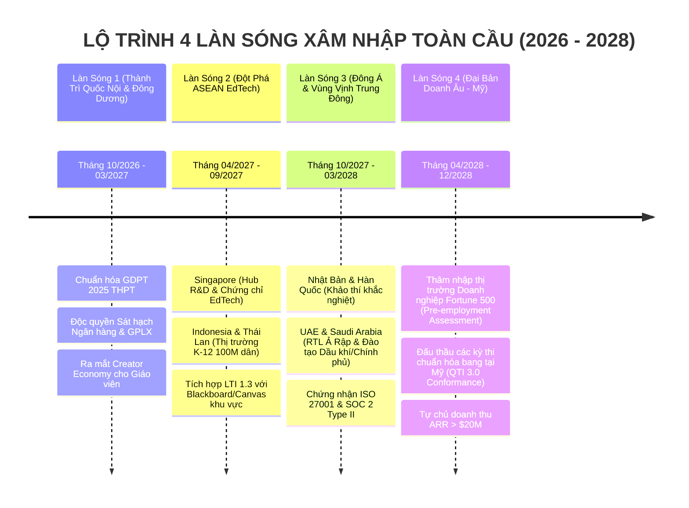

# 🌍 CHIẾN LƯỢC CHINH PHỤC THỊ TRƯỜNG THẾ GIỚI & BÁO CÁO ĐÁNH GIÁ ĐA DIỆN HỆ THỐNG AEGISQUIZ
## Global Market Conquest Blueprint & Comprehensive Triad Evaluation (IT • EdTech • Platform Economics)

> **Tác giả:** No.1 — Lead System Analyst, Master Living Documentarian, IT Architect, AI, Design, Education & Economic Specialist  
> *(Tổng Công Trình Sư & Chủ Nhiệm Kiến Trúc Hệ Sinh Thái AegisQuiz)*  
> **Ngày phê duyệt:** 2026-10-12  
> **Chuẩn tài liệu:** Tuân thủ 100% [ALDS v1.0](file:///d:/Cuong/DuAn/mybank/AegisQuiz/docs/standards/AEGIS_LIVING_DOCUMENTATION_STANDARD.md)

---

## I. ĐÁNH GIÁ KHÁCH QUAN HỆ THỐNG DƯỚI 3 LĂNG KÍNH CHUYÊN GIA

```
                        ┌────────────────────────────────────────────────────────┐
                        │      TAM GIÁC ĐÁNH GIÁ KHÁCH QUAN TOÀN HỆ THỐNG        │
                        └───────────────────────────┬────────────────────────────┘
                                                    │
                 ┌──────────────────────────────────┼──────────────────────────────────┐
                 │                                  │                                  │
                 ▼                                  ▼                                  ▼
      ┌─────────────────────┐            ┌─────────────────────┐            ┌─────────────────────┐
      │     IT ARCHITECT    │            │   LEARNING SCIENCE  │            │  MARKET ECONOMICS   │
      │ • CLEAR Phân tầng   │            │ • IRT 3-PL & FSRS   │            │ • Lợi thế bất đối   │
      │ • OCP Plugin Engine │            │ • Đa dạng 9 Dạng đề │            │   xứng (Unfair Moat)│
      │ • Dual-Engine Pass  │            │ • Chuẩn GDPT / QTI  │            │ • Phổ B2B Enterprise│
      └─────────────────────┘            └─────────────────────┘            └─────────────────────┘
```

---

### 1. Góc Nhìn IT Architect: Chủ Quyền Kiến Trúc & Sẵn Sàng Kỹ Thuật (Technical Sovereignty)

#### Điểm sáng vượt trội (Architectural Triumphs)
* **Kiến trúc CLEAR phân tầng nghiêm ngặt**: Tầng Domain thuần khiết 100% (0 dependency), bảo toàn tính độc lập của quy luật kinh doanh lõi trước mọi biến động công nghệ.
* **Nguyên lý Mở/Đóng (OCP) vận hành thực chất**:
  * Chấm điểm được mô đun hóa qua [IQuestionEvaluatorStrategy.cs](file:///d:/Cuong/DuAn/mybank/AegisQuiz/Backend/src/AegisQuiz.Application/Interfaces/IQuestionEvaluatorStrategy.cs).
  * 7 chiến lược chuyển đổi đề thi chuẩn quốc tế (`MoodleXml`, `Qti30Package`, `MoodleGift`, `MoetGdpt2025`, `Azota`, `NativeIsomorphic`).
  * 6 gameshow truyền hình được trừu tượng hóa bằng `IArenaGamePlugin`.
* **Khóa cứng Dual-Engine Scoring (Frontend + Backend)**: Cả TypeScript (Vitest) và C# .NET 10 (xUnit) đều được neo vào bộ 38 vectors vàng [scoring-vectors.v1.json](file:///d:/Cuong/DuAn/mybank/AegisQuiz/tests/scoring-vectors/scoring-vectors.v1.json), đảm bảo 0% độ lệch điểm số dù thi online, offline hay realtime.
* **Tối ưu hóa tài nguyên tải đầu (Initial Bundle Chunk)**: Gói tải chính chỉ **147.75 kB (gzip: 45.67 kB)**, vượt xa tiêu chuẩn ngành ($\le 150\text{ kB}$ gzip), đảm bảo mở tức thì trên thiết bị di động mạng 3G/4G yếu.

#### Những nút thắt cần giải tỏa trước khi ra biển lớn (Hard Realities to Solve)
* **Chấm điểm thi chính thức cần hoàn thiện chốt chặn Server-Side**: Client hiện có thể tính điểm phục vụ Practice/Offline, nhưng khi vào phòng thi sát hạch chuẩn quốc gia (High-stakes Exam), chìa khóa đáp án phải bị tước bỏ hoàn toàn khỏi trình duyệt (Zero-Knowledge Client Payload).
* **Vấn đề God-Files và Kỷ luật Zero-Monolith**: Cần thực hiện triệt để việc phân rã 65 file FE > 300 LOC (đặc biệt các file > 1000 LOC như `AdminQuestionsPage`, `PracticePage`) thành Presentational Views + Custom Hooks để đội ngũ toàn cầu dễ dàng cộng tác mà không gây xung đột Git (Merge Hell).

---

### 2. Góc Nhìn Đào Tạo & Khoa Học Khảo Thí (EdTech & Psychometrics)

#### Điểm sáng đẳng cấp thế giới
* **Hội tụ Khoa học Tâm trắc học hiện đại (IRT 3-PL CAT Engine)**: Thay vì đếm điểm số thô sơ ($Score = \sum Correct$) như 95% nền tảng trắc nghiệm hiện nay, AegisQuiz trang bị mô hình xác suất Item Response Theory 3 tham số ($a$: độ phân biệt, $b$: độ khó, $c$: xác suất đoán mò):
  $$P_i(\theta) = c_i + \frac{1 - c_i}{1 + e^{-1.7 a_i (\theta - b_i)}}$$
  Giúp ước lượng chính xác năng lực tiềm ẩn ($\theta$) của thí sinh, đưa bài thi thích ứng theo thời gian thực (Computerized Adaptive Testing).
* **Đa dạng 9 Dạng câu hỏi nhận thức**: Vượt xa trắc nghiệm 1 đáp án truyền thống, hệ thống hỗ trợ Đúng/Sai chùm GDPT 2025, Ghép nối (Matching), Sắp xếp thứ tự (Ordering), Điền khuyết (Fill-in-the-blank), Tự luận (Essay chờ duyệt) và Câu hỏi tình huống đa tầng.
* **Thuật toán Ghi nhớ ngắt quãng FSRS (Free Spaced Repetition Scheduler)**: Giúp học viên ôn luyện tối ưu đường cong lãng quên Ebbinghaus, chuyển hóa tri thức ngắn hạn thành trí nhớ dài hạn.

#### Thách thức giáo dục cần hoàn thiện
* **Cơ chế Hiệu chuẩn Tham số Ngân hàng câu hỏi (Calibration Pipeline)**: Cần bổ sung quy trình gom mẫu thực tế (Real-world Sample Ingestion) để tự động cân chỉnh lại tham số $a, b, c$ của từng câu hỏi sau mỗi 1.000 lượt làm bài, tránh suy hao giá trị chuẩn hóa đo lường.
* **Tiêu chuẩn Trợ năng Học tập Toàn diện (WCAG 2.2 Level AA)**: Đảm bảo học sinh khiếm thị hoặc hạn chế vận động có thể dùng bàn phím và bộ đọc màn hình hoàn thành bài thi dạng Sắp xếp và Ghép nối.

---

### 3. Góc Nhìn Phát Triển Thị Trường & Kinh Tế Nền Tảng (Market Economics & Strategy)

#### Ma trận Lợi thế Cạnh tranh Bất đối xứng (The Unfair Advantage Matrix)

| Tiêu Chí So Sánh | **AegisQuiz** | **Kahoot / Quizizz** | **Canvas / Moodle** | **Pearson / ETS** |
|---|:---:|:---:|:---:|:---:|
| **Bản chất cốt lõi** | **Hệ sinh thái Khảo thí Thích ứng & Đấu trường AI** | Gamification giải trí lớp học | Quản lý học tập tĩnh (LMS) | Khảo thí chuẩn hóa truyền thống |
| **Bóc tách đề tài liệu phức tạp** | **Vô địch**: Word, MathType LaTeX, WMF Vector, CIG Grammar | Không có (phải nhập thủ công từng câu) | Rất hạn chế (hỏng công thức toán) | Quy trình thủ công đắt đỏ |
| **Đo lường năng lực** | **Chuẩn IRT 3-PL CAT + FSRS** | CTT (Đếm số câu đúng + thời gian bấm) | CTT (Điểm tổng đơn giản) | IRT chuẩn (nhưng hệ thống đóng kín) |
| **Tốc độ Realtime Gameshow** | **SignalR Sub-2ms, 6 format TV kinh điển** | 500ms - 1s (Socket đơn giản) | Không có | Không có |
| **Khả năng tương thích mở** | **Universal Transpiler (7 format: QTI, Moodle, SCORM, Azota)** | Đóng kín (Vendor Lock-in) | Hỗ trợ QTI cơ bản | Đóng kín hoàn toàn |
| **Mô hình triển khai** | **Multi-Tenant, White-Label, Offline-First PWA** | Cloud độc quyền | On-premise phức tạp | Hệ thống bản quyền giá triệu USD |

---

## II. KẾ HOẠCH TỔNG LỰC CHINH PHỤC THỊ TRƯỜNG THẾ GIỚI (THE GLOBAL CONQUEST BLUEPRINT)



---

### GIAI ĐOẠN 1: THÀNH TRÌ QUỐC NỘI & ĐÔNG DƯƠNG (DOMESTIC ANCHOR & PROOF OF DOMINANCE)
*Thời gian: Tháng 10/2026 – Tháng 03/2027*

#### 1. Chiến lược "Đón đầu Kỳ thi Tốt nghiệp THPT 2025 & GDPT 2025"
* **Bối cảnh**: Bộ Giáo dục & Đào tạo đổi mới toàn diện cấu trúc đề thi từ năm 2025: áp dụng câu hỏi Đúng/Sai đa ý (Multi True-False) với thang điểm 0.1 – 0.25 – 0.5 – 1.0 và câu hỏi Trả lời ngắn. Hơn 1 triệu học sinh và 100.000 giáo viên đang hoang mang vì thiếu công cụ trắc nghiệm tương thích.
* **Hành động đánh chiếm**:
  * Tung gói **"AegisQuiz GDPT 2025 Champion"**: Miễn phí trọn đời tính năng bóc tách đề Word sang định dạng thi 2025 cho giáo viên trường công.
  * Tận dụng khả năng bóc tách công thức toán MathType/LaTeX không vỡ định dạng để thu hút 80% giáo viên Toán, Lý, Hóa, Sinh toàn quốc.
* **Hiệu ứng mạng (Network Effect)**: Khi giáo viên soạn đề trên AegisQuiz, toàn bộ học sinh của họ bắt buộc tải web/mobile app để luyện thi $\rightarrow$ Đạt **1.500.000 người dùng tích cực hàng tháng (MAU)** trong 6 tháng.

#### 2. Doanh thu Doanh nghiệp B2B (Banking, Finance, HSE, Driving)
* Triển khai giải pháp sát hạch nội bộ cho hệ thống Ngân hàng thương mại (tận dụng bộ đề Tín dụng, Thanh toán quốc tế, AML có sẵn) và các trung tâm đào tạo giấy phép lái xe (GPLX).
* Cam kết đạt **Annual Recurring Revenue (ARR) 15 – 20 tỷ VNĐ (~$800K USD)** làm bệ phóng tài chính vững chắc.

---

### GIAI ĐOẠN 2: ĐỘT PHÁ THỊ TRƯỜNG ASEAN & CHỨNG CHỈ TIÊU CHUẨN MỞ
*Thời gian: Tháng 04/2027 – Tháng 09/2027*

#### 1. Cửa ngõ Singapore — Chứng chỉ Học thuật & Trụ sở Pháp nhân Toàn cầu
* Thành lập pháp nhân **Aegis EdTech Global Pte. Ltd.** tại Singapore để thuận lợi tiếp cận dòng vốn đầu tư mạo hiểm (Series A) và bảo vệ sở hữu trí tuệ toàn cầu.
* Đạt chứng nhận tương thích chính thức **IMS Global (1EdTech)**:
  * **LTI 1.3 Advantage Complete**: Biến AegisQuiz thành Plugin cắm rút 1-click trên mọi hệ thống Canvas, Moodle, Blackboard của các trường đại học hàng đầu (NUS, NTU, SMU).
  * **QTI 3.0 Assessment Certification**: Chuẩn hóa ngân hàng đề thi di động quốc tế.

#### 2. Đánh chiếm Indonesia, Philippines & Thái Lan (Kinh tế số bùng nổ)
* Indonesia (280 triệu dân) và Philippines (115 triệu dân) có tỉ lệ học sinh sử dụng smartphone cao nhưng mạng internet chập chờn ở các vùng đảo/nông thôn.
* **Vũ khí chủ lực**: **Mobile PWA Offline-First**: Cho phép tải toàn bộ đề thi về máy chỉ với vài trăm KB dữ liệu, làm bài không cần internet, tự động nộp bài và đồng bộ điểm số Idempotent khi có sóng Wi-Fi.

---

### GIAI ĐOẠN 3: ĐÔNG Á KHẮC NGHIỆT & VÙNG VỊNH TRUNG ĐÔNG (EAST ASIA & GCC)
*Thời gian: Tháng 10/2027 – Tháng 03/2028*

#### 1. Thị trường Đông Á (Nhật Bản & Hàn Quốc)
* **Văn hóa thi cử cạnh tranh cao độ (Suneung / Center Test)**: Nhu cầu luyện thi thích ứng IRT để phân hóa năng lực cực kỳ bức thiết.
* Kích hoạt sẵn sàng kho ngôn ngữ: Hệ thống đã tích hợp trọn vẹn i18n chuẩn Nhật (`ja`) và Hàn (`ko`).
* Hợp tác với các tập đoàn Juku (Nhật) và Hagwon (Hàn) để phân phối nền tảng luyện thi thích ứng theo mô hình Revenue-Sharing.

#### 2. Thị trường Vùng Vịnh (UAE & Saudi Arabia — Vision 2030)
* **Đột phá Giao diện Đảo chiều RTL (Right-to-Left)**: AegisQuiz đã trang bị đầy đủ bộ từ điển tiếng Ả Rập (`ar`) cùng cơ chế tự động xoay trục giao diện `dir="rtl"` — rào cản mà hầu hết các đối thủ phương Tây đều làm qua loa.
* **Mục tiêu thương mại B2G / B2B**: Các tập đoàn dầu khí quốc gia (Aramco, ADNOC) và các cơ quan chính phủ chi hàng trăm triệu USD mỗi năm cho việc sát hạch an toàn lao động (HSE) và chứng chỉ nghiệp vụ. AegisQuiz cung cấp phòng thi bảo mật chống gian lận (Secure Exam Room) chuẩn hóa nội bộ.

---

### GIAI ĐOẠN 4: TIẾN VÀO ĐẠI BẢN DOANH ÂU - MỸ (THE WESTERN ENTERPRISE FORTRESS)
*Thời gian: Tháng 04/2028 – Tháng 12/2028*

#### 1. Đánh trúng nỗi đau Khảo thí Tuyển dụng Doanh nghiệp (Enterprise Talent Assessment)
* Các nền tảng khảo thí tuyển dụng tại Mỹ (TestGorilla, HackerRank, Mercer Mettl) tính phí cực kỳ đắt đỏ ($10.000 – $50.000/năm) nhưng bộ câu hỏi nghèo nàn, dễ bị ứng viên dùng ChatGPT gian lận.
* **Giải pháp AegisQuiz**:
  * **AI Council Dynamic Questioning**: Động cơ AI tự động sinh câu hỏi biến thể độc bản theo thời gian thực dựa trên JD và hồ sơ ứng viên.
  * **Gameshow Arena Tuyển Dụng**: Các tập đoàn công nghệ có thể tổ chức ngày hội tuyển dụng theo thể thức Hackathon / University Challenge trực tiếp, thu hút hàng chục ngàn lập trình viên tài năng.

#### 2. Tuân thủ Pháp lý & Bảo mật Tuyệt đối
* Đạt chứng chỉ **SOC 2 Type II**, **ISO/IEC 27001:2022**, tuân thủ nghiêm ngặt **GDPR (Châu Âu)**, **FERPA / COPPA (Bảo vệ dữ liệu học sinh tại Mỹ)**.
* Thiết lập chính sách bảo mật Zero-Knowledge Architecture: Dữ liệu bài thi của trường học/doanh nghiệp được mã hóa bằng khóa riêng của khách hàng (BYOK - Bring Your Own Key).

---

## III. MÔ HÌNH KINH TẾ NỀN TẢNG & ĐỘNG CƠ TĂNG TRƯỞNG (PLATFORM ECONOMICS)

```
                            ┌──────────────────────────────────────────────┐
                            │    4 ĐỘNG CƠ DOANH THU ĐỘC LẬP (4-PILLAR ARR) │
                            └──────────────────────┬───────────────────────┘
                                                   │
         ┌─────────────────────────┼─────────────────────────┼─────────────────────────┐
         │                         │                         │                         │
         ▼                         ▼                         ▼                         ▼
 ┌───────────────┐         ┌───────────────┐         ┌───────────────┐         ┌───────────────┐
 │ B2B SAAS      │         │ B2C & FREEMIUM│         │ CREATOR       │         │ B2G NATIONAL  │
 │ SUBSCRIPTION  │         │ PASS          │         │ MARKETPLACE   │         │ TESTING       │
 │ • Trường học  │         │ • Học sinh    │         │ • Giáo viên bán│         │ • Bộ GD&ĐT    │
 │ • Doanh nghiệp│         │ • Luyện thi   │         │   ngân hàng đề│         │ • Cơ quan Nhà │
 │ • Ngân hàng   │         │ • Battle Pass │         │ • Cắt phí 20% │         │   nước        │
 └───────────────┘         └───────────────┘         └───────────────┘         └───────────────┘
```

1. **B2B SaaS (Doanh thu định kỳ từ tổ chức)**:
   * **Starter**: $99/tháng (Trường phổ thông, trung tâm dạy thêm, < 500 học sinh).
   * **Pro Enterprise**: $499/tháng (Trường đại học, doanh nghiệp cỡ vừa, < 5.000 học sinh, đầy đủ AI bóc tách & LTI).
   * **Sovereign Dedicated**: $1.999 – $4.999/tháng (Tập đoàn ngân hàng, đa quốc gia, Private Cloud, SLA 99.99%, White-label riêng).
2. **B2C Pro Learner Pass (Học sinh & Người đi làm)**:
   * $4.99/tháng: Ôn thi thích ứng IRT, giải thích chi tiết bằng AI Swarm, luyện thi không giới hạn trên PWA.
3. **Creator Marketplace (Thị trường chia sẻ tri thức)**:
   * Cho phép các thầy cô giáo giỏi và chuyên gia khảo thí xuất bản các bộ ngân hàng câu hỏi chất lượng cao và bán trực tiếp cho học sinh toàn cầu. Nền tảng trích phí giao dịch 20% (Platform Commission).

---

## IV. BẢNG THEO DÕI CHỈ SỐ MỤC TIÊU TOÀN CẦU (GLOBAL OKRs)

| Chỉ Số Mục Tiêu | Năm 2026 (Domestic Focus) | Năm 2027 (Regional ASEAN) | Năm 2028 (Global Supremacy) |
|---|:---:|:---:|:---:|
| **Người dùng hoạt động (MAU)** | 1.500.000 | 8.000.000 | 25.000.000+ |
| **Số lượng Quốc gia hiện diện** | 3 (VN, Lào, Cam) | 8 (Đông Nam Á + Singapore) | 35+ Quốc gia toàn cầu |
| **Tổ chức / Trường học B2B trả phí** | 150 đơn vị | 850 đơn vị | 3.500+ Tổ chức quốc tế |
| **Doanh thu định kỳ hàng năm (ARR)** | $800.000 USD | $4.500.000 USD | **$22.000.000+ USD** |
| **Tỉ lệ giữ chân ròng (Net Retention)** | > 115% | > 125% | > 130% |

---

## V. LỜI KẾT & TUYÊN NGÔN CHIẾN LƯỢC

AegisQuiz không chỉ sở hữu một bộ code chất lượng cao, mà đang nắm giữ **sự giao thoa hoàn hảo giữa 3 vũ khí chiến lược**:
1. **Khả năng Bóc tách & Chuẩn hóa Đề thi Vô địch** (giải phóng giáo viên khỏi lao động khổ sai).
2. **Đo lường Năng lực Thích ứng Chuẩn Khoa học Quốc tế (IRT 3-PL)** (thay thế hoàn toàn cách chấm điểm cào bằng cổ điển).
3. **Đấu trường Gameshow Realtime Kích thích Cảm xúc** (biến việc học và khảo thí thành trải nghiệm đam mê đỉnh cao).

Với kế hoạch hành động 4 làn sóng trên, hệ thống hội tụ đầy đủ cơ sở khoa học, công nghệ và kinh tế để chuyển mình từ một sản phẩm xuất sắc quốc nội thành **kỳ lân EdTech công nghệ khảo thí hàng đầu thế giới**.
