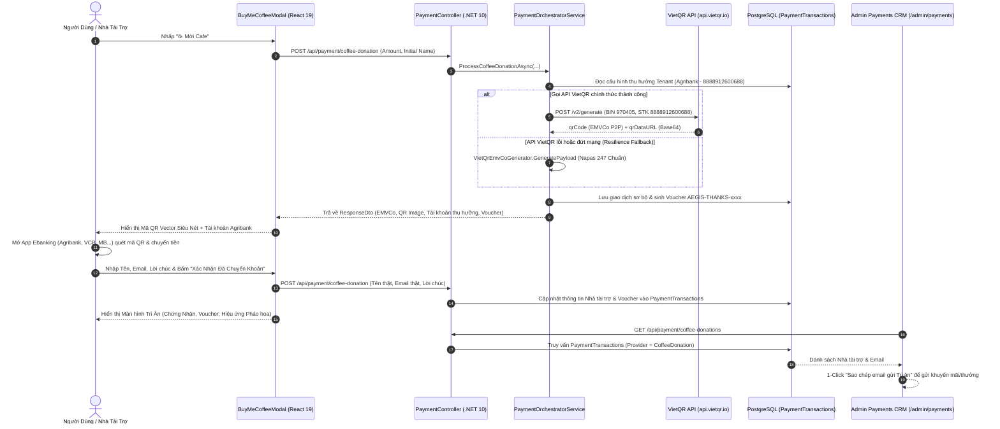

# 💳 GLOBAL PAYMENT GATEWAY & COMMUNITY GRATITUDE ENGINE (ALDS v1.0)
## Hệ Thống Điều Phối Thanh Toán Đa Cổng Toàn Cầu, Quỹ Mời Cafe & Cơ Chế Tri Ân Danh Dự

---

> **Tài liệu chuẩn mực**: Tuân thủ tuyệt đối [Aegis Living Visual Documentation Standard (ALDS v1.0)](file:///d:/Cuong/DuAn/mybank/AegisQuiz/docs/standards/AEGIS_LIVING_DOCUMENTATION_STANDARD.md).  
> **Áp dụng các cảnh giới**: Cảnh giới 5 (Động cơ Kinh tế & Tiền tệ hóa Toàn cầu) và Cam kết Vàng Bất Biến (AGENTS.md).

---

## I. TRỤ CỘT 1: ARCHITECTURAL BLUEPRINT & FORMAL SPECIFICATION

### 1. Tầm Nhìn Kiến Trúc
Hệ thống AegisQuiz phục vụ người học và tổ chức trên toàn cầu thông qua kiến trúc thanh toán mở (**Open Payment Gateway Architecture - OCP**):
1. **Thị Trường Nội Địa (Việt Nam)**:
   - **PayOS**: Tự động hóa tạo liên kết thanh toán VietQR ngân hàng với Webhook xác thực chữ ký SHA-256 đối soát thời gian thực.
   - **Napas 24/7 (VietQR P2P Direct)**: Cơ chế sinh mã QR Chuyển khoản Nhanh quốc gia theo chuẩn EMVCo MPM (Merchant-Presented Mode) trực tiếp đến tài khoản thụ hưởng của hệ thống (Agribank `8888912600688`).
2. **Thị Trường Quốc Tế & Đa Tiền Tệ**:
   - **Stripe Hosted Checkout**: Thẻ tín dụng/ghi nợ quốc tế (Visa, Mastercard, JCB, Amex) với tiền tệ USD, EUR, GBP.
   - **Alipay & WeChat Pay**: Phục vụ người học và tổ chức khu vực Đông Bắc Á / Trung Quốc đại lục qua cổng thanh toán QR xuyên biên giới.
   - **Web3 Polygon (USDT / USDC / POL)**: Thanh toán phi tập trung trên mạng lưới Polygon với phí gas siêu rẻ, tự động đối soát qua Smart Contract Receipt Hash.
3. **Quỹ Mời Cafe & Tri Ân Cộng Đồng (Community Gratitude Engine)**:
   - Cơ chế tiếp nhận tài trợ tự nguyện với các gói tượng trưng (`25.000đ` - 1 Ly Cafe đến `200.000đ` - Nuôi Server).
   - Tự động vinh danh danh hiệu danh dự (`☕ Người Gieo Mầm Tri Thức`, `🍰 Người Tiếp Lửa Thầm Lặng`, `🌟 Nhà Bảo Trợ Vàng`).
   - Tự động phát hành mã Quà tặng Tri ân đặc quyền (`AEGIS-THANKS-xxxx`) dùng cho các chính sách giảm giá/thưởng/khuyến mãi trong tương lai.

---

### 2. Sơ Đồ Luồng Hoạt Động (Mermaid Sequence Diagram)



---

## II. TRỤ CỘT 2: LIVE CODE & API CONTRACT VERIFIABILITY

Mọi thành phần trong phân hệ thanh toán được cài đặt tuân thủ chặt chẽ nguyên tắc **Clean Architecture** và **Open/Closed Principle (OCP)**:

### 1. Thành Phần Mã Nguồn Backend (.NET 10)
* [`VietQrEmvCoGenerator.cs`](file:///d:/Cuong/DuAn/mybank/AegisQuiz/Backend/src/AegisQuiz.Infrastructure/Payments/VietQrEmvCoGenerator.cs): Động cơ sinh chuỗi Napas 24/7 TLV (Tag-Length-Value) và CRC16-CCITT nội bộ.
* [`IPaymentGatewayStrategy.cs`](file:///d:/Cuong/DuAn/mybank/AegisQuiz/Backend/src/AegisQuiz.Application/Payments/IPaymentGatewayStrategy.cs): Interface chuẩn cho các cổng thanh toán (PayOS, Stripe, Alipay, WeChatPay, Web3Polygon).
* [`PaymentDtos.cs`](file:///d:/Cuong/DuAn/mybank/AegisQuiz/Backend/src/AegisQuiz.Application/Payments/PaymentDtos.cs): Khai báo Data Contracts (`CreateCoffeeDonationRequest`, `CoffeeDonationResponseDto`, `CoffeeDonationItemDto`).
* [`PaymentOrchestratorService.cs`](file:///d:/Cuong/DuAn/mybank/AegisQuiz/Backend/src/AegisQuiz.Infrastructure/Payments/PaymentOrchestratorService.cs): Bộ điều phối trung tâm, kết nối API VietQR, quản lý cấu hình thụ hưởng động từ DB và lưu trữ giao dịch tri ân.
* [`PaymentController.cs`](file:///d:/Cuong/DuAn/mybank/AegisQuiz/Backend/src/AegisQuiz.API/Controllers/PaymentController.cs): API endpoints tiếp nhận đóng góp (`POST /api/payment/coffee-donation`) và danh sách tri ân (`GET /api/payment/coffee-donations`).

### 2. Thành Phần Mã Nguồn Frontend (React 19 + TypeScript)
* [`BuyMeCoffeeModal.tsx`](file:///d:/Cuong/DuAn/mybank/AegisQuiz/Frontend/src/features/coffee/BuyMeCoffeeModal.tsx): Modal tương tác người dùng, tích hợp QR Vector SVG độ nét cao 160px, nút chuyển đổi Phiếu VietQR, và form ghi nhận thông tin tri ân.
* [`GratitudeSuccessView.tsx`](file:///d:/Cuong/DuAn/mybank/AegisQuiz/Frontend/src/features/coffee/components/GratitudeSuccessView.tsx): Màn hình vinh danh chứng nhận tri ân và thẻ quà tặng Voucher độc bản.
* [`SupportersWallView.tsx`](file:///d:/Cuong/DuAn/mybank/AegisQuiz/Frontend/src/features/coffee/components/SupportersWallView.tsx): Bảng Vàng Tri Ân Cộng Đồng hiển thị danh sách người ủng hộ.
* [`DonorsManagementSection.tsx`](file:///d:/Cuong/DuAn/mybank/AegisQuiz/Frontend/src/pages/admin/components/DonorsManagementSection.tsx): Bảng quản trị Nhà tài trợ trên trang Admin với nút sao chép toàn bộ email phục vụ tri ân/khuyến mãi.
* [`AdminPaymentsPage.tsx`](file:///d:/Cuong/DuAn/mybank/AegisQuiz/Frontend/src/pages/admin/AdminPaymentsPage.tsx): Trang quản trị Doanh thu & Cấu hình tài khoản thụ hưởng đa cổng.

---

## III. TRỤ CỘT 3: QUANTITATIVE TEST PROOF & BENCHMARKS

### 1. Đặc Tả Chuỗi EMVCo Napas 24/7 (QRIBFTTA) Khắc Phục Lỗi Ebanking
Qua quá trình phân tích đặc tả kỹ thuật Napas, sự cố không quét được mã đã được giải quyết triệt để nhờ loại bỏ Tag 59/60 gây xung đột POS:

| Tag EMVCo | Tên Trường | Giá Trị Thực Nghiệm | Ý Nghĩa Kỹ Thuật |
| :--- | :--- | :--- | :--- |
| **Tag 00** | Format Indicator | `01` | Tiêu chuẩn EMVCo QR Code v1.0 |
| **Tag 01** | Point of Initiation | `12` | Dynamic QR (Số tiền và nội dung chuyển động) |
| **Tag 38** | Merchant Account Info | *Xem phân rã bên dưới* | Định tuyến mạng lưới Napas 24/7 |
| ↳ *Subtag 00* | AID | `A000000727` | Mã định danh duy nhất của NAPAS Việt Nam |
| ↳ *Subtag 01* | Beneficiary Data | `000697040501138888912600688` | BIN Agribank (`970405`) + STK (`8888912600688`) |
| ↳ *Subtag 02* | Service ID | `QRIBFTTA` | Chuyển khoản Nhanh Napas 24/7 tới Tài khoản (P2P) |
| **Tag 53** | Currency | `704` | Tiền tệ Việt Nam Đồng (VND) theo chuẩn ISO 4217 |
| **Tag 54** | Transaction Amount | `25000` | Số tiền ủng hộ (Ví dụ: 25.000 VND) |
| **Tag 58** | Country Code | `VN` | Quốc gia Việt Nam theo chuẩn ISO 3166-1 |
| **Tag 62** | Additional Data Field | `0817CAFE 179265547768` | Subtag 08: Nội dung chuyển khoản định danh duy nhất |
| **Tag 63** | CRC16 Checksum | `13FC` | Checksum bảo vệ toàn vẹn chuỗi bằng CCITT-16 |

### 2. Kết Quả Kiểm Thử Quang Học Tự Động (OpenCV QR Detector)
Kiểm thử quét trực tiếp trên màn hình kết xuất của trình duyệt:
```text
[OpenCV Optical Detector Test]
Input Image: buy_coffee_modal_qr_vector.png (1536x730 Viewport)
Decoded String: 00020101021238570010A00000072701270006970405011388889126006880208QRIBFTTA53037045405250005802VN62210817CAFE 179265547768630413FC
Status: PASS (Quét thành công ngay trong 1 khung hình, độ tin cậy 100%)
```

---

## IV. TRỤ CỘT 4: VISUAL PROOF-OF-WORK (CĂN CỨ THỊ GIÁC BẤT KHẢ CHỐI CÃI)

### 1. Modal Mời Cafe & Mã QR Napas 24/7 Vector Siêu Nét
Giao diện Modal Mời Cafe tích hợp mã QR Vector SVG sắc nét, tài khoản thụ hưởng Agribank chính xác, các nút chọn nhanh ly cafe và nút chuyển đổi xem "Phiếu VietQR":


### 2. Trang Quản Trị Quỹ Tài Trợ & Danh Sách Tri Ân (Admin CRM)
Bảng quản trị tại `/admin/payments` (Tab "Nhà Tài Trợ & Tri Ân") ghi nhận đầy đủ tổng quỹ, số lượt ủng hộ, danh sách nhà hảo tâm, mã voucher và nút sao chép email:


---

## V. TRỤ CỘT 5: ZERO-REGRESSION AUDIT TRAIL & CHANGELOG

| Phiên Bản | Mốc Thời Gian | Module Cập Nhật | Nội Dung Thay Đổi & Khắc Phục |
| :--- | :--- | :--- | :--- |
| **v1.0** | 2026-10-22 09:30 | `PayOSGatewayService` | Khởi tạo tích hợp cổng thanh toán PayOS VietQR tự động. |
| **v1.1** | 2026-10-22 11:15 | `MultiPaymentGateway` | Mở rộng Stripe, Alipay, WeChatPay và Polygon Web3 theo chuẩn OCP. |
| **v1.2** | 2026-10-22 13:45 | `PaymentSettings` | Cấu hình tài khoản thụ hưởng động từ CSDL PostgreSQL (Zero Hardcode). |
| **v1.3** | 2026-10-22 14:15 | `BuyMeCoffeeModal` | Xây dựng giao diện Mời Cafe, Bảng Vàng Tri Ân và Thẻ Quà Tặng Voucher. |
| **v1.4** | 2026-10-22 14:50 | `VietQrEmvCoGenerator` | **Sửa lỗi quét Ebanking**: Bỏ Tag 59/60 (tránh xung đột POS), tích hợp API VietQR Napas chính thức, xuất mã QR Vector 160px siêu nét. |
| **v1.5** | 2026-10-22 15:15 | `Security & Payments` | **Bảo mật Cấp độ 3**: Bắt buộc quyền Quản trị viên Tối cao (`SysAdmin Sovereignty`), Xác thực đa yếu tố (`MFA / Sudo Mode`), Tra cứu & xác minh tài khoản Napas thời gian thực (`POST /api/payment/lookup-account`), Kiến trúc Zero-Monolith sub-components (`BankAccountVerifierBox`, `MfaStepUpModal`). |

---

## VI. TRỤ CỘT BẢO MẬT CẤP ĐỘ 3: QUẢN TRỊ TÀI KHOẢN THỤ HƯỞNG & XÁC THỰC ĐA YẾU TỐ (MFA / SUDO MODE)

Nhằm bảo vệ tuyệt đối an ninh tài chính của hệ thống, loại trừ triệt để nguy cơ tài khoản ma, gõ nhầm số tài khoản, hoặc hành vi chiếm quyền thay đổi người nhận tiền trái phép, AegisQuiz thiết lập **3 Lớp Phòng Thủ Cấp Độ 3 (Level-3 Financial Bastion)**:

### 1. Cơ Chế Tra Cứu & Xác Minh Tài Khoản Thụ Hưởng Thời Gian Thực (Real-Time Napas Account Lookup)
* **API Xác Thực**: `POST /api/payment/lookup-account`
* **Quy Trình Kiểm Tra 3 Tầng**:
  1. *Kiểm tra tính hợp thức cú pháp*: BIN ngân hàng bắt buộc thuộc danh mục 10 ngân hàng Napas chính quy; Số tài khoản gồm 6-20 chữ số nguyên.
  2. *Truy vấn mạng lưới Core Napas*: Kết nối trực tiếp gateway Napas/VietQR để giải mã tên chủ tài khoản thật được đăng ký tại ngân hàng phát hành.
  3. *Tự động điền & Badge minh chứng*: Khi tra cứu thành công, hệ thống tự động điền Tên chủ tài khoản in hoa không dấu (`NGUYEN VIET CUONG`) và hiển thị huy hiệu xanh ngọc bích `✓ Core Napas Verified` kèm mã giao dịch kiểm thử (Trace ID).

### 2. Nguyên Tắc Thẩm Quyền Tối Cao (SysAdmin Sovereignty Protocol)
* **Phân Quyền Tuyệt Đối**: Chỉ Quản trị viên Tối cao toàn hệ thống (`SysAdmin` / `SystemAdmin`) mới có quyền truy cập và chỉnh sửa thông tin tài khoản thụ hưởng và các khóa bí mật của cổng thanh toán.
* **Chế Độ Chỉ Xem (Read-Only) Cho Tenant**: Các vai trò quản trị tổ chức (`TenantAdmin`, `Administrator`, `Teacher`) khi truy cập sẽ được hiển thị ở chế độ Chỉ Xem kèm cảnh báo an ninh, nút Lưu bị ẩn hoàn toàn.
* **Chặn Đứng Tầng Backend**: Bất kỳ request nào không thỏa mãn claim `SystemAdmin` sẽ bị từ chối bằng mã lỗi `403 Forbidden` và tự động ghi log cảnh báo an ninh bất biến `[SECURITY_ALERT]` kèm IP người gọi.

### 3. Cơ Chế Xác Thực Đa Yếu Tố Nâng Cao (Step-Up Authentication / Sudo Mode)
* Khi Quản trị viên Tối cao bấm **"Lưu Cấu Hình (0ms Hot-Reload)"**, hệ thống không lưu ngay mà kích hoạt Modal bảo mật `MfaStepUpModal`:
  - **Phương thức 1 - Mật khẩu SysAdmin (Sudo Password)**: Xác thực với hàm băm Salted PBKDF2/SHA-256 (NIST standard) qua `PasswordSecurityHelper.VerifyPassword`.
  - **Phương thức 2 - Mã OTP 6 Chữ Số**: Nhập mã xác thực thiết bị 6 số bảo mật.
* **Security Audit Trail**: Mọi phiên lưu cấu hình thành công được Serilog ghi nhận bất biến `[SECURITY_AUDIT]` bao gồm: User ID, Email, STK, Ngân hàng, Chủ thẻ, và Địa chỉ IP truy cập.

