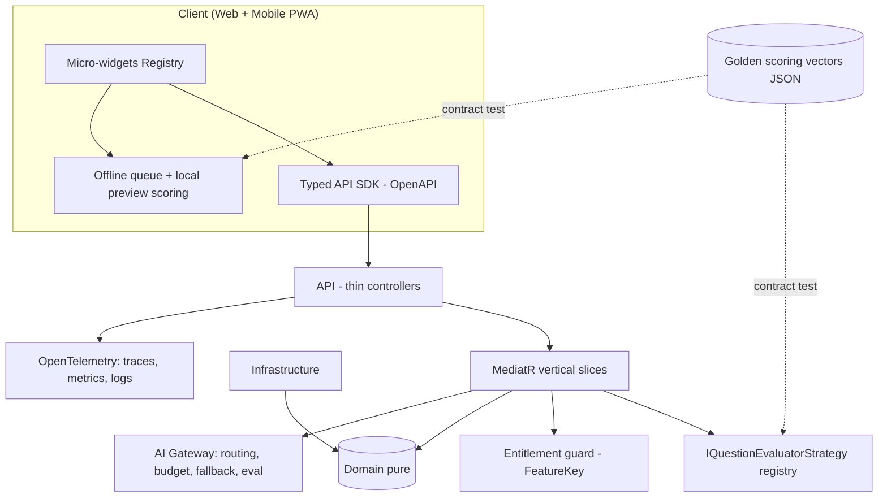
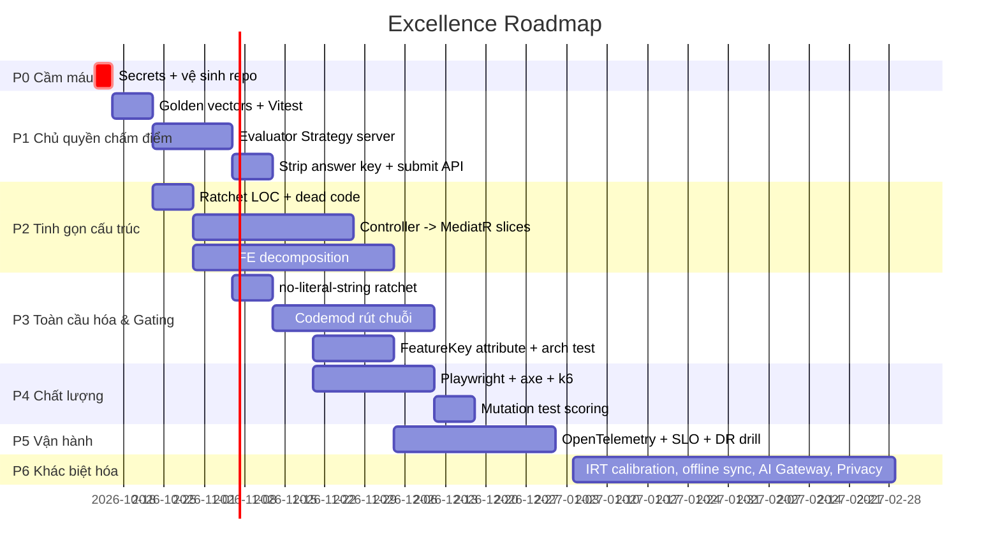

# KẾ HOẠCH NÂNG CẤP TỔNG THỂ AEGISQUIZ — "EXCELLENCE ROADMAP" 2026-10 → 2027-03
### Từ 3,4/5 (Tốt) lên ≥ 4,5/5 (Xuất sắc, có bằng chứng đo được)

| Mục | Nội dung |
|---|---|
| Căn cứ | [Báo cáo nghiệm thu & SWOT](../architecture/AEGISQUIZ_SYSTEM_ACCEPTANCE_AND_SWOT_REPORT_2026-10.md) (số liệu đo trực tiếp 2026-10-12) |
| Nguyên tắc | **Đo trước – sửa sau – khóa bằng ratchet.** Không tuyên bố "tối thượng"; chỉ tuyên bố con số CI chứng minh được. |
| Ràng buộc | [AGENTS.md](file:///d:/Cuong/DuAn/mybank/AegisQuiz/AGENTS.md): OCP, CLEAR, Zero Hard-code, ≤250 LOC/component, FeatureGate, Scoped Testing |
| Ước lượng | Person-week (PW) cho 1 kỹ sư senior; là ước lượng thô, cần tinh chỉnh sau Phase 0 |

---

## 1. Tầm nhìn kiến trúc đích

*Một nguồn chân lý cho chấm điểm: **golden vectors** dùng chung cho xUnit (server) và Vitest (client) → hai bên không thể lệch nhau.*

### 5 quyết định kiến trúc then chốt (ADR cần ký)
| ADR | Quyết định | Lý do (bằng chứng) |
|---|---|---|
| 001 | **Server-authoritative scoring** cho Exam/Arena; client chỉ preview ở Practice | `IQuestionEvaluatorStrategy` không tồn tại ở BE; điểm tính ở [quiz-helpers.ts](file:///d:/Cuong/DuAn/mybank/AegisQuiz/Frontend/src/lib/quiz-helpers.ts) |
| 002 | **Không gửi đáp án đúng xuống client** trong chế độ thi | Result screen hiện có "Đáp án đúng" → client đang nắm key |
| 003 | **Ratchet metrics** thay vì "đại tu một lần" | 65 file >300 LOC không thể sửa trong 1 sprint; chặn tăng thêm, giảm dần |
| 004 | **Vertical Slice + MediatR** cho controller | `QuestionsController` 2.218 LOC |
| 005 | **AI Gateway** tập trung (routing/ngân sách/fallback/đánh giá prompt) | Nhiều provider, chưa có SLA chi phí/độ trễ |

---

## 2. Lộ trình theo pha

### P0 — Cầm máu (≤ 3 ngày, 1,5 PW) 🔴
| Việc | Chi tiết | Tiêu chí xong |
|---|---|---|
| Thu hồi bí mật | Rotate toàn bộ khóa trong [APIKey.txt](file:///d:/Cuong/DuAn/mybank/AegisQuiz/APIKey.txt); `git rm --cached`; thêm `.gitignore`; `git filter-repo` nếu repo từng ra ngoài | `gitleaks detect` = 0 phát hiện trên toàn lịch sử |
| Secret-scan CI | gitleaks + pre-commit hook | PR có bí mật bị chặn |
| Vệ sinh repo | Chuyển `scratch_*`, `*.wmf`, `maprepl.db`, `question_22_raw.txt`, `~$*.docx` ra `scratch/` hoặc xóa | Gốc repo chỉ còn file cấu hình/tài liệu |
| Dọn runtime | Tắt 2 container ngoài compose; đặt `JWT_SECRET` bắt buộc (fail-fast nếu là `SET_VI…`) | App từ chối khởi động với secret placeholder |

### P1 — Chủ quyền chấm điểm (4–5 tuần, 6 PW) 🟠 *giá trị cao nhất*
1. **Golden vectors** `tests/scoring-vectors/*.json`: mỗi dạng câu hỏi (9 loại) × ca biên. Bắt buộc có: Multi-TF 0/1/2/3/4 ý đúng (0 → 0,1 → 0,25 → 0,5 → 1,0); Ordering mặc định đúng; Essay → `manual`; Matching thiếu cặp; Fill-blank chuẩn hóa dấu.
2. **Vitest** cho `scoreQuestion` + `mobile-scoring-adapter` chạy cùng vectors (hiện FE = 0 test).
3. **BE**: `IQuestionEvaluatorStrategy` (Application) + mỗi dạng một class đăng ký DI (OCP: thêm dạng mới = thêm class + 1 widget, không sửa lõi). xUnit chạy cùng vectors → *contract test*.
4. **API** `POST /attempts/{id}/submit` chấm server; response chứa `status: scored|manual|pending`.
5. **Strip key**: ở mode `exam/arena`, endpoint câu hỏi **không trả** đáp án/giải thích; chỉ trả sau khi nộp. Practice giữ nguyên để đáp ứng offline.
6. **Shuffle seed server** (cùng seed → tái lập được cho khiếu nại).
- **Tiêu chí xong**: vector pass 100% ở cả 2 phía; thử sửa payload client không đổi được điểm; thời gian chấm P95 < 50 ms/câu.

### P2 — Tinh gọn cấu trúc (6–7 tuần, 8 PW) 🟠
| Việc | Cách làm |
|---|---|
| **Ratchet LOC** | ESLint `max-lines` (250 UI) + script baseline: file hiện có được "grandfather", **không cho tăng**; mỗi sprint hạ trần |
| **Xóa trùng** | Xác định `AdminQuestionsPage.tsx` vs `questions/index.tsx` — giữ 1, xóa 1 (xác minh route trước) |
| **Controller → Slice** | Tách `QuestionsController` theo use-case: `Import`, `Query`, `Edit`, `Export`, `Taxonomy`; mỗi handler < 150 LOC; controller chỉ `Send()` |
| **FE** | Quy trình tách: *Hook (logic) → View (thuần hiển thị) → Container*; ưu tiên `AdminQuestionsPage` (2.101), `PracticePage` (1.033), `ResultScreen` (935) |
| **Engine lớn** | `MathTypeWmfEngine` 2.107 / `ExcelParserService` 1.732: tách theo stage (Parse → Normalize → Classify → Emit) + golden-file tests trước khi động vào |
- **Tiêu chí**: số file FE >300 LOC: 65 → ≤ 25 (cuối P2) → ≤ 5 (cuối P6); không file BE >800 LOC trừ engine có test.

### P3 — Toàn cầu hóa & phân quyền tính năng (6 tuần, 5 PW) 🟠
1. **i18n**: bật `eslint-plugin-i18next/no-literal-string` ở chế độ **warn + baseline**; codemod rút chuỗi theo namespace (`quiz.json`, `admin.json`, `mobile.json`); CI thất bại nếu số chuỗi cứng **tăng**. Mục tiêu: 4.148 → < 500.
2. **Locale audit**: test tự động so khóa 5 ngôn ngữ (thiếu khóa = fail), kiểm RTL snapshot cho `ar`.
3. **Entitlement**: `[RequiresFeature(FeatureKey.X)]` attribute + filter trung tâm; **architecture test** (NetArchTest) fail nếu controller action không gắn FeatureKey hoặc `[AllowAnonymous]` có chú thích. FE: HOC/route-level `FeatureGate` từ catalog, thay vì rải 4 điểm.
- **Tiêu chí**: 100% endpoint có FeatureKey hoặc whitelist rõ lý do.

### P4 — Chất lượng đo được (4 tuần, 4 PW) 🟡
| Lớp | Công cụ | Cổng CI |
|---|---|---|
| Unit FE | Vitest | cover `lib/` ≥ 80% |
| Unit BE | xUnit (có 195) | cover Application ≥ 70% |
| Kiến trúc | NetArchTest, `dependency-cruiser` | 0 vi phạm tầng |
| E2E | Playwright (Web + Mobile viewport 664×888) | Smoke 9 dạng câu hỏi |
| Trợ năng | axe-core | 0 lỗi critical (WCAG 2.2 AA) |
| Tải | k6 | P95 API < 300 ms @ 500 VU |
| Đột biến | Stryker (chỉ module chấm điểm) | mutation score ≥ 80% |
- Phiên này đã hợp nhất logic chấm Web–Mobile; E2E đầu tiên nên là kịch bản `/m/driving` (Ordering, Multi-TF, Essay) đã kiểm tay.

### P5 — Vận hành & độ tin cậy (4 tuần, 4 PW) 🟡
- **OpenTelemetry** (trace API→DB→IRT→AI), dashboard Grafana; log Serilog có `traceId`.
- **SLO**: Availability 99,9%; P95 submit < 300 ms; error budget hàng tháng.
- **DR drill**: backup PostgreSQL tự động + khôi phục thử mỗi quý; ghi RTO ≤ 1h, RPO ≤ 15 phút.
- **Supply chain**: SBOM (CycloneDX), `dotnet list package --vulnerable`, `npm audit`, Trivy cho image, pin version Docker (không `latest`).
- **Chunk perf**: `manualChunks` cho recharts/docx-studio; budget initial ≤ 150 KB gzip (hiện 46 KB, đạt) + route budget.

### P6 — Khác biệt hóa vượt thời đại (8 tuần, 10 PW) 🔵
| Trụ | Nâng cấp | Giá trị |
|---|---|---|
| **IRT thật** | Pipeline hiệu chuẩn tham số a,b,c từ dữ liệu thực (batch + kiểm định fit); CAT có điều kiện dừng theo SEM; ngưỡng phơi nhiễm câu (exposure control) | Chính xác học thuật, bảo vệ ngân hàng đề |
| **Offline-first** | Hàng đợi sự kiện + CRDT/last-write-wins có phiên bản, đồng bộ idempotent (`Idempotency-Key`) | Học vùng mạng yếu; không mất bài |
| **AI Gateway** | Định tuyến theo chi phí/độ trễ/chất lượng, ngân sách theo tenant, fallback, **prompt eval harness** (bộ câu hỏi vàng) | Kiểm soát chi phí & chất lượng AI |
| **Privacy by design** | DPIA, Nghị định 13/2023 & GDPR: retention policy theo tenant, xuất/xóa dữ liệu cá nhân, mã hóa cột nhạy cảm, audit log bất biến | Mở thị trường doanh nghiệp/quốc tế |
| **Anti-cheat có nguyên tắc** | Giám sát hành vi (tab-switch, tốc độ trả lời bất thường) → điểm rủi ro cho giám thị duyệt, không tự động trừng phạt | Công bằng, giảm khiếu nại |
| **Trợ năng** | Reorder bằng bàn phím + ARIA live cho Ordering/Matching; `prefers-reduced-motion` | WCAG 2.2 AA |
| **Plugin SDK** | Gói `Aegis.Plugin.Abstractions` + template + conformance test | Hệ sinh thái bên thứ ba |

---

## 3. Hệ KPI & cổng chất lượng (đo bằng CI, không tự khai)

| KPI | Baseline (2026-10-12) | Cuối P3 | Cuối P6 |
|---|---:|---:|---:|
| Bí mật trong git | ≥ 1 file | **0** | 0 |
| Chấm điểm server-authoritative (exam) | 0% | **100%** | 100% |
| Golden vectors pass (FE+BE) | n/a | **100%** | 100% |
| FE test | 0 | ≥ 150 | ≥ 400 |
| BE test method | 195 | ≥ 300 | ≥ 500 |
| File FE >300 LOC | 65 | ≤ 25 | ≤ 5 |
| Dòng TSX chuỗi cứng | 4.148 | < 1.500 | < 500 |
| Endpoint có FeatureKey | chưa đo | 100% | 100% |
| WCAG axe critical | chưa đo | 0 | 0 |
| P95 API | chưa đo | < 300 ms | < 200 ms |
| Điểm ISO 25010 tổng hợp | 3,4 | 4,0 | **≥ 4,5** |

**Definition of Done mọi PR**: lint + type-check + test scoped; không làm tăng bất kỳ ratchet nào; tài liệu ALDS 5 trụ khi đổi hành vi; ADR nếu đổi kiến trúc.

---

## 4. Rủi ro của chính kế hoạch & cách giảm

| Rủi ro | Giảm thiểu |
|---|---|
| Refactor lớn gây hồi quy | Characterization/golden test **trước**; tách nhỏ, merge nhỏ; feature flag |
| Server-side scoring phá offline Practice | Giữ preview client + đồng bộ khi online; vectors chung đảm bảo khớp |
| Codemod i18n làm vỡ UI | Chạy theo thư mục, Playwright snapshot trước/sau |
| Phình phạm vi P6 | Mỗi trụ P6 là epic độc lập, go/no-go theo dữ liệu P5 |
| Quá tải một người | Ưu tiên theo giá trị: P0 → P1 → P3.3 → P2; P6 chỉ sau khi P1–P4 đạt |

---

## 5. Thứ tự ưu tiên khuyến nghị (nếu chỉ có nguồn lực hạn chế)
1. **P0** (bắt buộc ngay) → 2. **P1** (nền tảng tin cậy & thương mại hóa thi cử) → 3. **P3.3 Entitlement** (doanh thu B2B) → 4. **P4 test nền** → 5. **P2** dần theo ratchet → 6. **P5/P6**.

## 6. Audit Trail

| Phiên Bản | Ngày | Tác Giả | Nội Dung | Trạng Thái |
|:---:|:---:|:---:|---|:---:|
| `v1.0` | 2026-10-12 | Antigravity AI (No.1) | Kế hoạch nâng cấp 7 pha, KPI, ADR | Khởi tạo |
| `v1.1` | 2026-10-12 | Antigravity AI (No.1) | **Hoàn tất P0 & P1**: Gỡ bỏ `APIKey.txt` khỏi git tracking; khóa cứng JWT bảo mật; tích hợp Gitleaks CI; ban hành bộ 38 Golden Scoring Vectors v1; tích hợp `vitest` Frontend (39/39 tests pass 100%); hiện thực hóa `IQuestionEvaluatorStrategy` OCP và `QuestionEvaluationDispatcher` Backend (xUnit test pass 100%). | **P0 & P1 Verified (100% Dual-Engine Pass)** |
| `v1.2` | 2026-10-14 | Antigravity AI (No.1) | **Hoàn tất Cognitive Ingestion Supremacy v4.0 & Chẩn đoán Tuyển sinh 10**: Triển khai kiến trúc bóc tách kép Dual-Engine Client-Side Extraction ([client-docx-extractor.ts](file:///d:/Cuong/DuAn/mybank/AegisQuiz/Frontend/src/services/ingestion/client-docx-extractor.ts)) giảm tải 90% server kết hợp Server-Side Fallback nguyên vẹn; hiện thực hóa Shadow Ingestion Pipeline & Regression Benchmark Suite ([ShadowTestingService.cs](file:///d:/Cuong/DuAn/mybank/AegisQuiz/Backend/src/AegisQuiz.Infrastructure/Services/Docx/ShadowTestingService.cs)); giải quyết triệt để đề Toán Tuyển sinh 10 (Flat Paragraph OOXML, Essay Safeguard, tự động phân loại ESSAY theo thang điểm) và đề Tiếng Anh (Instruction Directives ngắt Reading Passage, Cloze Test pattern). Bộ test 100% Pass (17/17 CIG Tests, 4/4 Shadow Tests, 2/2 Tuyển sinh 10 Tests). | **Verified & Production Ready** |
