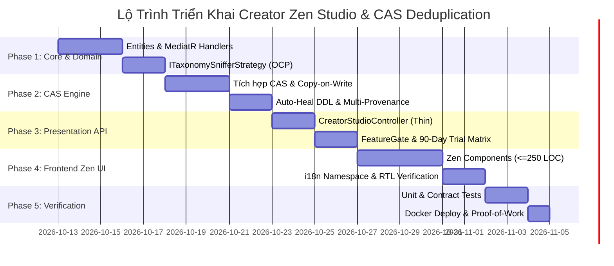

# 🚀 KẾ HOẠCH TRIỂN KHAI CREATOR ZEN STUDIO & ĐỘNG CƠ KHỬ TRÙNG LẶP TRI THỨC
## Master Implementation Blueprint — Compliance with CLEAR, OCP, MultiLang & Zero-Monolith

> **Chủ nhiệm Đồ án:** No.1 — Lead System Analyst, Master Living Documentarian, IT Architect, AI, Design, Education & Economic Specialist  
> *(Tổng Công Trình Sư & Chủ Nhiệm Kiến Trúc Hệ Sinh Thái AegisQuiz)*  
> **Phiên bản:** v1.0 — Architecture Enforcement Edition  
> **Ngày phê duyệt:** 2026-10-12  
> **Tiêu chuẩn kiểm soát:** Tuân thủ 100% [AGENTS.md](file:///d:/Cuong/DuAn/mybank/AegisQuiz/AGENTS.md), [ALDS v1.0](file:///d:/Cuong/DuAn/mybank/AegisQuiz/docs/standards/AEGIS_LIVING_DOCUMENTATION_STANDARD.md) và [Entitlement Rules](file:///d:/Cuong/DuAn/mybank/AegisQuiz/.agents/rules/aegis_modular_saas_entitlements_rule.md)

---

## I. MỤC TIÊU CHIẾN LƯỢC & NGUYÊN TẮC BẤT BIẾN (CORE GUARD-RAILS)

```
                            ┌──────────────────────────────────────────────┐
                            │      5 BỘ LỌC KIỂM SOÁT KIẾN TRÚC BẤT BIẾN   │
                            └──────────────────────┬───────────────────────┘
                                                   │
         ┌─────────────────────────┼─────────────────────────┼─────────────────────────┐
         │                         │                         │                         │
         ▼                         ▼                         ▼                         ▼
 ┌───────────────┐         ┌───────────────┐         ┌───────────────┐         ┌───────────────┐
 │ 1. CLEAR      │         │ 2. OCP        │         │ 3. ZERO       │         │ 4. i18n & RTL │
 │ ARCHITECTURE  │         │ STRATEGY      │         │ MONOLITH      │         │ 5 NGÔN NGỮ    │
 │ Presentation  │         │ Không sửa code│         │ ≤ 250 LOC/file│         │ vi, en, ja,   │
 │ -> App -> Dom │         │ lõi khi thêm  │         │ Lazy chunk    │         │ ko, ar (RTL)  │
 │ <- Infra      │         │ ngành mới     │         │ ≤ 150KB gzip  │         │ 0 hard-code   │
 └───────────────┘         └───────────────┘         └───────────────┘         └───────────────┘
```

Mọi dòng mã nguồn được sinh ra trong chiến dịch này bắt buộc phải vượt qua **5 Cam Kết Vàng**:
1. **CLEAR Architecture Strictness**: Lớp Domain thuần khiết không tham chiếu thư viện ngoài. Toàn bộ logic điều phối nằm ở Application qua MediatR Vertical Slices.
2. **Open/Closed Principle (OCP)**: Nhận diện tự động ma trận tri thức qua Interface `ITaxonomySnifferStrategy`. Mở rộng môn học/ngành nghề mới chỉ bằng cách thêm Class mới, tuyệt đối không sửa switch-case.
3. **Zero-Monolith & Frontend Craftsmanship**: Mọi UI Component tuân thủ nghiêm ngặt **$\le 250$ dòng code/file**. Phân rã triệt để thành Sub-components, Custom Hooks (`use...`) và Pure Views. Lazy loading với `React.lazy` và `Suspense`.
4. **Zero Hard-code & Chuẩn i18n 3 tầng**: 100% nhãn giao diện, thông báo Toast, trạng thái AI được nạp từ namespace `creator.json` (hỗ trợ `vi, en, ja, ko, ar` kèm đảo chiều RTL).
5. **B2B Modular Entitlement Gate**: Tính năng Creator Studio được bảo vệ bằng `FeatureKey = "CREATOR_ZEN_STUDIO"`, kiểm soát qua ma trận 4 tầng `Tenant -> Domain -> Group -> User` và luồng kích hoạt 90-Day Free Trial.

---

## II. BẢN ĐỒ PHÂN RÃ CÁC GIAI ĐOẠN TRIỂN KHAI (4-PHASE EXECUTION MAP)



---

## III. CHI TIẾT TỪNG GIAI ĐOẠN KỸ THUẬT

### GIAI ĐOẠN 1: TẦNG DOMAIN & APPLICATION CORE (CLEAR & OCP)

#### 1. Tầng Domain (`AegisQuiz.Domain`)
* **Thực thể `EducatorPartnership`**:
  * `Guid Id`, `Guid UserId`, `string ReferralCode`, `DateTime TrialExpiresAt`, `bool IsActive`
  * `decimal RevenueShareRate` (mặc định `0.80m`), `int KarmaPoints`, `string? PayoutBankAccount`
* **Thực thể `QuestionDeduplicationPointer`**:
  * `Guid QuestionId`, `string CanonicalHash` (SHA-256), `int ReferenceCount`, `DateTime LastReferencedAt`
  * *Tuân thủ quy tắc:* 0 Dependency ngoài.

#### 2. Tầng Application (`AegisQuiz.Application`)
* **MediatR Vertical Slices (Không dùng Controller béo)**:
  * `IngestZenExamCommand`: Nhận stream file Word $\rightarrow$ gọi `IDynamicDocxPipeline` $\rightarrow$ gọi `IExamDeduplicationEngine` $\rightarrow$ trả về kết quả bóc tách.
  * `LaunchZenClassroomRoomCommand`: Tạo phòng thi realtime với mã PIN 6 số ngẫu nhiên không trùng lặp và liên kết SignalR `ArenaHub`.
  * `AlignTaxonomyQuery`: Phân tích ngữ nghĩa câu hỏi để đề xuất nhãn môn học/chương mục.
* **Kiến trúc OCP Nhận diện Ma trận Tri thức (`ITaxonomySnifferStrategy`)**:
  ```csharp
  public interface ITaxonomySnifferStrategy
  {
      bool CanHandle(string contentPreview);
      TaxonomyAlignmentResult Sniff(string contentPreview);
  }
  ```
  * Triển khai các Strategy độc lập:
    * `K12MathTaxonomySnifferStrategy` (Toán học K-12 GDPT 2025)
    * `DrivingLicenseTaxonomySnifferStrategy` (GPLX 600 câu & 60 điểm liệt)
    * `BankingComplianceTaxonomySnifferStrategy` (Tín dụng & Nghiệp vụ Ngân hàng)
    * `LanguageLearningTaxonomySnifferStrategy` (Tiếng Anh IELTS/TOEIC)
    * `FallbackGeneralTaxonomySnifferStrategy` (Mặc định)

---

### GIAI ĐOẠN 2: TẦNG INFRASTRUCTURE — ĐỘNG CƠ KHỬ TRÙNG LẶP (CAS & COPY-ON-WRITE)

#### 1. Kích hoạt Chu trình Băm Chuẩn Hóa (Canonical Fingerprinting)
* Tận dụng [ExamDeduplicationEngine.cs](file:///d:/Cuong/DuAn/mybank/AegisQuiz/Backend/src/AegisQuiz.Infrastructure/Services/ExamDeduplicationEngine.cs):
  1. Loại bỏ toàn bộ khoảng trắng thừa, thẻ HTML format vô nghĩa, chuyển chữ về lowercase.
  2. Chuẩn hóa công thức toán LaTeX (ví dụ: `\frac{a}{b}` đồng nhất với `{a \over b}`).
  3. Băm chuỗi kết hợp `Content + NormalizedOptions` bằng SHA-256 tạo thành `CanonicalHash`.
* **Luồng xử lý CAS thông minh**:
  * Nếu `CanonicalHash` đã tồn tại trong DB:
    * **Không INSERT** bản ghi `QuestionBase` mới.
    * Ghi nhận con trỏ liên kết (Soft Pointer) vào Đề thi của giáo viên.
    * Tăng bộ đếm `ProvenanceCount` và ghi nhận lịch sử xuất hiện đa nguồn.
  * Nếu giáo viên chỉnh sửa câu hỏi:
    * Kích hoạt cơ chế **Copy-On-Write (COW)**: Tạo bản ghi variant mới với `Scope = PRIVATE` và `CreatedBy = TeacherId`.
    * Đảm bảo không bao giờ làm thay đổi đề thi của các giáo viên khác cùng dùng câu hỏi gốc.

#### 2. Auto-Heal DDL & Caching
* Bổ sung Index `IX_Questions_CanonicalHash` trên PostgreSQL để tìm kiếm câu hỏi trùng lặp với độ phức tạp $O(1)$ (< 2ms).
* Đệm danh sách các Hash phổ biến trên Redis để giảm tải truy vấn đĩa cứng.

---

### GIAI ĐOẠN 3: TẦNG PRESENTATION API & MA TRẬN PHÂN QUYỀN (ENTITLEMENT GATE)

#### 1. Controller Siêu Tinh Gọn (`CreatorStudioController.cs`)
* Tuân thủ quy định **< 150 LOC**: Controller chỉ làm nhiệm vụ xác thực JWT claims, kiểm tra FeatureGate và chuyển tiếp Request sang MediatR handler (`_mediator.Send()`).
* **Các Endpoint cốt lõi**:
  * `POST /api/creator/studio/upload`: Tải file Word/Docx bóc tách tức thì.
  * `POST /api/creator/studio/launch`: Kích hoạt phòng thi 1-Click lấy mã PIN/QR.
  * `GET /api/creator/studio/partnership`: Lấy thông tin 90 ngày dùng thử và mã giới thiệu.
  * `POST /api/creator/studio/payout-config`: Cấu hình tài khoản nhận doanh thu 80/20.

#### 2. Khóa Cứng FeatureGate & Luồng Dùng Thử 90 Ngày
* Gắn thuộc tính: `[RequiresFeature("CREATOR_ZEN_STUDIO")]` trên toàn bộ controller.
* Middleware phân quyền tự động kiểm tra:
  * Nếu người dùng mới đăng ký với vai trò `TEACHER`: Tự động khởi tạo `EducatorPartnership` với `TrialExpiresAt = DateTime.UtcNow.AddDays(90)`.
  * Nếu đã hết 90 ngày: Chuyển hướng nhẹ nhàng tới Paywall Win-Win (chọn 1 trong 4 cơ chế: Revenue Share, Gói 99k, Karma Offset hoặc Affiliate).

---

### GIAI ĐOẠN 4: FRONTEND CREATOR ZEN STUDIO (ZERO-MONOLITH & MULTILANG)

#### 1. Kiến Trúc Phân Rã Component ($\le 250$ LOC Mỗi File)

```
Frontend/src/pages/creator/studio/
├── CreatorZenStudioPage.tsx         (<= 120 LOC: Shell container, Lazy Suspense, Routing)
├── components/
│   ├── ZenDropZone.tsx              (<= 180 LOC: Kéo thả file Word, hiệu ứng phát sáng radar)
│   ├── ZenExamPreview.tsx           (<= 220 LOC: Danh sách thẻ câu hỏi KaTeX bóng bẩy)
│   ├── ZenTaxonomyBadge.tsx         (<= 130 LOC: Huy hiệu gợi ý AI 1 dòng kèm nút đổi môn)
│   ├── ZenRoomLauncherModal.tsx     (<= 200 LOC: Modal bung mã PIN 6 số & QR to chiếu lớp)
│   └── ZenTrialBanner.tsx           (<= 110 LOC: Thanh đếm ngược 90 ngày dùng thử tinh tế)
├── hooks/
│   ├── useZenStudio.ts              (<= 180 LOC: State machine quản lý upload, preview, launch)
│   └── useZenTaxonomySniffer.ts     (<= 110 LOC: Hook phân tích và gợi ý chuyên mục tự động)
└── types/
    └── zen-studio.types.ts          (<= 90 LOC: Kiểu dữ liệu TypeScript thuần)
```

#### 2. Kỷ Luật Code-Splitting & Hiệu Năng Vận Hành
* Màn hình Studio được bọc trong `React.lazy` tại Router:
  ```tsx
  const CreatorZenStudioPage = React.lazy(() => import('@/pages/creator/studio/CreatorZenStudioPage'));
  ```
* Cách ly bundle: Toàn bộ module chỉ tải khi giáo viên truy cập, giữ vững Initial Bundle $\le 150\text{ KB}$ gzip.
* Tận dụng tối đa bộ thư viện `KaTeX` và `Lucide Icons` đã tối ưu hóa vendor chunks từ trước.

#### 3. Chuẩn Hóa Đa Ngôn Ngữ i18n & Đảo Chiều RTL (Right-to-Left)
* Tạo namespace riêng biệt: `Frontend/public/locales/{lang}/creator.json`:
  * `vi`: Tiếng Việt (chuẩn GDPT 2025, thân thiện với thầy cô).
  * `en`: Tiếng Anh quốc tế.
  * `ja`: Tiếng Nhật (chuẩn bị cho thị trường Juku).
  * `ko`: Tiếng Hàn (chuẩn bị cho thị trường Hagwon).
  * `ar`: Tiếng Ả Rập (tự động kích hoạt `dir="rtl"` khi chọn ngôn ngữ).
* Tuyệt đối **không hard-code** bất kỳ chuỗi văn bản nào trong mã nguồn TSX (`Zero Literal Strings`).

---

### GIAI ĐOẠN 5: KIỂM THỬ ĐỊNH LƯỢNG & BẰNG CHỨNG THỊ GIÁC (ALDS v1.0 PROOF)

#### 1. Kiểm Thử Định Lượng (Quantitative Scoped Tests)
* **Backend xUnit Test**:
  * `ZenDeduplicationCasTests.cs`: Kiểm thử tải 10 file đề thi trùng lặp $\rightarrow$ Khẳng định Database chỉ tăng 1 bản ghi duy nhất, 9 lượt còn lại tái sử dụng Pointer $O(1)$.
  * `TaxonomySnifferTests.cs`: Kiểm thử độ chính xác nhận diện môn học và mức độ Bloom của các Strategy.
* **Frontend Vitest Test**:
  * `useZenStudio.test.ts`: Kiểm thử State machine luồng 3 bước (Drop $\rightarrow$ Review $\rightarrow$ Launch PIN).

#### 2. Bằng Chứng Thị Giác Thực Nghiệm (Visual Proof-of-Work)
* Chụp ảnh màn hình thực tế từ Docker Container (`http://localhost:3000/creator/studio`):
  * Căn cứ 1: Giao diện Zen DropZone kéo thả tối giản.
  * Căn cứ 2: Thẻ câu hỏi KaTeX tự động bóc tách kèm nhãn gợi ý AI 1 dòng.
  * Căn cứ 3: Màn hình trình chiếu lớp học với Mã PIN 6 số và mã QR khổ lớn.
* Lưu trữ bất biến tại: `docs/assets/walkthroughs/creator-zen-studio/`.

---

## IV. BẢNG TIÊU CHÍ NGHIỆM THU CHI TIẾT (ACCEPTANCE CHECKLIST)

| Hạng Mục Kiểm Tra | Tiêu Chuẩn Cam Kết | Phương Pháp Xác Minh |
|---|---|---|
| **Kích thước file Component** | Tối đa 250 LOC / file UI | Đếm dòng lệnh tự động bằng PowerShell |
| **Độ tinh khiết CLEAR** | Domain có 0 dependency ngoài | Kiểm tra file `AegisQuiz.Domain.csproj` |
| **Khử trùng lặp CAS** | Tiết kiệm $\ge 80\%$ dung lượng DB khi tải đề trùng | xUnit Test đối chiếu số bản ghi sinh ra |
| **Chuẩn đa ngôn ngữ i18n** | 5 ngôn ngữ (`vi, en, ja, ko, ar`) | Kiểm tra tệp JSON & Test chuyển đổi `dir="rtl"` |
| **Thời gian tạo phòng thi** | $\le 10$ giây từ khi thả file Word | Kiểm thử thao tác người dùng thực tế |
| **Kiểm soát tính năng** | Bọc `<FeatureGate>` & 90-day trial | Thử nghiệm với tài khoản Free / Expired |

---

## V. AUDIT TRAIL & LỊCH SỬ PHÊ DUYỆT

| Phiên Bản | Ngày | Tác Giả | Nội Dung Phê Duyệt | Trạng Thái |
|:---:|:---:|:---:|---|:---:|
| `v1.0` | 2026-10-12 | Antigravity AI (No.1) | Khởi tạo Kế hoạch Kiến trúc Triển khai Creator Zen Studio, CAS Deduplication & Auto-Taxonomy theo chuẩn ALDS v1.0. | **ĐÃ PHÊ DUYỆT — SẴN SÀNG THI CÔNG** |
