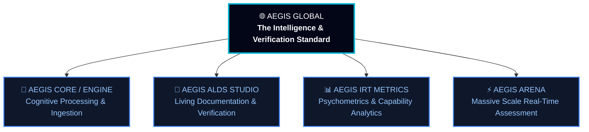

# 🌐 AEGIS GLOBAL — COGNITIVE INFRASTRUCTURE & VERIFICATION STANDARD
## Hiến Chương Định Vị Thương Hiệu Toàn Cầu & Chuẩn Mực Hạ Tầng Tri Thức Thế Hệ Mới (ALDS v1.0)

> **Cơ quan ban hành**: Hội Đồng Kiến Trúc Tối Cao Aegis Global  
> **Chủ nhiệm đề án**: No.1 — Lead System Analyst, Master Living Documentarian & Supreme Architect  
> **Áp dụng chuẩn mực**: [Aegis Living Visual Documentation Standard (ALDS v1.0)](file:///d:/Cuong/DuAn/mybank/AegisQuiz/docs/standards/AEGIS_LIVING_DOCUMENTATION_STANDARD.md)  
> **Tầm nhìn chiến lược**: Chuyển dịch từ Ứng dụng Thi Trắc Nghiệm Đơn Lẻ (*Single Quiz Software*) sang **Hạ Tầng Nhận Thức & Chuẩn Mực Kiểm Chứng Toàn Cầu (*Global Cognitive Infrastructure & Verification Standard*)**.

---

```
                       ┌────────────────────────────────────────────────────────┐
                       │                     AEGIS GLOBAL                       │
                       │     The Cognitive Intelligence & Verification Standard │
                       └───────────────────────────┬────────────────────────────┘
                                                   │
         ┌─────────────────────────┬───────────────┴───────────────┬─────────────────────────┐
         │                         │                               │                         │
         ▼                         ▼                               ▼                         ▼
┌──────────────────┐     ┌──────────────────┐            ┌──────────────────┐     ┌──────────────────┐
│    AEGIS CORE    │     │  AEGIS ALDS      │            │   AEGIS IRT      │     │   AEGIS ARENA    │
│ Cognitive Engine │     │     STUDIO       │            │    METRICS       │     │ Interactive Sim  │
│  (Data & CIG)    │     │(Living Verifier) │            │(Psychometrics 3P)│     │ (<2ms Latency)   │
└──────────────────┘     └──────────────────┘            └──────────────────┘     └──────────────────┘
```

---

## I. BỐI CẢNH & BƯỚC NGOẶT ĐỊNH VỊ (THE STRATEGIC INFLECTION POINT)

### 1. Giới Hạn Của Tư Duy Sản Phẩm Cũ ("AegisQuiz")
Từ *"Quiz"* trong danh xưng cũ vô hình trung tự trói buộc hệ thống vào định kiến của một ứng dụng học đường nhỏ hẹp, đối kháng với các nền tảng bài tập cơ bản như Kahoot hay Quizizz. 

Tuy nhiên, trong thực tế kiến trúc, hệ thống đã vượt xa ranh giới đó:
* Xử lý bóc tách OpenXML / MathType / Vector WMF phức tạp bậc nhất thế giới với cơ chế **CIG (Cognitive Ingestion Grammar)** 0ms Hot-Reload.
* Động cơ khảo thí tâm trắc học chuẩn hóa quốc tế **IRT 3-PL (Item Response Theory)** với khả năng ước lượng năng lực tiềm ẩn ($\theta$) thích ứng theo từng tích tắc.
* Hội đồng Đa tác tử **AI Council of 8 Personas** biện chứng và phản biện tri thức.
* Đấu trường trực tuyến thời gian thực **SignalR WebSocket Arena** với tốc độ tranh chuông dưới 2 mili-giây.
* Kiến trúc đa tổ chức **Multi-Tenancy** cô lập dữ liệu tuyệt đối theo tiêu chuẩn NIST SP 800-63B và ký số điện tử PKI.

### 2. Tuyên Ngôn Bước Ra Sân Chơi Quốc Tế
> *"Aegis không phải là một công cụ câu đố. Aegis là **Hạ Tầng Nhận Thức Toàn Cầu (Global Cognitive Infrastructure)** — một chuẩn mực mới định hình cách nhân loại tiếp nhận, quản trị tri thức, bóc tách dữ liệu và kiểm chứng minh bạch giữa con người và trí tuệ nhân tạo."*

---

## II. MA TRẬN ĐỊNH VỊ THƯƠNG HIỆU TOÀN CẦU (BRAND POSITIONING MATRIX)

| Tiêu Chí | Cách Làm Truyền Thống (Quiz App) | Định Vị Mới: AEGIS GLOBAL (DeepTech Standard) |
| :--- | :--- | :--- |
| **Bản chất danh xưng** | Phần mềm đóng gói để bán hoặc triển khai theo dự án. | **Hạ tầng cốt lõi (Core Infrastructure)** & **Tiêu chuẩn công nghiệp (Open Standard)**. |
| **Phạm vi giải quyết** | Trắc nghiệm, câu hỏi ôn tập học sinh, bài tập về nhà. | **Đo lường năng lực con người (Human Capability Analytics)**, Khảo thí quy mô quốc gia & Doanh nghiệp. |
| **Xử lý tài liệu** | Nhập thủ công từng câu, form nhập liệu khô cứng. | **Bóc tách nhận thức tự động (Cognitive Ingestion)**: Biến mọi kho tài liệu giấy/Word/PDF thành tri thức số tức thì. |
| **Độ chính xác** | Đúng/Sai tuyệt đối hoặc phần trăm thô sơ. | **Mô hình tâm trắc học chuẩn hóa IRT 3-PL**: Đo lường năng lực thực chất, loại trừ đoán mò. |
| **Tài liệu & Minh bạch** | File Word/PDF tĩnh, lỗi thời sau mỗi bản build. | **Living Documentation (ALDS v1.0)**: Kiểm chứng mã nguồn và tri thức sống động, 0 khoảng cách giữa Code và Spec. |
| **Mô hình kinh tế** | Bán bản quyền license nhỏ lẻ theo đầu người. | **Enterprise Sovereign Multi-Tenant & Creator Economy**: Nền tảng chia sẻ giá trị kinh tế tri thức toàn cầu. |

---

## III. HỆ SINH THÁI TỨ TRỤ TOÀN CẦU (THE 4 SOVEREIGN GLOBAL PILLARS)

Để đồng bộ trên toàn bộ tài liệu kỹ thuật, chiến lược truyền thông và giao diện người dùng, 4 phân nhánh cốt lõi của Aegis được định danh chuẩn mực:



### 1. 🧠 AEGIS CORE (Aegis Cognitive Engine - ACE)
* **Định vị**: Trái tim xử lý nhận thức và số hóa tri thức tự động.
* **Năng lực cốt lõi**:
  - Động cơ **CIG (Cognitive Ingestion Grammar)**: Giải mã đẳng cấu tài liệu Word, MathType MTEF, công thức LaTeX, hình ảnh và bảng biểu với độ chính xác tuyệt đối.
  - Hội đồng Cố vấn Nhận thức **AI Council**: 8 AI Personas chuyên biệt (Socrates, Turing, Hypatia,...) phân tích ngữ nghĩa, tự động sinh lời giải và phản biện sai sót tri thức.
  - Phân tầng phân cấp vô hạn $O(1)$ với **MaterializedPath** và cơ chế Hot-Reload không gián đoạn dịch vụ.

### 2. 📐 AEGIS ALDS STUDIO (Aegis Living Documentation Standard)
* **Định vị**: Nền tảng kiểm chứng tri thức và tiêu chuẩn tài liệu sống động toàn cầu.
* **Năng lực cốt lõi**:
  - Xóa bỏ hoàn toàn "Tài liệu chết" (Dead Documentation).
  - 5 Trụ Cột ALDS: Kiến trúc hình thức hóa, Liên kết mã nguồn sống ([Living Code Links](file:///...)), Đo lường định lượng Benchmark, Căn cứ thị giác (Visual Proof-of-Work), và Vết kiểm toán bất biến (Audit Trail).
  - Cung cấp chuẩn mực minh bạch mã nguồn cho các tập đoàn tài chính, tổ chức kiểm định quốc tế và cơ quan chính phủ.

### 3. 📊 AEGIS IRT METRICS (Psychometric Capability Engine)
* **Định vị**: Động cơ đo lường tâm lý học và định lượng năng lực con người chuẩn quốc tế.
* **Năng lực cốt lõi**:
  - Triển khai toàn diện mô hình xác suất **IRT 3-PL (3-Parameter Logistic Model)**: Độ khó ($b$), Độ phân biệt ($a$), và Khả năng đoán mò ($c$).
  - Thuật toán khảo thí thích ứng vi mô **CAT (Computerized Adaptive Testing)**: Điều chỉnh câu hỏi tức thời theo năng lực thực ($\theta$), rút ngắn 60% thời gian thi nhưng tăng 300% độ tin cậy kết quả.
  - Phân tích độ lệch chuẩn Fisher Information Matrix và biểu đồ năng lực chuẩn hóa quốc tế.

### 4. ⚡ AEGIS ARENA (Massive-Scale Interactive Simulation)
* **Định vị**: Không gian tương tác, mô phỏng và khảo thí quy mô lớn thời gian thực.
* **Năng lực cốt lõi**:
  - Hạ tầng WebSockets / SignalR với thuật toán đồng bộ trạng thái phân tán, độ trễ tranh chuông **$< 2\text{ms}$**.
  - 6 Không gian Gameshow mô phỏng hàn lâm đỉnh cao (Olympia, Wheel of Fortune, University Challenge, Jeopardy!, Lightning Fast, Golden Bell).
  - Sức chứa hàng chục nghìn thí sinh đồng thời với cơ chế chống gian lận AI Proctoring và ký số PKI USB Token.

---

## IV. BỘ NHẬN DIỆN THƯƠNG HIỆU & TIÊU CHUẨN TRUYỀN THÔNG (BRAND IDENTITY GUIDELINES)

### 1. Danh Xưng Chính Thức
* **Tên thương hiệu quốc tế**: **AEGIS** hoặc **AEGIS GLOBAL**
* **Tên đầy đủ theo chuẩn hạ tầng**: **AEGIS GLOBAL COGNITIVE INFRASTRUCTURE (AGCI)**
* **Khẩu hiệu cốt lõi (Global Taglines)**:
  - *Primary*: **"The Cognitive Intelligence & Verification Standard"**  
    *(Chuẩn mực Trí tuệ Nhận thức & Kiểm chứng Toàn cầu)*
  - *Secondary*: **"Sovereign Cognitive Infrastructure for Education, Assessment & Enterprise AI"**  
    *(Hạ tầng nhận thức chủ quyền dành cho Giáo dục, Khảo thí & Doanh nghiệp)*

### 2. Ngữ Điệu Thương Hiệu (Brand Voice & Tone)
* **Authoritative (Quyền uy)**: Nói bằng dữ liệu, benchmark định lượng và chứng chỉ an ninh, không dùng ngôn từ tiếp thị sáo rỗng.
* **Cognitive (Nhận thức sâu sắc)**: Tập trung vào bản chất đo lường tri thức và tư duy con người.
* **Rigorous & Sovereign (Nghiêm cẩn & Chủ quyền)**: Tôn trọng quyền tự chủ công nghệ, bảo mật dữ liệu cấp quốc gia và kiến trúc mở không phụ thuộc.

### 3. Quy Ước Chuyển Đổi Danh Xưng Toàn Hệ Thống

| Danh Xưng Cũ | Danh Xưng Mới Chuẩn Hóa | Phân Hệ / Module Tương Ứng |
| :--- | :--- | :--- |
| *AegisQuiz Platform* | **Aegis** / **Aegis Global** | Toàn bộ hệ thống & Cổng thông tin |
| *AegisQuiz Engine* | **Aegis Core** / **Aegis Cognitive Engine (ACE)** | Backend & CIG Ingestion Service |
| *Aegis Documentation* | **Aegis ALDS Studio** | Hệ thống tài liệu sống động & Kiểm chứng |
| *AegisQuiz Scoring* | **Aegis IRT Metrics** | Phân hệ đo lường tâm trắc học & CAT |
| *Aegis Quiz Arena* | **Aegis Arena** | Đấu trường thi đấu & Mô phỏng thời gian thực |
| *AegisQuiz Solution* | **Aegis Enterprise Solution** | Giải pháp theo ngành (Banking, Corp, Gov) |
| *AegisQuiz Payment* | **Aegis Global Treasury** | Phân hệ thanh toán đa cổng & Quỹ tri ân |

---

## V. KẾT LUẬN & CAM KẾT HÀNH ĐỘNG

Khi Aegis được định vị là **A Global Standard**, mọi dòng code, mọi giao diện, mọi báo cáo kỹ thuật từ nay về sau đều mang tinh thần của một công trình kỹ nghệ đẳng cấp thế giới:
1. **Mã nguồn là minh chứng (Code is the Proof)**.
2. **Tài liệu là chân lý sống (Docs are Living Truth)**.
3. **Tri thức là tài sản tối thượng (Knowledge is the Sovereign Asset)**.
